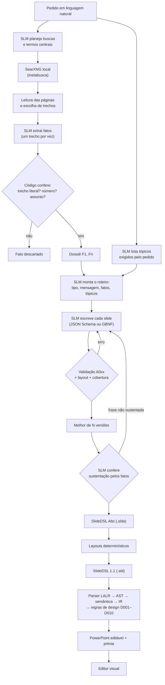

# SlideDSL

**IA local (SLMs) + linguagem específica de domínio (DSL) para gerar apresentações de slides
automaticamente.**

O usuário descreve em linguagem natural o que quer apresentar. Um modelo de linguagem pequeno
(SLM), executado no próprio computador, pesquisa o assunto, organiza o conteúdo e o escreve numa
linguagem formal de slides. Um compilador valida essa linguagem com uma **gramática livre de
contexto (GLC)** e gera um **PowerPoint editável**.

O objetivo é combinar a flexibilidade da IA com a precisão de uma linguagem formal. A ideia é que
modelos menores, rodando localmente, consigam criar apresentações estruturadas, reduzindo a
dependência de serviços externos e pagos.

> Projeto de TCC. O registro detalhado do que foi feito em 12/10/2026 está em
> [docs/MUDANCAS_2026-10-12.md](docs/MUDANCAS_2026-10-12.md); as referências acadêmicas
> comentadas, em [docs/REFERENCIAS.md](docs/REFERENCIAS.md). O README anterior, que descreve os
> fluxos e experimentos históricos, está em [docs/README_HISTORICO.md](docs/README_HISTORICO.md).

---

## Sumário

1. [Por que este projeto existe](#1-por-que-este-projeto-existe)
2. [Visão geral do fluxo](#2-visão-geral-do-fluxo)
3. [Cada parte, como funciona e por quê](#3-cada-parte-como-funciona-e-por-quê)
4. [Como executar](#4-como-executar)
5. [Estrutura do repositório](#5-estrutura-do-repositório)
6. [Avaliação e resultados até agora](#6-avaliação-e-resultados-até-agora)
7. [Limitações](#7-limitações)
8. [Trabalhos relacionados](#8-trabalhos-relacionados)
9. [Referências](#9-referências)

---

## 1. Por que este projeto existe

**A IA de ponta está ficando cara e concentrada.** O AI Index 2024, de Stanford, estima que
treinar o GPT-4 custou cerca de US$ 78 milhões em computação e o Gemini Ultra cerca de
US$ 191 milhões, contra cerca de US$ 900 do Transformer original de 2017. Só algumas empresas
conseguem treinar modelos desse porte, e quem usa depende de APIs pagas, da conexão e das
políticas do fornecedor. Esse custo também tem um lado ambiental (Strubell et al., 2019;
Schwartz et al., 2020).

**Ao mesmo tempo, modelos pequenos e abertos ficaram bons.** Segundo o AI Index 2025, um modelo
de 3,8 bilhões de parâmetros (Phi-3-mini) já passa de 60% no MMLU, patamar que em 2022 exigia
540 bilhões, e o custo de inferência de um modelo nível GPT-3.5 caiu mais de 280 vezes em cerca
de 18 meses. Modelos com pesos abertos permitem rodar localmente, auditar e não depender de um
único fornecedor (Kapoor et al., 2024). É isso que "democratizar a IA" significa aqui: uma
ferramenta útil que roda num computador comum, sem custo por uso.

**Mas SLMs têm limites claros.** Eles são fracos em raciocínio longo (Lu et al., 2024), lembram
pouco sobre os assuntos e tendem a inventar quando tentam lembrar (alucinação; Ji et al., 2023).
Pedir a um modelo de 4B uma apresentação inteira, de memória e em formato livre, dá resultado
genérico e frágil. No próprio projeto, a geração direta da DSL de baixo nível teve 0 de 5
programas válidos ([docs/RESULTADOS_OLLAMA.md](docs/RESULTADOS_OLLAMA.md)).

**A hipótese do TCC:** compensar essas fraquezas com **estrutura**, em quatro frentes:

| Fraqueza do SLM | Compensação no SlideDSL | Base |
|---|---|---|
| Inventa sintaxe e estrutura | DSL do domínio + GLC; geração restrita pela gramática | Mernik et al. (2005); Wang et al. (2023); Geng et al. (2023) |
| Não sabe o assunto, alucina | Pesquisa local (SearXNG) e fatos com trecho literal verificado | Lewis et al. (2020); Ji et al. (2023) |
| Raciocínio longo fraco | Tarefa dividida em chamadas curtas (um trecho, um slide) | Lu et al. (2024) |
| Sem noção de layout | Compilador determinístico decide geometria, fonte e cor | — |

---

## 2. Visão geral do fluxo



Em resumo, o SLM faz tarefas pequenas e o código faz o resto:

| Quem faz | Tarefas |
|---|---|
| **SLM** (Qwen3 4B local) | planejar buscas; extrair fatos de um trecho; listar tópicos do pedido; montar o roteiro; escrever um slide; corrigir um slide; julgar se uma frase é sustentada |
| **Código** | buscar; ler páginas; conferir fatos; validar; escolher a melhor versão; fazer layout; compilar pela GLC; gerar o PPTX |

---

## 3. Cada parte, como funciona e por quê

### 3.1 Pedido

O usuário escreve o pedido no painel **Criar com pesquisa** do editor ou no comando `criar`. O
pedido pode ser curto ("Monolito ou microsserviços para uma startup") ou detalhado, com itens
obrigatórios.

### 3.2 Pesquisa com SearXNG — `src/slidedsl/research.py`

**Como funciona:** o SLM gera de 3 a 5 consultas curtas e uma lista de **termos centrais** (as
palavras que todo fato útil deve mencionar, ex.: "monolito", "microsserviços"). As consultas vão
para o **SearXNG**, que roda localmente em Docker e repassa a busca a vários buscadores (Google,
Bing, DuckDuckGo, Wikipedia…). O programa baixa cada página, extrai o texto (com o *charset*
correto) e escolhe os trechos mais relevantes, de preferência os que têm números e datas.

**Por que SearXNG:** ele busca na web inteira, roda no próprio computador, não exige chave nem
cadastro e não tem custo, o que é coerente com o objetivo de reduzir a dependência de serviços
externos. A documentação oficial descreve a API (`/search?q=…&format=json`) e exige habilitar o
JSON no `settings.yml`; o projeto já traz essa configuração em `searxng/`. Desde 12/10/2026 o
**SearXNG é o único buscador** usado pelo projeto; Tavily, Brave e Wikipedia continuam no código
só para comparação experimental.

**Por que pesquisar:** recuperar texto e gerar a partir dele (RAG; Lewis et al., 2020) é mais
confiável do que pedir ao modelo que lembre.

### 3.3 Fatos verificados — `research.py` (`verify_fact`)

**Como funciona:** o SLM recebe **um trecho por vez** e devolve fichas `{afirmação, tipo, valor,
trecho, relevância}`. O código só aceita a ficha se:

* o `trecho` existir literalmente na página (≥ 85% contíguo);
* o número da afirmação aparecer no texto;
* a afirmação for uma frase completa e o trecho não terminar em "…";
* o fato mencionar um termo central (filtra o que está fora do assunto);
* a fonte não passar de 5 fatos (diversidade).

Citação só conta como citação se o autor aparece no texto; senão vira fato comum.

**Por quê:** o SLM é bom em extração curta e ruim em lembrar. A conferência literal impede que
um fato inventado entre no dossiê (mitigação de alucinação; Ji et al., 2023). Cada fato recebe
um ID (F1, F2…) e leva a URL de origem para as notas do apresentador.

### 3.4 Tópicos exigidos e roteiro — `alto_quality.py`, `alto_generation.py`

**Como funciona:** em pedidos com 15 palavras ou mais, o SLM lista os tópicos que o pedido exige
explicitamente (ex.: "latência de rede", "transações distribuídas"). Em seguida monta o
**roteiro**: para cada slide, o tipo, a mensagem (uma afirmação, não um tema), os fatos que a
sustentam e os tópicos que cobre. A resposta é travada por JSON Schema:

* o modelo só pode citar IDs de fatos que existem;
* tipos que exigem dados (números, gráfico, linha do tempo, citação) só aparecem se houver fatos
  daquele tipo;
* se faltar um tópico obrigatório, o roteiro volta para correção.

**Por quê:** planejar antes de escrever separa a decisão de estrutura da escrita, e as restrições
do schema tornam impossíveis erros que antes eram comuns (citar fonte inexistente, slide de
números sem número).

### 3.5 Escrita de cada slide — `alto_generation.py`

**Como funciona:** uma chamada por slide, com o **contrato editorial**:

* título é a mensagem (até ~60 caracteres);
* item = rótulo de 2 a 5 palavras + uma frase completa com algo concreto (número, nome, data,
  exemplo ou condição);
* números e nomes só dos fatos, mantendo o mesmo sujeito e período;
* notas com o raciocínio para o apresentador.

Há três modos de restrição da saída:

| Modo | Provedor | Como a saída é restrita |
|---|---|---|
| `json` (padrão) | Ollama | JSON Schema por tipo de slide (*structured outputs*) |
| `gramatica` | llama.cpp | a GLC da SlideDSL Alto convertida em **GBNF**: o modelo não consegue gerar sintaxe inválida |
| `direto` | qualquer | texto livre na SlideDSL Alto, validado pelo parser |

**Por quê:** restringir a decodificação por uma gramática permite que modelos sem ajuste fino
gerem saídas estruturadas corretas (Geng et al., 2023), e o custo dessa restrição é baixo
(Willard; Louf, 2023). Colocar a gramática no prompt também ajuda a gerar a DSL (Wang et al.,
2023). Um detalhe aprendido nos testes: `maxLength` no schema faz o decodificador **cortar** o
texto no limite, por isso os limites do schema são folgados e o tamanho é cobrado pela validação.

### 3.6 Validação, reparo, melhor versão e sustentação — `alto.py`, `alto_quality.py`

**Como funciona:** cada versão de slide passa por:

* **Validação estrutural A0xx**, por exemplo:
  * quantidade de itens e tamanho dos textos;
  * texto cortado (A013) ou que não cabe no layout (A010);
  * fonte inexistente;
  * número sem fato (A012);
  * detalhe genérico ou em forma de "cenário solto" (A009);
  * citação sem autor real (A015);
  * tópico pedido ausente (A016).

  Os erros voltam ao modelo apontando o campo exato (ex.: `itens[1].detalhe`), em até 2
  correções.
* **Melhor de N:** gera N versões e escolhe a de maior pontuação de concretude (fatos citados,
  dados, frases bem formadas).
* **Sustentação (A014):** o SLM compara cada frase com número ou nome contra os fatos citados
  (sustentada, parcial ou não sustentada). Frases problemáticas voltam para correção; se
  persistirem, entra a reescrita sugerida; o que sobrar aparece no painel como "Frases a revisar".

**Por quê:** nos testes, os fatos eram reais mas às vezes usados com outro sentido ("a plataforma
cresceu 30%" virou "o ecossistema cresceu 30%"). Validar estrutura não basta; é preciso conferir
o significado. A verificação usa o mesmo SLM, então reduz erros mas não substitui revisão humana.

### 3.7 SlideDSL Alto — a GLC de alto nível — `grammar/slidedsl_alto.lark`, `alto.py`

**Como funciona:** a linguagem que o modelo preenche descreve **a intenção** de cada slide, sem
coordenadas:

```lark
deck: "deck" STRING "{" tema? slide+ "}"
?slide: capa | secao | topicos | numeros | comparacao | etapas
      | linha_do_tempo | citacao | grafico | imagem | conclusao
topicos: "topicos" "{" titulo item+ fontes? notas? "}"
item: "item" STRING STRING?
fontes: "fontes" fonte_ref ("," fonte_ref)*
```

```slidedsl
numeros {
  titulo "Voltar ao monolito cortou 90% do custo"
  valor "90%" "redução de custo de infraestrutura no monitoramento do Prime Video"
  fontes F3
  notas "O caso mostra que distribuir tem custo de rede e orquestração."
}
```

**Por quê:** uma DSL troca generalidade por expressividade no domínio e permite análise
(Mernik et al., 2005). Com a intenção separada da geometria, o SLM só decide o que comunicar; a
gramática garante a forma e o compilador garante o visual.

### 3.8 Layouts e compilação para a SlideDSL 1.1 — `alto_layout.py`, `alto_compile.py`

**Como funciona:** cada tipo tem um layout determinístico:

| Tipo | Layout |
|---|---|
| `capa` | 3 variações de capa |
| `topicos` | cards ou lista numerada, alternando |
| `numeros` | número gigante |
| `comparacao` | duas colunas |
| `etapas` | etapas ligadas por trilho |
| `linha_do_tempo` | eixo com marcos |
| `grafico` | barras como formas editáveis |
| `citacao`, `imagem`, `conclusao` | layouts próprios |

A fonte é a maior que cabe para **todos** os textos do mesmo papel, e o texto nunca é cortado. As
cores têm contraste ≥ 4,5 nos temas claro e escuro. O resultado é escrito na **SlideDSL 1.1**, a
DSL de baixo nível original (retângulos, textos, coordenadas), estendida com `negrito`,
`alinhado`, `arredondado` e `notas`.

**Por quê:** reaproveitar a SlideDSL 1.1 mantém toda a cadeia de validação original e permite
abrir o resultado no editor. São duas GLCs em camadas: a de alto nível (o que o modelo escreve) e
a de baixo nível (o que o compilador gera).

### 3.9 Compilador da SlideDSL 1.1 — `grammar/slidedsl.lark`, `parser.py`, `semantic.py`, `design_rules.py`

**Como funciona:**

| Etapa | O que faz |
|---|---|
| Parser Lark/LALR | confere a sintaxe pela GLC; erro P001 com linha e coluna |
| AST | comandos, argumentos e posições no código |
| Análise semântica | IDs, referências, posições relativas, tokens do tema |
| IR (Pydantic) | a cena: slides, elementos, coordenadas, grupos, camadas, notas |
| Regras de design D001–D010 | limites do canvas, contraste, sobreposição, alinhamento, overflow, densidade |
| Renderer (PptxGenJS) | IR validada → `.pptx` com objetos editáveis e notas com as fontes |

A área lógica é 1280 × 720. Detalhes em [docs/GRAMATICA.md](docs/GRAMATICA.md),
[docs/SEMANTICA.md](docs/SEMANTICA.md), [docs/METAMODELO.md](docs/METAMODELO.md) e
[docs/REGRAS_DESIGN.md](docs/REGRAS_DESIGN.md).

**Por quê:** a GLC é o que dá precisão ao sistema. Qualquer coisa que o modelo produza só vira
slide se passar pela gramática e pelas regras; erros viram diagnósticos com código, e não slides
quebrados.

### 3.10 Editor visual — `editor/`, `src/slidedsl/server.py`, `alto_jobs.py`

**Como funciona:** `slidedsl serve` abre a API local (FastAPI) e o editor (React Flow) em
http://127.0.0.1:8000.

* O painel **Criar com pesquisa** mostra o estado do SearXNG, o progresso passo a passo, a
  cobertura do pedido, as frases a revisar, os fatos usados (com link) e o código SlideDSL Alto.
* O resultado abre no editor para ajustes e exportação.
* Cada execução fica em `outputs/criar/<id>/` com todos os prompts, respostas e versões
  (`chamadas.jsonl`, `candidatos.json`, `dossie.json`, `qualidade.json`, `validacao.json`).

**Por quê:** a IA gera o rascunho e a pessoa decide o resultado final. A auditoria completa
permite analisar os experimentos do TCC.

---

## 4. Como executar

### Requisitos

* Windows com Python 3.12, Node/npm e Git (o `scripts/setup_windows.ps1` prepara o ambiente).
* **Ollama** com o modelo `qwen3:4b-instruct` (`ollama pull qwen3:4b-instruct`).
* **Docker Desktop**, para o SearXNG.

### Passo a passo (cmd, um comando por vez)

```
powershell -NoProfile -ExecutionPolicy Bypass -File scripts/setup_windows.ps1
npm run build --prefix editor
scripts\iniciar_searxng.cmd
.venv\Scripts\slidedsl.exe serve
```

Abra http://127.0.0.1:8000, escreva o pedido em **Criar com pesquisa** e clique em
**Criar apresentação**. O painel mostra se o SearXNG está respondendo.

O script cria `searxng/.env` com um segredo aleatório de cada instalação; esse arquivo é
ignorado pelo Git. O Compose passa o valor ao SearXNG por `SEARXNG_SECRET`.

### Pela linha de comando

```
.venv\Scripts\slidedsl.exe criar "Monolito ou microsserviços para uma startup" --out outputs\criar\teste --candidatos 2
.venv\Scripts\slidedsl.exe pesquisar "energia solar residencial" --out outputs\dossie.json --provider ollama
.venv\Scripts\slidedsl.exe alto-compile examples\alto\microsservicos.slda --out outputs\alto\micro.pptx --strict
.venv\Scripts\slidedsl.exe previa examples\alto\catalogo.slda --out outputs\alto\previa
.venv\Scripts\slidedsl.exe gbnf --out outputs\alto.gbnf
```

Opções úteis do `criar`:

* `--slides 6` e `--candidatos 2`;
* `--modo json|gramatica|direto` e `--provider ollama|llamacpp`;
* `--buscador searxng|nenhum`;
* `--sem-fatos` (gera mesmo sem fatos), `--sem-verificacao`, `--sem-cobertura`, `--tema escuro`.

### Problemas comuns

| Sintoma | Causa provável | O que fazer |
|---|---|---|
| "SearXNG não encontrado" | Docker fechado ou contêiner parado | abrir o Docker Desktop e rodar `scripts\iniciar_searxng.cmd` |
| "SearXNG não respondeu em 30 s" | serviço lento/travado ou buscadores limitando consultas | conferir `docker info`, espaço em disco e logs; reiniciar o Docker se ele também não responder |
| "A pesquisa não encontrou fatos" | nenhuma página útil ou SearXNG fora do ar | reformular o pedido ou marcar "continuar sem fatos" |
| Painel antigo aparece | editor não recompilado ou cache | `npm run build --prefix editor` e Ctrl + F5 |

---

## 5. Estrutura do repositório

```
src/slidedsl/
  grammar/slidedsl_alto.lark   GLC de alto nível (o que o SLM escreve)
  grammar/slidedsl.lark        GLC de baixo nível (SlideDSL 1.1)
  alto.py                      AST, impressão e validação A0xx da SlideDSL Alto
  alto_layout.py               layouts por tipo de slide → SlideDSL 1.1
  alto_compile.py              cadeia Alto → 1.1 → PPTX
  alto_generation.py           roteiro, escrita, reparo, melhor de N, orquestração
  alto_quality.py              sustentação, cobertura, truncamento, citação literal
  research.py                  SearXNG, leitura de páginas, extração e conferência de fatos
  gbnf.py                      conversor GLC (Lark) → GBNF e reconhecedor para testes
  alto_jobs.py, server.py      API local e fila de execuções do painel
  parser.py, semantic.py, ir.py, design_rules.py, compiler.py   compilador da 1.1
  models/                      Ollama, llama.cpp, OpenAI, mock
editor/                        editor visual (React Flow) e painel Criar com pesquisa
renderer/render.mjs            IR → PowerPoint (PptxGenJS)
searxng/                       configuração do SearXNG local
examples/alto/                 exemplos em SlideDSL Alto
tests/                         testes (pytest); tests/test_alto.py cobre o fluxo novo
docs/                          documentação, registros e referências
outputs/                       resultados de execuções (ignorado pelo Git)
```

---

## 6. Avaliação e resultados até agora

* **Testes automatizados:** 388 testes Python passaram na revisão local, incluindo o fluxo completo com modelo
  simulado, a GLC, a GBNF nos exemplos testados, a pesquisa
  com HTTP simulado e a API do painel.
* **Testes reais (Qwen3 4B)** em `outputs/testes_multitemas_20261012/`: 12 pedidos em
  quatro temas e três níveis de detalhe, com 21 execuções preservadas e 13 PPTX. A comparação
  usa 12 apresentações: seis com fatos pesquisados pelo SearXNG e seis sem fatos, após a
  indisponibilidade do Docker. As repetições afetadas pelo ambiente ficaram separadas.
  O lote retrata o código anterior aos ajustes de qualidade feitos depois das 20:51;
  não demonstra o efeito dessas correções. A revisão apontou títulos incompletos, fatos
  usados com outro sentido, citações mal atribuídas e assuntos omitidos. Os ajustes
  implementados estão em [docs/MUDANCAS_2026-10-12.md](docs/MUDANCAS_2026-10-12.md);
  a avaliação real com o código final permanece pendente.
* **Histórico:** comparações anteriores (geração direta da DSL × JSON × planejamento) estão em
  [docs/README_HISTORICO.md](docs/README_HISTORICO.md) e nos documentos `docs/EVOLUCAO_*.md`.

Próxima avaliação sugerida para o TCC: repetir os casos multitemas com o código final e avaliar,
com pessoas, conteúdo, design e coerência (critérios do PPTEval; Zheng et al., 2025), registrando
o custo (chamadas e tempo) de cada configuração.

---

## 7. Limitações

* O verificador de sustentação é o próprio SLM; ele pega distorções óbvias, mas não garante
  correção factual. Um fato verificado prova que o texto existe na fonte, não que a fonte está
  certa.
* O SearXNG depende de buscadores externos, que podem limitar ou bloquear consultas automáticas;
  consultar buscadores dessa forma não é um uso oficial deles.
* A prévia PNG é aproximada; a renderização real no PowerPoint não foi automatizada.
* Faltam avaliação humana, mais repetições (sementes) e medição de variância.
* O tempo de geração (minutos por deck) depende do hardware; cada deck faz de 25 a 50 chamadas
  ao modelo.

---

## 8. Trabalhos relacionados

| Trabalho | Abordagem | Diferença em relação ao SlideDSL |
|---|---|---|
| DOC2PPT (Fu et al., 2022) | documento científico → slides | parte de um documento pronto; não pesquisa nem usa DSL |
| AutoPresent (Ge et al., 2025) | LLM gera **programa Python** (python-pptx); SlidesBench; LLaMA 8B ajustado se aproxima do GPT-4o | o SlideDSL usa uma DSL própria com GLC (validável e restringível), modelo de 4B **sem ajuste fino** e pesquisa local |
| PPTAgent (Zheng et al., 2025) | duas etapas, edição a partir de slides de referência; PPTEval (conteúdo, design, coerência) | o SlideDSL compila de uma especificação formal; os critérios do PPTEval servem para a avaliação humana |

O ponto comum com o AutoPresent é que gerar **programa**, e não imagem, é o caminho para slides
editáveis. A contribuição do SlideDSL é testar até onde um SLM local chega quando esse programa é
uma DSL do domínio com gramática formal.

---

## 9. Referências

Lista comentada e com links em [docs/REFERENCIAS.md](docs/REFERENCIAS.md). Principais:

* FU, T.-J. et al. DOC2PPT: Automatic Presentation Slides Generation from Scientific Documents. *AAAI*, 2022.
* GE, J. et al. AutoPresent: Designing Structured Visuals from Scratch. *CVPR*, 2025.
* GENG, S. et al. Grammar-Constrained Decoding for Structured NLP Tasks without Finetuning. *EMNLP*, 2023.
* JI, Z. et al. Survey of Hallucination in Natural Language Generation. *ACM Computing Surveys*, 2023.
* KAPOOR, S. et al. Position: On the Societal Impact of Open Foundation Models. *ICML*, 2024.
* LEWIS, P. et al. Retrieval-Augmented Generation for Knowledge-Intensive NLP Tasks. *NeurIPS*, 2020.
* LU, Z. et al. Small Language Models: Survey, Measurements, and Insights. arXiv:2409.15790, 2024.
* MASLEJ, N. et al. *The AI Index 2024 Annual Report*. Stanford HAI, 2024.
* MERNIK, M.; HEERING, J.; SLOANE, A. M. When and How to Develop Domain-Specific Languages. *ACM Computing Surveys*, 2005.
* SCHOLAK, T. et al. PICARD: Parsing Incrementally for Constrained Auto-Regressive Decoding. *EMNLP*, 2021.
* SCHWARTZ, R. et al. Green AI. *Communications of the ACM*, 2020.
* STANFORD HAI. *AI Index 2025: State of AI in 10 Charts*, 2025.
* STRUBELL, E.; GANESH, A.; McCALLUM, A. Energy and Policy Considerations for Deep Learning in NLP. *ACL*, 2019.
* WANG, B. et al. Grammar Prompting for Domain-Specific Language Generation with Large Language Models. *NeurIPS*, 2023.
* WILLARD, B. T.; LOUF, R. Efficient Guided Generation for Large Language Models. arXiv:2307.09702, 2023.
* YANG, A. et al. Qwen3 Technical Report. arXiv:2505.09388, 2025.
* ZHENG, H. et al. PPTAgent: Generating and Evaluating Presentations Beyond Text-to-Slides. arXiv:2501.03936, 2025.
* SEARXNG. Search API. https://docs.searxng.org/dev/search_api.html.
