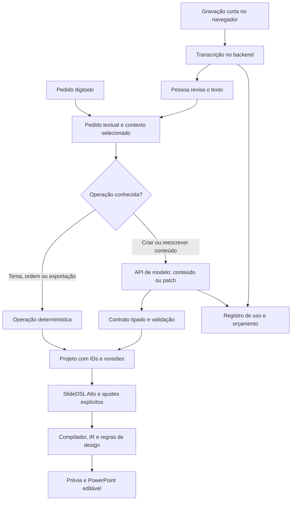

# Plano de evolução do SlideDSL

**APIs pagas para conteúdo · DSL para composição · edição por texto e voz · uso no celular**

Data: **01/11/2026** · Estado: **fase 1 concluída, com piloto remoto; próxima: fase 2**.

Este documento nasceu como plano. A implementação foi autorizada depois e começou na
branch `feature/slidedsl-api-voz-mobile`. Consulte o estado, as verificações e a próxima
tarefa em [CONTINUIDADE_API_VOZ_MOBILE.md](CONTINUIDADE_API_VOZ_MOBILE.md).
Não houve publicação. O piloto remoto pequeno foi concluído após corrigir a validação TLS.

As fontes foram registradas antes da redação em
[refs/PLANO_API_VOZ_FONTES.md](../refs/PLANO_API_VOZ_FONTES.md).

## 1. A ideia central

Criar uma aplicação web na qual a pessoa descreve uma apresentação, recebe slides editáveis
e consegue pedir mudanças por texto ou pelo microfone, inclusive no celular.
A IA decide o conteúdo e a intenção de cada slide. A SlideDSL e o compilador resolvem
composição, coordenadas, tipografia, cores e exportação.

**Proposta de apresentação do projeto:**

> O SlideDSL investiga a redução do consumo de tokens na criação e na edição de apresentações
> com IA. O modelo produz conteúdo em uma representação compacta, enquanto uma linguagem
> específica de domínio, definida por uma gramática livre de contexto, permite validar sua
> estrutura e compilá-la em slides editáveis. A economia será avaliada comparando geração
> visual detalhada, geração em alto nível e edição localizada, considerando também qualidade,
> latência e custo por slide válido.

Essa redação preserva a proposta do usuário e permite defendê-la com experimentos.
“Redução considerável” e “quantidade gigantesca” são resultados desejados, ainda a demonstrar.
A GLC define a sintaxe; as regras e o compilador organizam o visual. A gramática, sozinha,
não garante economia, veracidade ou qualidade estética.

**Mudança de foco proposta:** o modelo local deixa de ser requisito da experiência principal.
APIs pagas, começando pela OpenAI, passam a ser uma opção central; Ollama/llama.cpp continuam
úteis para comparação e execução local. O diferencial passa a ser a arquitetura que evita
gastar geração de linguagem em decisões visuais que o programa consegue calcular.

## 2. O que já existe e o que precisa evoluir

Diagnóstico por leitura do código e dos registros existentes; não é uma nova execução de testes.

| Parte | Evidência atual | Decisão proposta |
| --- | --- | --- |
| DSL e compilador | `.slda` de alto nível, `.sld` 1.1, parser Lark, AST/IR, verificações e PptxGenJS | Evoluir essa base, preservando o compilador e seus contratos. |
| Conteúdo com fontes | Pesquisa, dossiê, roteiro, escrita por slide, cobertura, sustentação e reparos | Tornar a pesquisa uma escolha explícita; reutilizar fontes em edições e contabilizar todas as chamadas. |
| OpenAI | `models/openai_model.py` já usa Chat Completions e registra `usage` em metadados | Completar o suporte à saída estruturada e à contabilização por chamada. Não criar um adaptador duplicado. |
| Contrato dos modelos | `TextModel` não declara schema; OpenAI não aceita `response_schema`; o fluxo Alto retira a restrição após `TypeError` | Declarar capacidades por provedor e evitar perda silenciosa da restrição. |
| Fluxo web Alto | `CriarPayload` e `CriarPanel` aceitam apenas Ollama/llama.cpp; CLI já lista OpenAI | Integrar OpenAI de ponta a ponta: configuração, API, fila, interface e erros. |
| Quantidade | API Alto permite 3–12 slides e a fila usa um trabalhador | Planejar lotes, retomada e limites antes de prometer centenas de slides. |
| Edição | Editor altera IR; `edits.py` contém mecanismos de preservação por ID | Criar edição semântica localizada com revisões e conflitos, aproveitando o que já existe. |
| Fonte de verdade | Alto é compilado para a cena editável; o editor mantém estado em React | Definir relação entre Alto, ajustes manuais, IR e revisões persistidas antes do chat. |
| Celular | Há CSS responsivo, mas abaixo de 650 px a lista de slides é escondida | Criar navegação móvel explícita e validar a experiência com toque. |
| Voz | Não foi encontrada integração de microfone/transcrição no fluxo inspecionado | Acrescentar captura curta, transcrição revisável e o mesmo fluxo de edição textual. |
| Avaliação | Registros históricos apontam pendências de comparação remota, avaliação humana e renderização real | Medir a nova hipótese; os testes e resultados antigos não comprovam economia via API. |

O [HTML aberto no editor](como_funciona.html) explica bem a divisão atual entre IA e código.
Ele será uma referência didática; sua atualização fica para depois da implementação e dos resultados.

## 3. Experiência pretendida

### Criar

1. Informar tema, público, objetivo, quantidade e fontes opcionais.
2. Escolher um modelo configurado e um limite de gasto.
3. Gerar roteiro e conteúdo; acompanhar progresso e consumo.
4. Visualizar os slides e ajustar conteúdo, tema ou composição.
5. Salvar o projeto e exportar o PowerPoint editável.

### Editar por pedido

Exemplo: **“No slide 4, reduza o texto e mantenha os números e as fontes.”**

O sistema identifica o slide, envia ao modelo apenas o contexto necessário e recebe uma
alteração estruturada. A aplicação valida a mudança, mostra a prévia e permite desfazer.
Os demais slides permanecem preservados. “Esse slide” usa a seleção atual; referências
ambíguas são esclarecidas antes da alteração.

Pedidos como **“troque para o tema escuro”** devem seguir uma operação determinística
sempre que a intenção puder ser identificada com segurança. Trocar tema, reordenar ou
exportar não deve provocar nova geração de conteúdo.

### Usar no celular

A experiência principal será uma web responsiva, com prévia central, navegação entre slides,
campo de pedido e botão de microfone. Desktop pode manter painéis laterais e ferramentas
avançadas. No celular, propriedades e histórico abrem em painéis sob demanda.

O primeiro fluxo de voz será **gravar → transcrever → revisar → enviar**.
Conversação contínua e resposta falada ficam para uma etapa posterior.

## 4. Arquitetura proposta



**Decisão principal:** o estado semântico em alto nível, os ajustes manuais e a revisão
formam o projeto persistido. A IR é a cena compilada para prévia e exportação.
Não sobrescrever uma edição manual ao recompilar o Alto.

Antes de implementar, mapear como cada ajuste visual será representado: propriedade
suportada em alto nível, sobrescrita por ID ou conflito explícito. Não prometer conversão
inversa automática de qualquer IR para Alto.

Um patch deve carregar a revisão-base, os IDs dos alvos e uma lista fechada de operações.
O backend aplica a alteração atomicamente sobre uma cópia, valida e grava uma nova revisão.
Revisões antigas são rejeitadas ou reconciliadas; pedidos repetidos usam identificador
para evitar aplicação e cobrança duplicadas por reenvio da interface.

Operações iniciais: substituir título, substituir itens, mudar composição entre tipos
suportados, inserir/remover/reordenar slide e mudar tema. Novos números ou afirmações
exigem fonte ou indicação de revisão. O modelo não recebe autorização para executar código.

## 5. Como buscar economia de tokens

| Decisão | Benefício esperado | Como verificar |
| --- | --- | --- |
| Produzir intenção e conteúdo, sem geometria detalhada | Menor saída para a mesma informação | Comparar tokens totais com a DSL de baixo nível. |
| Editar por slide e por campo | Menor contexto e resposta | Comparar patch com regeneração completa. |
| Reutilizar roteiro e dossiê | Evitar repetir pesquisa e contexto | Registrar chamadas evitadas e fontes reutilizadas. |
| Um candidato por padrão no modo econômico | Reduzir multiplicação de gerações | Comparar custo e qualidade com best-of-N. |
| Reparos limitados e direcionados | Conter consumo em falhas | Somar tentativas e apresentar a causa da parada. |
| Tema e exportação determinísticos | Evitar inferência desnecessária | Confirmar zero chamadas de modelo nessas operações. |
| Lotes com progresso persistido | Evitar repetir slides já concluídos | Interromper e retomar uma geração controlada. |

Chamadas curtas também repetem instruções, schemas e contexto. O fluxo atual faz pesquisa,
extração, roteiro, candidatos e verificações: **o custo da apresentação é a soma de tudo isso**.
Representação compacta não significa automaticamente menos tokens, especialmente com campos
JSON repetidos. Comparar geração por slide e pequenos lotes antes de escolher o padrão.

Propor perfis **econômico** e **com pesquisa**, com etapas e estimativas visíveis.
Economizar não deve esconder remoção de verificações nem tratar conteúdo sem fontes como verificado.

Registrar por chamada: provedor/modelo efetivo, etapa, slide, tentativa, tokens de entrada,
entrada em cache quando informada, saída, detalhes de uso disponíveis, duração e estado final.
Capturar o uso imediatamente; o último `metadata.usage` não representa toda a execução.

```text
C_texto = soma das categorias de tokens cobradas × suas tarifas vigentes
C_total = C_texto + C_transcrição + C_busca/mídia + C_infraestrutura
C_slide_válido = custo de todas as tentativas / quantidade de slides válidos entregues
Economia = 1 - (custo da proposta / custo da condição de comparação)
```

Separar entrada comum e em cache sem contagem dupla. Não somar novamente tokens internos já
incluídos nos totais do provedor. Uso ausente é **desconhecido**, nunca zero.
Mostrar estimativa antes e consumo observado depois; a tarifa deve ter data e moeda [F03].
Limites locais devem considerar chamadas em andamento e reservar margem; não prometer um
teto exato baseado apenas na estimativa de tokens.

## 6. APIs, microfone e acesso pelo celular

**APIs:** começar completando o adaptador OpenAI existente. Escolher e registrar um modelo
acessível na conta com saída estruturada, qualidade e tarifa adequadas ao piloto, sem
assumir que todos aceitam os mesmos parâmetros. Avaliar Responses API para a evolução;
se migrar, preservar e testar o contrato usado pelos fluxos atuais.
Saída aderente ao schema ainda precisa de validação do domínio [F01].

Outros provedores entram depois de um fluxo completo funcional, com capacidades declaradas
para schema, uso, streaming e limites. A chave fica no backend, fora do bundle e do Git.
O navegador recebe opções de modelo e estado de configuração, sem receber o segredo.

**Voz:** usar captura pelo navegador e transcrição no servidor [F02, F05]. Detectar MIME,
limitar duração/tamanho, indicar gravação e encerrar as trilhas do microfone ao parar.
Manter texto digitado como alternativa em caso de permissão negada ou incompatibilidade.
Áudio bruto deve ser temporário, com descarte definido e sem inclusão automática no Git.

O anexo recebido é Ogg/Opus: usá-lo como exemplo de formato a considerar, sem presumir
aceitação pelo endpoint. Validar suporte real ou converter no servidor para formato aceito;
trocar a extensão do arquivo não converte o áudio.

**Celular:** testar microfone por HTTPS. Abrir `http://IP-do-PC:8000` pode permitir acesso
à página, mas não resolve o requisito de contexto seguro do microfone [F04].
Planejar origem HTTPS para a demonstração, com acesso controlado e backend na mesma origem.
A aplicação atual é local; não basta mudar o endereço de escuta para publicá-la.

Antes de disponibilizar o serviço, incluir sessão de usuário, autorização por projeto,
limites de gasto e requisição, proteção dos arquivos e caminhos e política de retenção.
Revisar o limite atual de **4 MiB por solicitação**, o formato de upload e o middleware
de origem; não remover essas proteções globalmente para aceitar áudio.

## 7. Taiga-S1: resposta à sugestão do professor

A transcrição fornecida pelo usuário sugere analisar a ferramenta, incluí-la nas referências
e verificar similaridades, diferenças, sinergias e impacto. Isso orienta uma comparação;
não implica instalar o modelo ou enviar os arquivos da disciplina para outra plataforma.

A [ficha do autor](https://huggingface.co/shhivv/taiga-s1) descreve um modelo de **1,2 milhão
de parâmetros** que escolhe ações no FreeCAD a partir de objetivo e estado da aplicação.
É uma referência de executor especializado. O tamanho “5 MB” do título recebido não foi
confirmado para um arquivo específico e não será usado como medida comparativa [F06–F07].

| Aspecto | Taiga-S1, conforme o autor | SlideDSL atual/proposto | Implicação |
| --- | --- | --- | --- |
| Domínio | Modelagem CAD no FreeCAD | Apresentações 2D | Há relação espacial, com problemas e restrições diferentes. |
| Planejamento | Objetivo define o que construir | Modelo define roteiro, conteúdo e intenção | Ambos permitem separar objetivo e execução. |
| Execução | Pequeno modelo escolhe ações a partir do estado | Compilador calcula composição e gera objetos | No SlideDSL, essa função já é resolvida por software determinístico. |
| Representação | Estado do CAD e ações disponíveis | DSL, AST, IR e diagnósticos | Estado explícito pode limitar ações e facilitar auditoria. |
| Correção | A ficha relata recuperação durante execução | Validação, rejeição de patch e restauração de revisão | Inspira ações limitadas e recuperação observável. |
| Evidência | Resultados do autor em tarefas CAD | Experimentos próprios ainda necessários para a nova proposta | Não transferir taxas ou desempenho entre domínios. |

**Similaridades:** decomposição da tarefa, estado estruturado, operações do domínio e
verificação da execução. **Diferenças:** executor aprendido versus compilador determinístico;
geometria CAD versus comunicação visual; parâmetros/peso do modelo versus tokens cobrados.

**Sinergia recomendada:** aproveitar a ideia de ações válidas conforme o estado, objetivos
explícitos e recuperação localizada. Conectar isso à edição por patches e ao histórico de revisões.
Relacionar também à análise espacial já existente em [ANALISE_TEXPACE.md](ANALISE_TEXPACE.md).

**Vale aprofundar? Sim, como trabalho relacionado e referência de arquitetura.** Aprofundar
primeiro ficha, contrato de estado/ações e método de avaliação. Um protótipo com executor
aprendido só se justifica se aparecer uma limitação mensurável que o compilador não resolve,
com dados de treinamento e critério de comparação. Treinamento e integração com FreeCAD ficam
fora do MVP; não ajudam diretamente a demonstrar economia de tokens na geração de slides.

## 8. Aparência e referência do Claude

O [artefato enviado](https://claude.ai/artifact/QHJ6k1BU8xt9wAttJoqn5t) não pôde ser lido.
Nenhuma aparência ou funcionalidade descrita aqui é atribuída a ele.
A proposta abaixo deriva do uso solicitado e precisa ser confrontada com a referência depois.

```text
Desktop: [slides] [prévia do slide selecionado] [pedido e histórico]
Celular: [slide atual / navegação] [prévia] [pedido + microfone]
```

Priorizar prévia legível, edição direta de texto, estado de salvamento, desfazer e
visibilidade do slide-alvo. Colocar DSL, IR e diagnósticos detalhados em uma área avançada.
Exibir consumo sem ocupar o centro da experiência. Não incluir percentuais promocionais
de economia antes dos experimentos.

Pendência visual: recuperar o conteúdo acessível ou uma captura da referência antes de
definir fidelidade de layout, cores e interações.

## 9. Fases e critérios de conclusão

As fases são sequenciais por dependência. Atualizar este plano, `ROADMAP.md` e
`docs/PROGRESSO.md` conforme cada entrega for realmente concluída.

| Fase | Trabalho | Critério de conclusão |
| --- | --- | --- |
| 0 — Preparação | Criar branch, registrar base, fechar representação do projeto e orçamento do piloto | Base e arquivos preexistentes preservados; contratos de estado e uso documentados. |
| 1 — API e custos | Integrar OpenAI com schema, capacidades, tratamento de erro e uso por chamada | Criar um deck pela web; nenhum fallback silencioso; contabilizar todas as etapas, inclusive falhas. |
| 2 — Editor web | Fluxo criar → visualizar → salvar → exportar; projeto com revisões | Reabrir o projeto, recuperar seleção e exportar o mesmo conteúdo. |
| 3 — Edição localizada | Pedidos textuais, patches por ID, conflitos, prévia e desfazer | Alterar um slide preservando os demais e ajustes manuais; rejeitar revisão desatualizada. |
| 4 — Celular e voz | Navegação móvel, captura, transcrição revisável e HTTPS de demonstração | Criar/editar no telefone; tratar permissão negada, formato incompatível e rede interrompida. |
| 5 — Escala | Geração em lotes, retomada, cancelamento e limites coerentes entre UI/API/CLI | Interromper e retomar sem regenerar slides concluídos; medir memória, tempo e custo. |
| 6 — Avaliação | Experimentos controlados de geração e edição, inspeção visual e avaliação humana | Resultados reproduzíveis com custos, falhas e limites, sem confundir prévia com PPTX renderizado. |
| 7 — Texto acadêmico | Atualizar motivação, arquitetura, trabalhos relacionados e conclusões | Cada alegação importante apoiada por resultado ou referência; Taiga comparado sem extrapolação. |

**MVP:** fases 0–4, com número moderado de slides e orçamento limitado.
Expansão de escala e alegações quantitativas dependem das fases 5–6.
Ficam para depois: app nativo, edição arbitrária de PPTX importado, colaboração simultânea,
voz contínua, vários provedores ao mesmo tempo e treinamento de modelo próprio.

### Arquivos envolvidos na implementação futura

| Área | Pontos a revisar |
| --- | --- |
| Provedores | `src/slidedsl/models/base.py`, `factory.py`, `openai_model.py` e seus chamadores |
| Geração e medição | `alto_generation.py`, `alto_jobs.py`, `alto_cli.py`, `research.py` |
| Estado e alterações | `edits.py`, `alto_compile.py`, `serializer.py`, `ir.py`; contrato de projeto/revisão a acrescentar |
| API e acesso | `server.py`, schemas de entrada, uploads e armazenamento |
| Interface | `editor/src/App.tsx`, `CriarPanel.tsx`, `api.ts`, `types.ts`, `style.css`, `Preview.tsx` |
| Verificação | Testes Python, testes do renderer e fluxos Playwright existentes, ampliados conforme cada mudança |
| Evidências | Novas execuções em `outputs/api_voz_mobile/`; nenhuma substituição de resultados históricos |

Não há necessidade prevista de reescrever o parser ou o renderer para começar.

## 10. Experimento para defender o diferencial

**Pergunta:** para conteúdo e qualidade comparáveis, descrever intenção e aplicar alterações
locais reduz o custo total frente a gerar instruções visuais detalhadas e regenerar tudo?

| Comparação | Condições | O que isola |
| --- | --- | --- |
| Geração | A: modelo produz `.sld` detalhado; B: produz alto nível compilado deterministicamente | Efeito da representação e da composição pelo programa. |
| Edição | C: regeneração completa; D: patch do slide-alvo, partindo do mesmo projeto | Efeito do contexto e da resposta localizados. |
| Operação sem IA | Mudança de tema, ordem e nova exportação | Ausência de inferência quando a operação é determinística. |
| Escala do compilador | Conteúdo fixo, 100/500/1.000 slides, sem chamadas de modelo | Capacidade de renderização, separada da qualidade de gerar muito conteúdo. |

Usar textos e fontes congelados na comparação de representação, com o mesmo modelo,
parâmetros compatíveis, requisitos, conteúdo obrigatório e política de reparo. Registrar
como cada formato foi solicitado; se mudarem restrições de saída, não atribuir todo o
efeito exclusivamente à DSL ou à GLC. Medir o fluxo completo com pesquisa em rodada separada.

Começar com **um caso pequeno pareado**, depois piloto com **três temas e cinco slides**.
Somente após estimar gasto, ampliar para 5/20/50 slides, três temas e três repetições:
**27 execuções por condição de geração**, além das edições planejadas. Esse lote é uma
proposta de avaliação, não autorização para executar despesas nesta etapa.

Métricas: entrada/saída/cache, custo de todas as tentativas, custo por slide válido,
latência, falhas, reparos, cobertura, alterações indevidas e qualidade humana de conteúdo,
clareza e design. Avaliação humana deve ocultar a condição; buscar pelo menos três avaliadores.
Guardar dados individuais e variabilidade, sem transformar amostra pequena em promessa geral.

Verificar o PPTX em PowerPoint ou LibreOffice quando disponível, além de inspecionar
objetos editáveis e texto. A prévia do navegador não comprova a renderização final.
Mostrar casos negativos e o ponto em que texto, memória, tempo ou custo limitam a escala.

## 11. Branch e próximos passos

Branch criada: **`feature/slidedsl-api-voz-mobile`**, a partir de `slidedsl`, base `168c29f`.
Foi a primeira ação de implementação, após autorização do usuário.

O Git tem como raiz todo o workspace, não apenas `code/slidedsl`. Há arquivos não rastreados
anteriores a esta etapa, inclusive o HTML aberto. Ao iniciar a implementação, conferir o
estado novamente e selecionar explicitamente o que pertence à mudança; não executar
`git add .`, stash, limpeza ou commit automático de trabalho preexistente.

Próxima entrega técnica proposta: **uma apresentação criada via OpenAI no editor, com
consumo completo registrado**, antes de acrescentar voz e escala. A edição localizada vem
em seguida, pois é a segunda hipótese central de economia.

### Checklist desta rodada

- [x] Inspecionar arquitetura, código, chamadores relevantes e documentação existente.
- [x] Registrar fontes oficiais e limitações de acesso.
- [x] Incorporar a transcrição fornecida pelo usuário e avaliar o Taiga-S1.
- [x] Desconsiderar o ZIP informado por engano.
- [x] Planejar API, edição, voz, celular, custos e experimentos.
- [ ] Recuperar a referência visual do Claude.
- [x] Criar a branch e iniciar a implementação após a autorização.
- [x] Integrar OpenAI ao painel/API, schema estrito e consumo por chamada; testar offline.
- [x] Concluir o piloto remoto: 3 slides, 5 chamadas, US$ 0,0028, PPTX exportado
  (causa da falha anterior: inspeção TLS do antivírus; ver continuidade).
- [ ] Implementar estado persistido, edição localizada e voz/celular nas próximas fases.

O diagnóstico da seção 2 descreve a base anterior; os requisitos das fases seguintes
continuam propostos. Os testes locais novos estão no registro de continuidade e não
comprovam qualidade do modelo remoto ou porcentagem de economia.
