# SlideDSL Alto — SLM + GLC + pesquisa para slides com substância

Data: 12/10/2026. Esta etapa ataca o diagnóstico de [PROXIMAS_MELHORIAS.md](PROXIMAS_MELHORIAS.md):
conteúdo raso, composições pouco variadas e um SLM que precisava "lembrar" do assunto.
Tudo é aditivo: os fluxos anteriores (SlideDSL 1.1, planejamento visual, editor) continuam iguais.

## O que mudou

| Problema observado | Causa | Mudança |
|---|---|---|
| Frases genéricas ("Facilita atualizações sem interromper o sistema") | O SLM escrevia de memória e o prompt limitava o detalhe a 8 palavras | **Pesquisa na internet** com fichas de fatos verificadas + **contrato editorial** por slide |
| Todo slide era "título + cards azuis" | Composição quase fixa por intenção | **11 tipos de slide** na nova GLC, cada um com layout próprio |
| 0/5 programas válidos na geração direta | O modelo escrevia coordenadas e a sintaxe de baixo nível | **GLC de alto nível** (sem coordenadas) e **geração restrita por GBNF** |
| Números sem fonte | Nada impedia inventar | Schema só aceita IDs de fatos reais; **A007** acusa número ausente dos fatos citados |
| Uma única tentativa por slide | — | **Best-of-N** com pontuação de concretude e **reparo** por campo |

## Arquitetura

```mermaid
flowchart LR
    P[Pedido] --> R[Pesquisa: consultas → busca → trechos]
    R --> F[Fichas F1..Fn com trecho literal verificado]
    F --> O[Roteiro: tipo + mensagem + fatos por slide]
    O --> S[Conteúdo por slide: JSON Schema ou GBNF]
    S --> V[Validação A0xx + layout A010]
    V -- diagnósticos --> S
    V --> B[Best-of-N]
    B --> A[SlideDSL Alto]
    A --> L[Layouts determinísticos]
    L --> D[SlideDSL 1.1]
    D --> G[Parser LALR + semântica + regras D001–D010]
    G --> X[PPTX editável + prévia PNG]
```



Cada chamada do modelo é pequena: um trecho por extração, um slide por geração. É o regime
em que modelos de 1–8B funcionam bem. O compilador continua determinístico e offline;
só a pesquisa (opcional) usa a rede, sempre por `media.fetch_public` (HTTPS, IP público fixado,
limites de tamanho e tempo) e com cache em `outputs/research/cache/`.

## A GLC de alto nível

Arquivo: [src/slidedsl/grammar/slidedsl_alto.lark](../src/slidedsl/grammar/slidedsl_alto.lark).

```lark
deck: "deck" STRING "{" tema? slide+ "}"
?slide: capa | secao | topicos | numeros | comparacao | etapas
      | linha_do_tempo | citacao | grafico | imagem | conclusao
topicos: "topicos" "{" titulo item+ fontes? notas? "}"
numeros: "numeros" "{" titulo valor+ fontes? notas? "}"
comparacao: "comparacao" "{" titulo lado lado fontes? notas? "}"
item: "item" STRING STRING?
fontes: "fontes" fonte_ref ("," fonte_ref)*
?fonte_ref: FATO | STRING        // FATO: F1, F2... do dossiê
```

Exemplo ([examples/alto/microsservicos.slda](../examples/alto/microsservicos.slda)):

```slidedsl
numeros {
  titulo "Os resultados dependem do problema, não da moda"
  valor "7 anos" "duração da migração da Netflix para a nuvem, de 2008 a 2016"
  valor "90%" "redução de custo de infraestrutura no monitoramento do Prime Video"
  fontes F3, F7
  notas "O caso mostra que distribuição tem custo; para fluxos intensos de dados..."
}
```

O modelo decide **o quê** cada slide comunica; o compilador ([alto_layout.py](../src/slidedsl/alto_layout.py))
decide **como**: geometria, fonte (o maior tamanho que cabe para *todos* os textos do mesmo papel),
cores com contraste ≥ 4,5 nos dois temas, camadas, rodapé com fontes e numeração, notas do
apresentador com as URLs. O resultado é SlideDSL 1.1 comum, que passa pelo parser, semântica
e regras de design originais e abre no editor.

| Tipo | Layout |
|---|---|
| `capa` | título e subtítulo centralizados verticalmente, painel e formas decorativas |
| `secao` | faixa colorida com número da seção |
| `topicos` | até 3 → cards numerados lado a lado; 4–5 → lista numerada em duas colunas |
| `numeros` | 1 → número gigante + explicação; 2–3 → cards com números grandes |
| `comparacao` | duas colunas com cabeçalhos coloridos e itens pareados |
| `etapas` | círculos numerados ligados por trilho |
| `linha_do_tempo` | eixo com marcos, datas em destaque |
| `citacao` | aspas grandes, texto e autor |
| `grafico` | barras como formas editáveis, maior valor destacado |
| `imagem` | imagem contida em moldura + itens |
| `conclusao` | painel com recomendações numeradas |

### Diagnósticos da SlideDSL Alto

| Código | Severidade | Significado |
|---|---|---|
| P001 | ERRO | sintaxe inválida (linha/coluna) |
| A002 | ERRO | campo obrigatório vazio |
| A003 | ERRO | quantidade de itens/valores/marcos/barras fora do limite do tipo |
| A004 | ERRO | barra negativa |
| A005 | ERRO | texto acima do limite do campo |
| A006 | ERRO | fonte `Fn` inexistente no dossiê |
| A007 | AVISO | número que não aparece nos fatos citados (possível invenção) |
| A008 | AVISO | slide de dados (`numeros`, `grafico`, `citacao`) sem fonte |
| A009 | AVISO | detalhe curto ou genérico ("facilita…", "melhora…" sem dado) |
| A010 | ERRO | texto não cabe no layout nem na fonte mínima (com caminho do campo) |
| A011 | AVISO | imagem não resolvida |

Os diagnósticos carregam o caminho do campo (`itens[1].detalhe`), que volta ao modelo no reparo.

## Extensões da SlideDSL 1.1

Para os layouts novos, a linguagem de baixo nível ganhou (com parser, printer, IR, editor e renderer):

```slidedsl
adicionar retangulo id card em (80, 100) tamanho (300, 200) cor primaria arredondado
adicionar texto id t "Olá" em (100, 120) tamanho (260, 60) fonte 24 cor #FFFFFF familia "Arial" negrito alinhado centro
notas "Texto para o apresentador"
```

`negrito` substitui a convenção antiga pelo sufixo `_ref_label` (mantida por compatibilidade).
A medição de texto agora também encontra Arial no macOS e Liberation Sans no Linux.

## Pesquisa na internet

[research.py](../src/slidedsl/research.py). **Desde 12/10/2026 o buscador do projeto é somente
o SearXNG local** (padrão na CLI, na API e no painel). Tavily (`TAVILY_API_KEY`), Brave
(`BRAVE_API_KEY`) e Wikipedia continuam no código apenas para comparações experimentais
(`--buscador wikipedia|tavily|brave` na CLI); o fallback para a Wikipedia só acontece com
`--fallback-wikipedia`. O SearXNG é detectado em `http://127.0.0.1:8888` sem configuração
(`SLIDEDSL_SEARXNG_URL` muda o endereço). `GET /api/searxng/status` informa se ele responde.

### SearXNG local (busca na web inteira, sem chave)

O projeto traz `searxng/docker-compose.yml` e `searxng/settings.yml` (JSON ligado, porta só em
127.0.0.1). Com o Docker Desktop aberto: `scripts\iniciar_searxng.cmd` (e `parar_searxng.cmd`).
O script cria `searxng/.env` com um segredo aleatório local, ignorado pelo Git;
o Compose o fornece como `SEARXNG_SECRET`, sem segredo no YAML versionado.
Limitações: exige Docker (~200 MB de RAM); os buscadores consultados (Google, Bing, DuckDuckGo)
podem limitar ou bloquear temporariamente consultas automáticas, então os resultados variam;
páginas que dependem de JavaScript ou bloqueiam robôs rendem pouco texto e são ignoradas.

Para cada trecho relevante (escolhido por sobreposição de termos e presença de números),
o SLM devolve até 4 fichas `{afirmacao, tipo, valor, trecho}` sob JSON Schema. **Uma ficha só
é aceita se o `trecho` for encontrado literalmente na página** (≥ 85% contíguo) e se o
número de `valor` e da afirmação aparecerem no texto. As descartadas ficam em `rejected` com o
motivo. Sem modelo, a extração é heurística (frases com números/definições).

## Geração

```powershell
# Ollama + JSON Schema (padrão)
.\.venv\Scripts\slidedsl.exe criar "Monolito ou microsserviços para uma startup" --out outputs/criar/micro --model qwen3:4b-instruct --candidatos 3

# llama.cpp + GBNF: o SLM escreve SlideDSL Alto e não consegue sair da gramática
llama-server -m modelo-qwen3-4b-instruct.gguf --port 8080
.\.venv\Scripts\slidedsl.exe criar @pedido.txt --out outputs/criar/gbnf --provider llamacpp --modo gramatica

# Só pesquisar / reaproveitar o dossiê
.\.venv\Scripts\slidedsl.exe pesquisar "microsserviços" --out outputs/criar/dossie.json --provider ollama
.\.venv\Scripts\slidedsl.exe criar "..." --dossie outputs/criar/dossie.json --out outputs/criar/b
```

Opções: `--slides 6`, `--modo json|gramatica|direto`, `--candidatos N`, `--reparos 2`,
`--buscador auto|wikipedia|brave|tavily|searxng|nenhum`, `--imagens`, `--tema escuro`, `--strict`.

A pasta de saída contém `pedido.txt`, `dossie.json`, `roteiro.json`, `chamadas.jsonl`
(cada prompt, restrição e resposta crua), `candidatos.json` (todas as versões com pontuação e
diagnósticos), `apresentacao.slda`, `apresentacao.sld`, `validacao.json`, `apresentacao.pptx`,
`previa/` e `previa.png`, além de `relatorio.json`.

### Contrato editorial (prompt de conteúdo)

* título = mensagem do slide, afirmação completa com até 60 caracteres;
* item = rótulo de 2–5 palavras + detalhe de 8–22 palavras com número, nome, data, exemplo ou condição;
* números só dos fatos fornecidos, com o ID em `fontes`; sem fato, exemplos qualitativos;
* `notas` com raciocínio, exemplo e ressalva para o apresentador.

O roteiro só oferece `numeros`, `grafico` e `citacao` quando há fatos, e o enum de `fontes`
só contém IDs existentes — o modelo não tem como citar uma fonte inventada.

### Best-of-N

Cada slide gera N candidatos (o primeiro com a temperatura pedida, os demais mais altos).
A pontuação soma: −100 por erro, −15 por A007, −5 por A008, −4 por A009; +5 por fato citado
(até 3), +2 por detalhe com número, +1 por nome próprio, +1 por detalhe de 8–24 palavras,
+2 por notas desenvolvidas. É uma heurística de concretude, não uma medida de qualidade.

### GBNF

`slidedsl gbnf --out alto.gbnf [--regra topicos] [--baixo-nivel]` converte o EBNF do arquivo
`.lark` em GBNF, preservando `+ * ?` (sem a recursão à esquerda que o LALR gera e que o
llama.cpp recusa). O teste usa um reconhecedor GBNF próprio para garantir que os exemplos e
todos os slides impressos são aceitos e que programas inválidos são rejeitados.

## Qualidade do conteúdo — segunda rodada (12/10/2026, noite)

Motivada pelos testes reais em `outputs/testes_multitemas_20261012/` (Qwen3 4B + SearXNG):

| Problema observado | Causa | Correção |
|---|---|---|
| Títulos e notas cortados ("mais esf") | `maxLength` do JSON Schema: o decoder corta o texto | Limites folgados no schema; **A013** detecta campo no limite e pede a frase completa |
| Fato usado com outro sentido ("a plataforma cresceu" → "o ecossistema cresceu") | Só se conferia se o número existia no fato | **Verificação de sustentação**: o SLM julga cada frase com número/nome contra os fatos citados (sustentada/parcial/não); frases problemáticas voltam para reparo e, se persistirem, recebem a reescrita sugerida; restantes viram **A014** e aparecem no painel |
| Citação com autor "F7" e texto parafraseado | O modelo escrevia a citação | Slide `citacao` montado do trecho literal de um fato `citacao` com autor presente no texto; **A015** recusa autor `Fn` ou texto não literal |
| "menos de 5 membros" sem aviso | Comparação por dígitos ("5" casava com "500") | Comparação por número inteiro normalizado (1.300 = 1,300; "20 mil" = 20000) |
| Fichas incompletas, "�", fatos fora do assunto, fonte única | Decodificação fixa em UTF-8; sem filtro de relevância | Charset detectado; ficha precisa de frase completa (≥ 6 palavras), trecho sem "…", relevância ≠ baixa; máx. 5 fatos por fonte; aviso de poucos fatos/fonte única |
| Pedido detalhado perdia itens (latência, transações...) | Roteiro não conferia cobertura | Tópicos obrigatórios extraídos do pedido (≥ 15 palavras), atribuídos no roteiro (com uma correção se faltar), exigidos no prompt do slide e conferidos no texto visível (**A016**); `qualidade.json` e o painel mostram a cobertura |
| Rodapé estourando (D010), comparação em 14 pt, capas iguais, cards repetidos | Layout | Rodapé com domínios em uma linha; fonte mínima 16 pt escolhendo o par rótulo/detalhe que favorece o detalhe; 3 variações de capa; tópicos alternam cards/lista |
| Detalhe como cenário solto ("uma casa com telhado...") | Prompt | Contrato exige frase completa; **A009** marca detalhe iniciado em minúscula |

Novos arquivos por execução: `qualidade.json` (tópicos, cobertura, frases não sustentadas).
CLI: `--sem-verificacao`, `--sem-cobertura`. Custo: ~1 chamada de sustentação por slide com
fatos, 1 de tópicos e eventuais reparos (≈ +8–15 chamadas por deck de 6 slides).

Limite importante: o verificador é o mesmo SLM que escreveu o slide. Ele pega distorções
evidentes (sujeito trocado, data alterada), mas não substitui revisão humana.

## No editor visual

`slidedsl serve` → http://127.0.0.1:8000. O painel **Criar com pesquisa** (no topo) usa este
fluxo: pedido, modelo, número de slides, versões por slide e tema, além do estado do SearXNG;
em *Pesquisa e opções avançadas* ficam "pesquisar com o SearXNG", provedor (Ollama ou
llama.cpp/GBNF), imagens e "continuar mesmo sem fatos". O progresso aparece passo a passo; ao terminar, a apresentação abre
no editor (fatos usados e o código SlideDSL Alto ficam visíveis no painel) e tudo é gravado em
`outputs/criar/<id>/`. O painel antigo continua disponível em *Fluxo anterior*. O botão
**Abrir .sld / .slda** também abre arquivos SlideDSL Alto.

API: `POST /api/criar` (fila de uma execução), `GET /api/criar/{id}`, `POST /api/alto/parse` e
`GET /api/searxng/status`.

### Quando a pesquisa não acha fatos

Se o SearXNG não responder ou nenhuma página trouxer fatos verificáveis, a geração para com a
mensagem do motivo, em vez de deixar o modelo inventar exemplos — marque *Continuar mesmo se a
pesquisa não achar fatos* (`--sem-fatos`) para gerar assim mesmo. (O campo *Contato* da
Wikipedia saiu do painel com a adoção do SearXNG; `--contato` continua na CLI para os
experimentos com Wikipedia.)

### Proteções contra conteúdo inventado

* sem fatos, o roteiro não oferece `numeros`, `grafico`, `citacao` nem `linha_do_tempo`;
* o prompt proíbe inventar empresas, pessoas, produtos, datas e estatísticas;
* **A012** (aviso) marca números em títulos/itens sem fato citado; nomes próprios que não estão
  nos fatos reduzem a pontuação do candidato;
* IDs de fatos inexistentes são descartados antes da validação.

Títulos longos demais para duas linhas a 42 pt agora reduzem a fonte até 32 pt (aviso D003)
em vez de impedir a geração do PPTX.

## Prévia sem Office

`slidedsl previa arquivo.slda --out pasta` desenha a cena com Pillow (aproximação: fontes e
quebras podem diferir do PowerPoint). Útil para comparar candidatos e para, no futuro, uma
crítica por modelo de visão.

## Limites e o que ainda falta medir

* Não executei SLM real nesta etapa (o ambiente de desenvolvimento não tinha Ollama nem rede
  para a Wikipedia). Toda a cadeia foi testada com modelos simulados e transporte HTTP falso;
  os números de qualidade com Qwen3 precisam ser medidos na máquina com Ollama.
* `/v1/chat/completions` do llama-server aceita `grammar`/`json_schema` nas versões recentes;
  confira a versão instalada.
* Fichas verificadas provam que o texto existe na fonte, não que a fonte está correta.
* A pontuação best-of-N e os limites de caracteres são heurísticos; a avaliação humana continua
  pendente, assim como renderização real no Office.

## Próximos passos sugeridos

1. Comparar, com Qwen3 4B local, o fluxo antigo × Alto sem pesquisa × Alto com pesquisa × Alto com GBNF
   (mesmos pedidos e seeds), medindo validade, fatos citados, A007/A009 e avaliação humana.
2. Crítica visual por modelo de visão pequeno sobre `previa/` (ex.: Qwen2.5-VL 3B).
3. Fine-tune LoRA do SLM em pares pedido → SlideDSL Alto gerados por modelo maior.
4. Botão "Criar com pesquisa" no editor, reaproveitando `create_presentation`.
