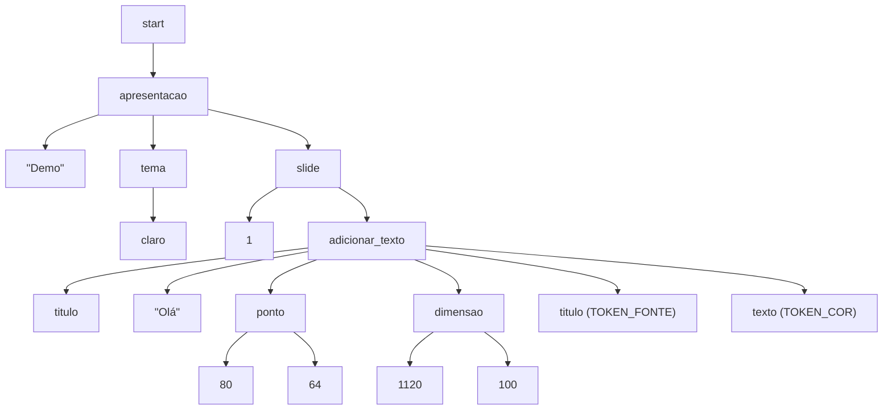
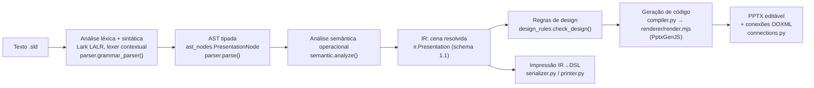
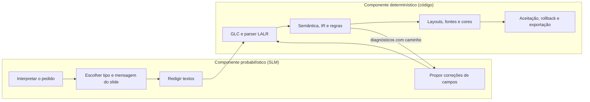
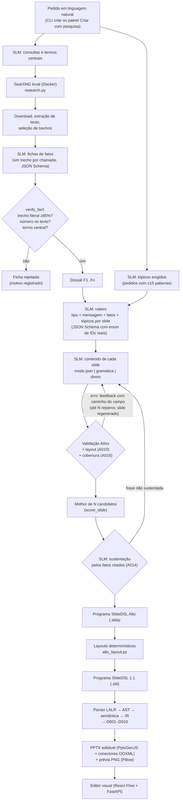
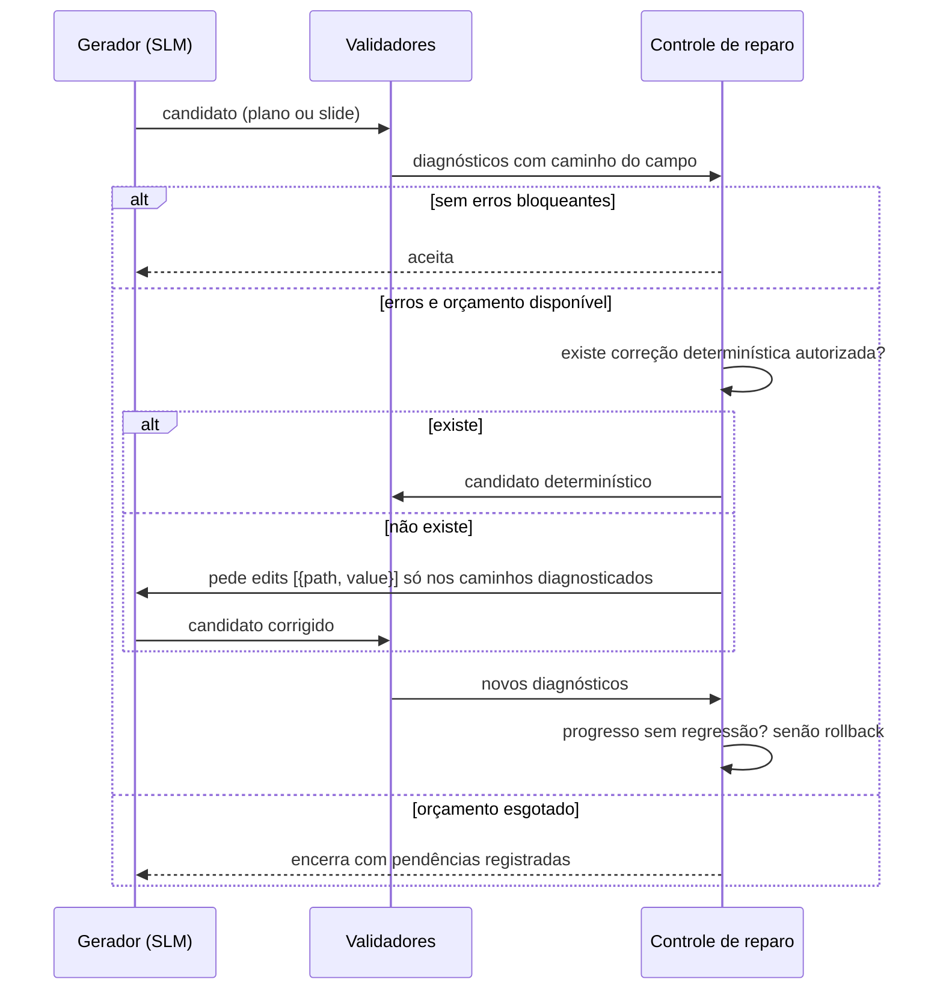

# SlideDSL: gramáticas livres de contexto e compilação determinística como mecanismo de controle da geração de apresentações por modelos de linguagem pequenos executados localmente

**Autor:** Thiago Barbosa
**Trabalho de Conclusão de Curso — Ciência da Computação**
**Versão do documento:** 1.0 (12/10/2026), referente ao commit `168c29f` do ramo `slidedsl`

> **Nota sobre evidências.** Cada afirmação técnica deste artigo está mapeada para arquivos, funções,
> testes ou relatórios do repositório em [EVIDENCIAS_TECNICAS.md](EVIDENCIAS_TECNICAS.md). A
> bibliografia comentada está em [REFERENCIAS.md](REFERENCIAS.md), e as evidências ainda ausentes
> estão em [LACUNAS_DA_PESQUISA.md](LACUNAS_DA_PESQUISA.md). Ao longo do texto, cada funcionalidade
> recebe um dos rótulos a seguir.
>
> | Rótulo | Significado |
> |---|---|
> | **[IC]** | Implementado e comprovado por experimento real ou teste automatizado com artefato preservado |
> | **[INA]** | Implementado, mas não avaliado experimentalmente com modelo real |
> | **[EXP]** | Experimental, opcional ou parcialmente implementado |
> | **[PLAN]** | Planejado para trabalhos futuros; não existe no código |

---

## Resumo

Transformar um pedido em linguagem natural em uma apresentação de slides exige duas competências
diferentes: decidir *o que* comunicar e decidir *como* dispor o conteúdo em um espaço bidimensional
finito. Modelos de linguagem pequenos (SLMs), executados localmente, são atraentes por custo,
privacidade e independência de fornecedores, mas produzem saídas estruturadas frágeis: erram
sintaxe, inventam comandos, extrapolam limites geométricos e escrevem conteúdo genérico ou não
sustentado. Este trabalho apresenta o **SlideDSL**, um sistema que combina geração probabilística
por SLMs com verificação e compilação determinísticas. O núcleo é uma linguagem específica de
domínio (DSL) em português controlado, definida por uma gramática livre de contexto (GLC) e
processada por um compilador com analisador sintático LALR (Lark), árvore sintática abstrata (AST)
e representação intermediária (IR) tipadas (Pydantic), análise semântica operacional, regras
geométricas e de design (D001–D010) e um gerador de PowerPoint editável (PptxGenJS). Sobre esse
núcleo foi construída a **SlideDSL Alto**, uma segunda GLC sem coordenadas, na qual o modelo
declara apenas a intenção de cada slide (tópicos, comparação, números, etapas etc.), enquanto
layouts determinísticos calculam geometria, tipografia e cores. A metodologia foi incremental e
empírica: onze conjuntos de experimentos com modelos Qwen locais (0,6B a 4B parâmetros) via
Ollama, entre 08 e 12/10/2026, todos com respostas brutas, prompts e hashes preservados. Os
resultados mostram uma progressão clara na **validade estrutural**: a geração direta do deck
inteiro na DSL de baixo nível obteve 0/5 programas sintaticamente válidos para cada modelo; a
geração slide a slide com JSON Schema elevou o Qwen3 4B a 5/5 programas semanticamente válidos
após reparos, mas apenas 2/5 exportáveis; o planejamento sem coordenadas com layouts
determinísticos alcançou 10/10 PPTX na validação estrita; e o fluxo Alto com pesquisa local
exportou 12/12 apresentações de seis slides em quatro domínios. Os mesmos experimentos mostram,
contudo, que validade formal não implica qualidade de conteúdo: títulos truncados, estatísticas
usadas com outro sentido, citações mal atribuídas e omissões de tópicos pedidos persistiram, e
os mecanismos de revisão semântica baseados no próprio SLM não demonstraram ganho. Conclui-se
que a GLC e o compilador são eficazes para garantir forma, geometria e editabilidade, e que a
qualidade semântica, visual e pedagógica permanece um problema aberto, não avaliado por pessoas
até o momento. As principais limitações são amostras pequenas (uma a cinco repetições por
configuração), um único modelo dominante, ausência de avaliação humana e de renderização no
PowerPoint, e o modo de decodificação restrita por GBNF implementado, mas não avaliado com modelo
real.

**Palavras-chave:** linguagens específicas de domínio; gramáticas livres de contexto; compiladores;
modelos de linguagem pequenos; geração estruturada; geração automática de apresentações.

---

## 1. Introdução

### 1.1 Contexto

Apresentações de slides são um dos meios mais comuns de comunicação técnica e acadêmica. Produzir
uma boa apresentação envolve selecionar e ordenar ideias, formular mensagens, escolher
representações (lista, comparação, diagrama, linha do tempo) e dispor textos e formas de modo
legível. Ferramentas de autoria como o PowerPoint oferecem liberdade total de posicionamento, mas
não verificam se o resultado é coerente, legível ou fiel ao que se pretendia comunicar.

Modelos de linguagem de grande porte (LLMs) tornaram plausível automatizar parte dessa tarefa a
partir de um pedido em linguagem natural. Trabalhos recentes, como AutoPresent (GE et al., 2025) e
PPTAgent (ZHENG et al., 2025), mostram que gerar *programas* que produzem slides — e não imagens de
slides — é o caminho para resultados editáveis. Esses trabalhos, porém, dependem de modelos grandes
ou de ajuste fino. O custo de treinar e servir modelos de fronteira é elevado e concentrado em
poucas empresas (MASLEJ et al., 2024; STRUBELL; GANESH; McCALLUM, 2019; SCHWARTZ et al., 2020).
Modelos pequenos e de pesos abertos podem ser executados em um computador pessoal, sem custo por
uso e sem enviar dados a terceiros (KAPOOR et al., 2024), mas são conhecidamente mais fracos em
raciocínio longo e mais propensos a alucinar (LU et al., 2024; JI et al., 2023).

### 1.2 O problema da geração estruturada por SLMs

Uma apresentação gerada automaticamente precisa ser, ao mesmo tempo, **sintaticamente válida**
(aceita pelo formato de destino), **semanticamente consistente** (referências existem, valores
estão em faixas válidas), **geometricamente correta** (nada sai da tela, textos cabem, elementos não
se encobrem indevidamente) e **adequada em conteúdo** (responde ao pedido, com afirmações
sustentadas). As três primeiras propriedades são verificáveis por programa; a quarta, em geral,
não.

O primeiro experimento real deste projeto ilustra a dificuldade. Ao pedir aos modelos Qwen3 0,6B e
Qwen3 4B que escrevessem um deck completo de cinco slides diretamente na DSL de baixo nível — com
coordenadas, tamanhos e identificadores —, **nenhuma das dez gerações iniciais nem dos vinte reparos
foi aceita pelo analisador sintático** (seção 8.1). Os erros foram de natureza variada: o modelo
menor inventou o comando `adicionar_imagem` (inexistente) no lugar de `adicionar imagem`; o maior
omitiu palavras obrigatórias e reescreveu comandos em formas não previstas. Mesmo quando a sintaxe é
garantida por um esquema JSON, os modelos produziram identificadores duplicados, referências a
objetos inexistentes e caixas fora da tela (seção 8.2).

### 1.3 Ideia central

A hipótese do trabalho é que é possível **compensar as fraquezas de um SLM com estrutura formal**,
deslocando para componentes determinísticos tudo o que pode ser verificado ou calculado, e deixando
ao modelo apenas decisões que exigem linguagem. Concretamente:

1. uma **DSL com GLC** define o espaço de programas aceitáveis, de modo que qualquer saída do modelo
   só se torna slide se for aceita pela gramática;
2. um **compilador** com análise semântica e regras geométricas converte erros em diagnósticos
   localizados, com código, linha, coluna e caminho do campo, que podem orientar correções;
3. uma **segunda GLC, de alto nível**, remove do modelo a responsabilidade pela geometria;
4. **layouts determinísticos** calculam posições, tamanhos de fonte e cores;
5. a tarefa é **decomposta** em chamadas curtas (um trecho, um slide), adequadas a modelos pequenos.

### 1.4 Problema de pesquisa, objetivos e contribuições

**Problema de pesquisa.** Em que medida uma linguagem específica de domínio definida por gramática
livre de contexto, associada a um compilador determinístico, permite que modelos de linguagem
pequenos executados localmente gerem apresentações de slides válidas, editáveis e alinhadas ao
pedido do usuário — e quais aspectos da qualidade permanecem fora do alcance dessa abordagem?

**Objetivo geral.** Projetar, implementar e avaliar empiricamente um sistema que converte pedidos em
linguagem natural em apresentações PowerPoint editáveis, usando SLMs locais para as decisões de
conteúdo e uma cadeia formal de compilação para garantir forma e geometria.

**Objetivos específicos.**

1. Definir uma DSL de baixo nível para cenas de slides (SlideDSL 1.1) e uma DSL de alto nível
   orientada à intenção (SlideDSL Alto), ambas por GLC.
2. Implementar o compilador: análise sintática LALR, AST, análise semântica, IR, regras de design e
   exportação PPTX.
3. Integrar modelos locais (Ollama; llama.cpp) com diferentes formas de restrição da saída
   (texto livre, JSON Schema, GBNF).
4. Implementar mecanismos de validação, reparo localizado e preservação (rollback).
5. Medir, com protocolos registrados, a validade sintática, semântica e geométrica e a exportação
   PPTX, separando-as de indicadores de conteúdo.
6. Identificar as limitações remanescentes e os pontos que exigem avaliação humana.

**Contribuições.**

- **C1.** Uma arquitetura em duas camadas de GLC (intenção → geometria) para geração de slides por
  SLMs, com compilação determinística até PPTX editável.
- **C2.** Um catálogo de diagnósticos rastreáveis (famílias P, S, D, V, L, M, F, R, C, A, K, Q, além
  dos controles de geração G e J) que separa
  explicitamente erros sintáticos, semânticos, geométricos, de requisitos e sinais editoriais.
- **C3.** Um conjunto de experimentos reais, auditados e preservados com modelos Qwen locais, que
  documenta tanto ganhos de validade estrutural quanto fracassos de conteúdo e de reparo.
- **C4.** Uma análise crítica da distância entre validade formal e qualidade de conteúdo, apoiada em
  evidências do próprio sistema.

### 1.5 Organização do texto

A seção 2 apresenta a fundamentação teórica (GLC, compiladores e SLMs). A seção 3 discute
trabalhos relacionados. As seções 4 e 5 descrevem a arquitetura e as decisões de projeto da
linguagem. A seção 6 trata da tradução de princípios de design em regras operacionais. As seções 7
e 8 apresentam a metodologia e os resultados experimentais. A seção 9 discute limitações e
trabalhos futuros, e a seção 10 conclui.

---

## 2. Fundamentação teórica

### 2.1 Gramáticas livres de contexto

#### 2.1.1 Definição

Uma **gramática livre de contexto** é uma quádrupla G = (V, Σ, P, S), em que (HOPCROFT; MOTWANI;
ULLMAN, 2006):

- **V** é um conjunto finito de **não terminais** (variáveis sintáticas), como `apresentacao`,
  `slide` e `instrucao`;
- **Σ** é um conjunto finito de **terminais**, disjunto de V — os símbolos que aparecem no texto
  final, como a palavra `adicionar`, a chave `{` ou um número;
- **P** é um conjunto finito de **produções** da forma A → α, com A ∈ V e α ∈ (V ∪ Σ)\*;
- **S** ∈ V é o **símbolo inicial**.

A gramática é "livre de contexto" porque o lado esquerdo de cada produção é um único não terminal:
a substituição de A por α não depende dos símbolos vizinhos (CHOMSKY, 1956). A linguagem gerada,
L(G), é o conjunto de cadeias de terminais deriváveis a partir de S.

#### 2.1.2 A GLC da SlideDSL 1.1

A gramática executada pelo sistema está em `src/slidedsl/grammar/slidedsl.lark`, na notação EBNF do
Lark. Um recorte:

```lark
start: apresentacao
apresentacao: "apresentacao" STRING "{" tema slide+ "}"
tema: "tema" TEMA
slide: "slide" INT "{" instrucao+ "}"
?instrucao: adicionar_retangulo | adicionar_elipse | adicionar_texto | adicionar_imagem
          | adicionar_seta | remover | mover | redimensionar | mudar_cor | trazer_frente
          | enviar_tras | alinhar | agrupar | desagrupar | distribuir | definir_camada
          | layout | notas
adicionar_texto: "adicionar" "texto" "id" ID STRING "em" posicao "tamanho" dimensao
                 "fonte" fonte "cor" cor papel? familia? negrito? alinhamento?
?posicao: ponto
        | "canto" "superior" "direito"              -> canto_superior_direito
        | "abaixo" "de" ID "com" "margem" NUMERO   -> abaixo_de
        | "a" "direita" "de" ID "com" "margem" NUMERO -> a_direita_de
ponto: "(" NUMERO "," NUMERO ")"
TEMA: "claro" | "escuro"
TOKEN_COR: "primaria" | "texto" | "fundo" | "secundaria" | "destaque"
ID: /[a-zA-Z_][a-zA-Z0-9_]*/
COR: /#[0-9A-Fa-f]{6}/
```

Nesse recorte, `apresentacao`, `tema`, `slide`, `instrucao`, `adicionar_texto`, `posicao` e `ponto`
são não terminais; as palavras entre aspas (`"adicionar"`, `"{"`), `STRING`, `INT`, `ID`, `COR` e
`NUMERO` são terminais; `start` é o símbolo inicial. Os operadores `+`, `?` e `|` da EBNF são
abreviações: `slide+` equivale a um não terminal recursivo `slides → slide | slides slide`. O
prefixo `?` (como em `?instrucao`) instrui o Lark a não criar um nó próprio na árvore quando há um
único filho, e `-> nome` atribui um rótulo à alternativa, usado depois na construção da AST.

#### 2.1.3 Derivação e árvore sintática

Considere o programa mínimo:

```slidedsl
apresentacao "Demo" {
  tema claro
  slide 1 {
    adicionar texto id titulo "Olá" em (80, 64) tamanho (1120, 100) fonte titulo cor texto
  }
}
```

Uma derivação mais à esquerda (simplificada) é:

```
start ⇒ apresentacao
      ⇒ "apresentacao" STRING "{" tema slide "}"
      ⇒ "apresentacao" "\"Demo\"" "{" "tema" "claro" slide "}"
      ⇒ ... "slide" "1" "{" instrucao "}" "}"
      ⇒ ... "slide" "1" "{" adicionar_texto "}" "}"
      ⇒ ... "adicionar" "texto" "id" "titulo" "\"Olá\"" "em" ponto "tamanho" dimensao
            "fonte" "titulo" "cor" "texto" ...
```

A árvore sintática correspondente tem `start` na raiz, `apresentacao` abaixo dela e, nas folhas,
os terminais na ordem do texto:



#### 2.1.4 O que a GLC garante e o que não garante

A gramática restringe a **forma** dos programas. Ela garante, por exemplo, que todo slide tem ao
menos uma instrução, que todo texto declara posição, tamanho, fonte e cor, que cores literais têm
seis dígitos hexadecimais e que apenas dois temas existem. Há, porém, propriedades que nenhuma GLC
consegue expressar de forma prática e que, por isso, foram deixadas para fases posteriores:

| Propriedade | Exemplo de violação | Nível que detecta | Código |
|---|---|---|---|
| Comando e palavras existentes | `adicionar_imagem`, `trazer_frente id x` | Sintático (GLC) | P001 |
| Identificador declarado antes do uso | `mover foto para (0,0)` sem `foto` | Semântico | S003 |
| Identificador único no slide | dois `adicionar ... id titulo` | Semântico | S002 |
| Fonte entre 10 e 96 pt | `fonte 200` | Semântico | S005 |
| Elemento dentro do canvas 1280×720 | `em (1300, 80)` | Geométrico | D001 |
| Contraste ≥ 4,5:1 | texto `#DDE8F9` sobre `#FFFFFF` | Design | D002 |
| Texto cabe na caixa | parágrafo longo em caixa baixa | Design (estimativa) | D010 |
| Conteúdo correto e pertinente | estatística usada com outro sentido | **Nenhum automático confiável** | — |

A exigência de declarar antes de usar é um exemplo clássico de propriedade **dependente de
contexto**: a linguagem {w c w}, em que um identificador declarado reaparece depois, não é livre de
contexto (HOPCROFT; MOTWANI; ULLMAN, 2006). Compiladores resolvem esse tipo de restrição com tabelas
de símbolos na análise semântica (AHO et al., 2006), e é exatamente o que o SlideDSL faz.

#### 2.1.5 Validação sintática, semântica e geométrica

O projeto distingue três níveis de validade, refletidos nas fases do compilador
(`pipeline.validate_source`):

1. **Sintática** — o texto pertence a L(G). Erro: P001, com linha, coluna, contexto e lista de
   terminais esperados.
2. **Semântica** — o programa tem significado executável: IDs existem e são únicos, referências
   espaciais apontam para objetos anteriores, tokens de tema existem, imagens são arquivos locais
   válidos. Erros: S001–S009.
3. **Geométrica e de design** — a cena resultante respeita limites e heurísticas: limites do
   canvas, contraste, hierarquia tipográfica, alinhamento, proximidade de grupos, densidade, oclusão
   e estimativa de overflow. Diagnósticos D001–D010 (e V001–V006 nos fluxos visuais).

Essa estratificação é central para o argumento do trabalho: um programa pode ser sintaticamente
válido e semanticamente inválido; pode ser semanticamente válido e geometricamente defeituoso; e
pode passar por todas as verificações e ainda assim comunicar algo errado.

#### 2.1.6 Relação entre a GLC e os erros dos modelos de linguagem

Um modelo de linguagem é um gerador probabilístico de sequências de tokens; ele não "conhece" a
gramática, apenas padrões estatísticos aprendidos. Quando o formato de destino é raro ou inédito —
como uma DSL criada para este projeto —, o modelo tende a aproximá-lo de formatos frequentes no
treinamento. Os erros observados no experimento de 08/10 ilustram isso: `adicionar_imagem` imita a
convenção de identificadores com sublinhado, comum em código; `trazer_frente id img1 para frente`
mistura o nome de uma regra interna com a sintaxe pública (seção 8.1). A GLC atua aqui de três
formas complementares:

- como **oráculo de aceitação**: rejeita a saída inválida antes que ela produza um slide quebrado;
- como **fonte de diagnóstico**: indica a posição e os terminais esperados, que podem orientar um
  reparo;
- como **restrição na decodificação**: quando convertida em GBNF ou JSON Schema, impede que o
  modelo amostre tokens que levariam a uma cadeia fora da linguagem (GENG et al., 2023).

### 2.2 Compiladores e processamento de linguagens

O SlideDSL é organizado como um compilador clássico (AHO et al., 2006), cuja "linguagem de máquina"
de destino é o formato PPTX. A Figura 1 relaciona cada fase com o código.



*Figura 1 — Fases do compilador da SlideDSL 1.1 e seus módulos.*

#### 2.2.1 Análise léxica

A análise léxica agrupa caracteres em **tokens** (lexemas classificados). No SlideDSL ela é feita
pelo Lark a partir das definições de terminais da própria gramática: palavras reservadas entre
aspas, `ID`, `COR`, `NUMERO`, `STRING` (importado como `ESCAPED_STRING`, com escapes JSON), `INT`.
Espaços e quebras de linha são descartados (`%ignore WS`). O Lark, com `parser="lalr"`, usa por
padrão um **lexer contextual**: em cada estado do autômato, só são considerados os terminais
aceitáveis naquele ponto. Isso resolve ambiguidades léxicas como a palavra `titulo`, que é ao mesmo
tempo um `TOKEN_FONTE` (`fonte titulo`) e um `PAPEL` (`papel titulo`).

#### 2.2.2 Análise sintática LALR

Analisadores **LR** leem a entrada da esquerda para a direita e constroem uma derivação mais à
direita em ordem inversa, decidindo entre *shift* (empilhar o próximo token) e *reduce* (substituir
o lado direito de uma produção pelo não terminal) com base em uma tabela e em *k* símbolos de
antecipação. O método **LALR(1)** (DeREMER, 1969) funde estados LR(1) com o mesmo núcleo,
produzindo tabelas do tamanho das tabelas LR(0), com poder suficiente para a maioria das linguagens
práticas. Suas vantagens para este projeto são: análise em tempo linear; detecção do erro no
**primeiro** token que não pode ser continuado (o "prefixo viável" é sempre verificado); e
mensagens com o conjunto de terminais esperados.

Em `parser.py`, a função `grammar_parser()` carrega a gramática com
`Lark(..., parser="lalr", propagate_positions=True)` (a mesma configuração é usada por
`alto.alto_parser()` para a SlideDSL Alto, e a inspeção das opções efetivas do Lark confirmou
LALR com lexer contextual nas duas); `propagate_positions` mantém linha e coluna em
cada nó, permitindo diagnósticos precisos. Uma `lark.UnexpectedInput` é convertida no diagnóstico
**P001**, cujo campo `evidence` contém o contexto textual e os terminais esperados. A consequência
prática, documentada em `docs/DIAGNOSTICO_OLLAMA.md`, é que o analisador para no primeiro erro:
erros posteriores no mesmo programa não são enumerados.

Há uma propriedade importante para a seção 4: o LALR exige a eliminação dos operadores EBNF em
produções recursivas, e o Lark gera internamente regras **recursivas à esquerda**, que são
eficientes para LR. O llama.cpp, por outro lado, não aceita recursão à esquerda em GBNF; por isso o
conversor `gbnf.py` (`lark_to_gbnf`) trabalha diretamente sobre o EBNF do arquivo `.lark`,
preservando `+`, `*` e `?` como operadores de repetição, removendo aliases e incluindo apenas os
símbolos alcançáveis a partir da regra inicial. A conversão impõe limites próprios — cadeias de até
600 caracteres, inteiros de até 6 dígitos, espaços em branco limitados — e, portanto, a linguagem
aceita pela GBNF é, por construção, mais restrita que a aceita pelo Lark. Não há prova de
equivalência: os testes verificam, com um reconhecedor GBNF próprio (`GBNFMatcher`), que os exemplos
e os slides impressos são aceitos e que programas inválidos são rejeitados.

#### 2.2.3 Árvore sintática abstrata

A árvore produzida pelo Lark é uma árvore **concreta** (de derivação). A função `parse()` a converte
em uma **AST** tipada em Pydantic (`ast_nodes.py`): `PresentationNode` (título, tema, slides),
`SlideNode` (número, comandos) e `Command`, com um campo `op` restrito a 14 operações (`add`,
`remove`, `move`, `resize`, `color`, `front`, `back`, `align`, `group`, `ungroup`, `distribute`,
`layer`, `layout`, `notes`). A AST descarta detalhes irrelevantes (palavras como `em` e `tamanho`)
e normaliza variações (por exemplo, `adicionar retangulo` e `adicionar elipse` tornam-se `op="add"`
com `element_type` diferente). Todos os modelos usam `extra="forbid"`, de modo que campos
inesperados são rejeitados.

#### 2.2.4 Análise semântica

A semântica do SlideDSL é **operacional**: o programa de cada slide é uma sequência de comandos
executados em ordem sobre uma cena inicialmente vazia (`semantic.analyze`). Cada comando altera
um dicionário de elementos, grupos e relações. As regras principais, documentadas em
`docs/SEMANTICA.md`, são:

- **posições relativas** são resolvidas no momento da execução: `abaixo de R com margem m` produz
  x = x_R e y = y_R + h_R + m; `a direita de R com margem m` produz x = x_R + w_R + m, y = y_R;
  `canto superior direito` produz x = 1280 − 64 − w, y = 64. Referências a grupos usam a caixa
  envolvente dos membros. As relações **não são reativas**: mover R depois não recalcula elementos
  já posicionados;
- **camadas (Z)** são renormalizadas para 0..n−1 após cada operação; `trazer` coloca o elemento
  acima do maior Z, `enviar` abaixo do menor;
- **grupos** são coleções lógicas de IDs, sem objeto gráfico próprio; grupos aninhados ou
  sobrepostos são rejeitados (S008);
- **imagens** devem ser arquivos PNG/JPEG locais, com assinatura válida e caminho dentro da raiz do
  projeto; URLs, caminhos absolutos, travessia de diretórios e *symlinks* que escapam são rejeitados
  (S007).

O resultado é a **IR**: a cena final de cada slide, com coordenadas absolutas. A distinção entre AST
e IR é deliberada: a AST preserva *o que foi escrito* (inclusive relações e operações), enquanto a IR
preserva *o que resulta* — o que permite ao editor visual manipular a cena e reimprimi-la como DSL.

#### 2.2.5 Representação intermediária

A IR (`ir.py`, `schema_version = "1.1"`) é um modelo Pydantic com `Canvas` fixo em 1280 × 720
"pixels lógicos", `Slide` (elementos, grupos, relações, notas) e `Element` (tipo, x, y, largura,
altura, z, texto, fonte, cor, papel, negrito, alinhamento, cantos arredondados, linha/coluna de
origem). O JSON Schema publicado em `src/slidedsl/schemas/ir.schema.json` é idêntico ao gerado pelo
Pydantic a partir da mesma definição, o que mantém API, editor e compilador alinhados. A função
`semantic_snapshot` define a igualdade canônica de duas IRs (ignorando apenas a proveniência
textual) e sustenta o teste de *round-trip* IR → DSL → IR.

#### 2.2.6 Transformações e validações sobre a IR

Sobre a IR atuam verificadores independentes do parser: `design_rules.check_design` (D001–D010),
`visual_validation.py` (V001–V006), verificadores de requisitos (`requirements.py`, R001) e de
fontes (`contextual.py`, F001/F002). Essas validações são **funções puras** da cena: não alteram a
IR, apenas emitem `Diagnostic` com código, severidade (`ERRO`, `AVISO`, `INFORMAÇÃO`), slide,
elemento, posição no código, evidência numérica e sugestão. Nem todas são aplicadas em todos os
percursos: `pipeline.validate_source` executa a semântica e D001–D010, mas **não** V001–V006; as
regras V são acrescentadas nos fluxos de planejamento e confiabilidade e no relatório da API do
editor (`server.report_ir`). A decisão de exportar depende de
`diagnostics.failed`: erros sempre bloqueiam; avisos bloqueiam apenas no modo estrito, e apenas os
códigos listados em `strict_codes` (D002, D008 e D010 em `config/design_rules.yaml`).

#### 2.2.7 Geração de código e exportação PPTX

A "geração de código" é a tradução da IR validada em um arquivo Office Open XML. O módulo
`compiler.py` (`compile_ir`) revalida a IR e as regras de design, rejeita erros (e avisos estritos,
se pedido), serializa a IR em JSON e invoca, sem *shell* e com tempo limite de 120 s,
`renderer/render.mjs`, um programa Node.js que usa a biblioteca PptxGenJS 4.0.1; depois inspeciona o
XML gerado, confere o número de slides e publica o arquivo por *staging* e `os.replace` (solução para
um problema de permissões herdadas de diretórios temporários no Windows). O renderer define um layout de 1280/96 × 720/96 polegadas (13,33 × 7,5 pol.,
formato 16:9), o que fixa a correspondência **1 pixel lógico = 1/96 polegada**. Cada elemento vira
um objeto nativo — `addText`, `addShape` (`rect` ou `roundRect`, `ellipse`, `downArrow`) ou
`addImage` com `sizing: contain` —, identificado pelo próprio ID da IR (`objectName`), e as notas do slide recebem
o texto do apresentador e os créditos de imagens. O renderer revalida o canvas e rejeita objetos
fora da área, uma defesa redundante contra IRs inválidas. Depois do PptxGenJS, `connections.py`
substitui cadeias verticais `retângulo → seta → retângulo` por conectores OOXML nativos
(`p:cxnSp` com `a:stCxn` e `a:endCxn`, geometria em EMU a 9525 EMU por pixel lógico), recurso que
a versão 4.0.1 do PptxGenJS não expõe. O renderer não tem tipos para tabelas, gráficos nativos,
vídeo ou animação; grupos lógicos da IR são exportados como membros separados, não como grupos
nativos do PowerPoint; os "gráficos" da SlideDSL Alto são barras feitas de formas.

### 2.3 Inteligência artificial e modelos de linguagem pequenos

#### 2.3.1 O que são SLMs

Não há uma fronteira formal entre modelos "pequenos" e "grandes". O levantamento de Lu et al.
(2024) considera SLMs modelos de linguagem baseados em *transformers* com aproximadamente 100
milhões a 5 bilhões de parâmetros, treinados com as mesmas técnicas dos LLMs, porém projetados para
execução em dispositivos de usuário. Os modelos usados neste trabalho — Qwen3 0,6B, Qwen3 4B
(variantes `qwen3:4b` e `qwen3:4b-instruct`) e Qwen2.5 3B Instruct (YANG et al., 2025) — estão nessa
faixa. As diferenças relevantes em relação a LLMs de fronteira, para este problema, são:

- **menor capacidade de memorização factual**, o que aumenta a tendência a alucinar quando o modelo
  precisa "lembrar" de um assunto (JI et al., 2023);
- **raciocínio de longo alcance mais fraco**, com degradação em tarefas de muitos passos (LU et al.,
  2024);
- **menor robustez a formatos raros**, como uma DSL nova;
- **custo de inferência baixo**, viabilizando várias chamadas curtas por tarefa e execução local.

Belcak et al. (2025) argumentam que SLMs são suficientes e mais econômicos para tarefas
especializadas e repetitivas, mas trata-se de um artigo de posição. Este trabalho **não** sustenta
que SLMs sejam superiores a LLMs: não houve comparação com modelos grandes (o experimento com
`gpt-4.1` e `gpt-4.1-mini` foi preparado, mas não executado por falta de credencial; seção 7).

#### 2.3.2 Inferência local

Os experimentos usaram o **Ollama** (versões 0.40.1 e 0.40.2) em Windows, com execução observada em
uma GPU RTX 3060 de 12 GiB. O Ollama expõe uma API HTTP em *loopback* com parâmetros de amostragem
(`temperature`, `seed`), tamanho de contexto (`num_ctx`), limite de geração (`num_predict`), controle
de "pensamento" (`think`) e o campo `format`, que aceita um JSON Schema. O adaptador
`models/ollama_model.py` registra, para cada chamada, o motivo de término (`done_reason`), as
contagens de tokens e o tamanho do texto de pensamento, e consulta `/api/show` para descobrir se o
modelo aceita `think=false` — o que se mostrou relevante: a etiqueta `qwen3:4b` instalada só aceitava
`think=true`, consumindo o orçamento de saída com raciocínio (seção 8.1). Há também um adaptador para
o servidor do **llama.cpp** (`models/llamacpp_model.py`), que envia gramáticas GBNF (`grammar`) ou
JSON Schema (`json_schema`) ao endpoint `/v1/chat/completions`, e um adaptador OpenAI, que gera
apenas texto livre (não aceita schema nem gramática). Todos os modelos usados nos experimentos estavam
quantizados em 4 bits (GGUF Q4_K_M, segundo os metadados do Ollama), o que é típico da inferência
local e pode afetar a qualidade em relação aos pesos originais.

#### 2.3.3 Geração estruturada

Há três formas principais de obter saída estruturada de um modelo:

1. **instrução no prompt**: descrever o formato e dar exemplos (*few-shot*), eventualmente incluindo
   a própria gramática (WANG et al., 2023). Não há garantia de conformidade;
2. **decodificação restrita**: a cada passo, mascarar os tokens que não podem continuar uma cadeia
   válida. Com expressões regulares ou JSON Schema, a restrição pode ser compilada em um autômato
   finito sobre o vocabulário (WILLARD; LOUF, 2023); com GLCs, exige um reconhecedor incremental
   (SCHOLAK; SCHUCHER; BAHDANAU, 2021; GENG et al., 2023);
3. **validação e reparo a posteriori**: aceitar ou rejeitar a saída com um verificador externo e,
   se necessário, devolver diagnósticos ao modelo.

O SlideDSL implementa as três: o modo `direto` (texto livre na DSL, com a GLC no prompt), os modos
`json` (Ollama, JSON Schema) e `gramatica` (llama.cpp, GBNF derivada da GLC Alto) e, em todos, a
validação pela cadeia formal com reparo limitado.

A decodificação restrita tem custos. Tam et al. (2024) mostram que restrições de formato podem
degradar o raciocínio de LLMs. Este projeto observou um efeito colateral concreto: o atributo
`maxLength` do JSON Schema fez o decodificador **cortar** frases no limite de caracteres, gerando
títulos truncados como "mais esf" (seção 8.11). A forma é garantida, o conteúdo não.

#### 2.3.4 Limitações de SLMs na produção de programas e layouts

Gerar um slide na DSL de baixo nível exige que o modelo mantenha, ao mesmo tempo, a sintaxe, a
unicidade de identificadores, as referências entre objetos e um modelo espacial do canvas (somar
coordenadas e larguras para não ultrapassar 1280 pixels). Modelos de linguagem não executam
aritmética espacial de forma confiável, e o experimento incremental registrou caixas fora do canvas
(D001) em vários slides do Qwen3 4B (seção 8.2). Esse é o argumento técnico mais forte para a
SlideDSL Alto: **retirar a geometria do espaço de decisão do modelo**.

#### 2.3.5 A gramática como verificador externo e a combinação probabilístico–determinístico

Zhang et al. (2024) mostram que a autocorreção de modelos pequenos depende de verificadores fortes;
quando o próprio modelo decide se e o que corrigir, os ganhos são limitados. O SlideDSL adota um
princípio compatível com essa evidência: **o modelo propõe, o compilador decide**. A Figura 2
resume a divisão de trabalho.



*Figura 2 — Divisão de responsabilidades entre o SLM e o compilador.*

Nesse arranjo, a validade estrutural do resultado final **não depende** da confiabilidade do
modelo: uma saída inválida é rejeitada, reparada dentro de um orçamento fixo ou registrada como
falha. Já a qualidade do conteúdo continua dependendo inteiramente do modelo e das fontes
fornecidas a ele — limite que os resultados da seção 8 tornam explícito.

---

## 3. Trabalhos relacionados e referências científicas

Esta seção organiza as fontes em cinco grupos. Para cada uma, indica-se o conceito aproveitado e se
ele foi **inspiração** (orientou decisões), **implementação efetiva** (há código que realiza o
mecanismo) ou **evidência experimental** (o projeto mediu algo relacionado).

### 3.1 Linguagens específicas de domínio

Mernik, Heering e Sloane (2005) caracterizam DSLs como linguagens que trocam generalidade por
expressividade e possibilidade de análise em um domínio, e catalogam padrões de decisão e projeto.
Fowler (2010) distingue DSLs externas — com sintaxe própria e parser dedicado — de DSLs internas, e
enfatiza a separação entre sintaxe e "modelo semântico". O SlideDSL é uma DSL externa cujo modelo
semântico é a IR. A separação em dois níveis (Alto e 1.1) aplica o argumento de Mernik et al.: a
camada Alto expressa conceitos do domínio (comparação, etapas, números), e a 1.1, a geometria.
*Relação:* inspiração para o projeto; implementação efetiva nas duas gramáticas.

O projeto também registra (`docs/ANALISE_TEXPACE.md`, `refs/texpace/`) a análise do Texpace/
Spacemantics, um projeto de código aberto (licença MIT) de DSL espacial com verificador
determinístico e benchmark. Dele foram adaptadas **ideias**, não código: separar DSL, verificador e
benchmark; relações espaciais do tipo "abaixo de" e "à direita de"; oclusão e ordem Z; e a distinção
entre "falso" e "não avaliável" — esta última visível no status INDETERMINADO do contraste (D002).

### 3.2 Geração estruturada e decodificação restrita

- **Grammar prompting** (WANG et al., 2023): incluir uma gramática BNF especializada no prompt
  melhora a geração de programas de DSL com poucos exemplos. *Implementado* no prompt
  `prompts/system_dsl.txt` do protocolo histórico de geração integral (que contém uma cópia da
  gramática anterior às extensões mais recentes, como `seta`, `notas`, `negrito`, `arredondado` e
  `alinhado`). *Evidência própria:* com a gramática no prompt, a geração
  direta do deck completo obteve 0/5 programas válidos por modelo (seção 8.1), e a geração direta
  slide a slide, 1/5 → 2/5 para o Qwen3 4B (seção 8.2). Isso não refuta Wang et al., que usaram
  modelos maiores, mas mostra que a técnica não bastou para os SLMs testados.
- **Grammar-constrained decoding** (GENG et al., 2023) e **PICARD** (SCHOLAK; SCHUCHER; BAHDANAU,
  2021): restringir a decodificação por uma gramática ou por um parser incremental garante saídas
  válidas sem ajuste fino. *Implementado* no modo `gramatica` (GLC Alto → GBNF → llama.cpp),
  **sem avaliação com modelo real** [INA].
- **Geração guiada eficiente** (WILLARD; LOUF, 2023): explica como JSON Schema e expressões
  regulares são compilados em autômatos sobre o vocabulário. *Contexto* para o modo `json`,
  efetivamente usado em quase todos os experimentos.
- **Restrições de formato e raciocínio** (TAM et al., 2024): restrições estritas podem degradar o
  desempenho. *Contexto crítico*; não testado diretamente, mas compatível com os truncamentos
  observados.

### 3.3 Validação, reparo e autocorreção

O SlideDSL usa reparo guiado por diagnósticos: o modelo recebe o código do erro e o caminho do campo
(`itens[1].detalhe`, `slides.3.relations.0`); nos fluxos planejados, só pode propor edições nesses
caminhos, enquanto no fluxo Alto regenera o slide com essa orientação. Zhang et
al. (2024) indicam que modelos pequenos precisam de verificadores fortes para se autocorrigir;
Zhou et al. (2023) motivam a decomposição de tarefas complexas em subproblemas. O projeto registra
explicitamente a decomposição como **hipótese de engenharia** inspirada nessa linha, sem transferir
resultados (refs/FONTES.md). *Evidência própria:* os reparos com SLM não produziram ganho mensurável
em nenhum dos experimentos em que foram isolados (seções 8.3, 8.4 e 8.9); os reparos
**determinísticos** resolveram os requisitos estruturais pendentes no experimento de confiabilidade
(seção 8.4).

### 3.4 Recuperação de informação e alucinação

Lewis et al. (2020) propõem a geração aumentada por recuperação (RAG); Ji et al. (2023) classificam
alucinações e métodos de mitigação. O fluxo Alto implementa uma forma simplificada de RAG: o SLM
gera consultas, um SearXNG local busca páginas, o código extrai trechos e o SLM produz "fichas de
fatos" que só são aceitas se o trecho existir literalmente na página (≥ 85% contíguo) e se os números
da afirmação aparecerem no texto (`research.verify_fact`). *Implementado* e exercitado em seis
apresentações reais (seção 8.11). A verificação literal impede fatos fabricados no dossiê, mas não
impede que um fato real seja usado com outro sentido no slide — exatamente o problema observado.

### 3.5 Design de apresentações e aprendizagem multimídia

**Michael Alley e colaboradores.** Alley et al. (2006) compararam, em um curso de geologia, slides
com título em frase sustentado por evidência visual com o formato tradicional de título-tópico e
marcadores, observando maior acerto em questões específicas no primeiro caso. Garner e Alley (2013),
em experimento com 110 estudantes de engenharia, associaram a abordagem **assertion–evidence** — um
título que enuncia a afirmação principal e um corpo com evidência predominantemente visual — a
melhor compreensão, menos concepções errôneas e menor carga cognitiva percebida. Há críticas a
essa linha, como a de que as comparações usam exemplos de controle pouco favoráveis; os resultados
devem ser lidos como evidência favorável em contextos educacionais específicos, não como lei geral.
*Relação com o SlideDSL:* **inspiração** para o contrato editorial da SlideDSL Alto ("título é a
mensagem do slide, afirmação completa com até ~60 caracteres") e para o planejamento visual
("mensagens em títulos sustentadas por representações do conteúdo"). O projeto **não mediu** efeito
de compreensão ou retenção.

**Mayer e Fiorella (2014).** Princípios de coerência (excluir material irrelevante), sinalização
(destacar a organização) e contiguidade espacial (aproximar texto e figura relacionados). *Relação:*
inspiração para o planejamento visual (`visual_planning.py`, `composition.py`): preferir diagramas
ligados ao assunto a fotos decorativas, rótulos junto dos componentes, faixas e setas como sinais. O
projeto declara ter consultado apenas o resumo do capítulo.

**WCAG 2.2** (W3C). Define a razão de contraste e o mínimo de 4,5:1 para texto normal. *Implementado*
literalmente em `design_rules.luminance` e `contrast` (D002).

**Recomendações da Microsoft.** A página de suporte "Tips for creating and delivering an effective
presentation" recomenda fontes simples como Arial ou Calibri, evitar textos menores que 18 pt, alto
contraste entre fundo e texto, temas consistentes e frases curtas; o guia de acessibilidade recomenda
títulos em todos os slides, ordem de leitura consistente e texto alternativo em imagens. Essas
páginas **não são citadas pelo projeto**; elas são trazidas aqui como referência comparativa. Várias
decisões do SlideDSL coincidem com elas (fonte Arial, aviso V003 para corpo abaixo de 18 pt, corpo ≥
22 pt no percurso expressivo, contraste ≥ 4,5), e uma não coincide (o renderer usa o ID do elemento
como texto alternativo da imagem). Outra página da própria Microsoft sugere que fontes abaixo de
30 pt podem ser difíceis de ler, o que mostra que esses limiares são convenções, não constantes
empíricas.

### 3.6 Geração automática de slides

| Trabalho | Entrada → saída | Modelo | Avaliação | Relação com o SlideDSL |
|---|---|---|---|---|
| DOC2PPT (FU et al., 2022) | artigo científico → slides | redes neurais específicas | métricas automáticas | parte de documento pronto; não usa DSL |
| AutoPresent (GE et al., 2025) | instrução → programa python-pptx → PPTX | LLMs; LLaMA 8B ajustado se aproxima do GPT-4o em um cenário | SlidesBench | gera *programa* editável, como o SlideDSL; usa Python genérico e ajuste fino |
| PPTAgent (ZHENG et al., 2025) | documento + slides de referência → edição | LLMs | PPTEval: conteúdo, design, coerência | inspira os critérios da avaliação humana pendente |
| **SlideDSL** | pedido → DSL Alto → DSL 1.1 → PPTX | SLMs locais (0,6B–4B), sem ajuste fino | validade estrutural e indicadores automáticos; **sem avaliação humana** | GLC própria, verificável e restringível |

A principal diferença em relação ao AutoPresent é a **linguagem de destino**: um programa Python
genérico pode fazer qualquer coisa (inclusive falhar em tempo de execução), enquanto um programa
SlideDSL só tem as operações do domínio e pode ser totalmente verificado antes de ser executado. A
contrapartida é a expressividade limitada (seção 5.4). Uma comparação quantitativa com esses
trabalhos não é possível com os dados atuais: as tarefas, as métricas e os modelos são diferentes.

---

## 4. Arquitetura do SlideDSL

### 4.1 Visão geral e evolução

O SlideDSL não nasceu com a arquitetura atual. Ele evoluiu, entre 08 e 12/10/2026, em etapas
registradas em `docs/PROGRESSO.md`, `ROADMAP.md` e nos documentos `docs/EVOLUCAO_*.md`. Cada
etapa foi motivada por uma falha observada na anterior, e todas as anteriores continuam acessíveis
no código. A Tabela 1 resume essa evolução, que também estrutura a seção 8.

*Tabela 1 — Gerações do pipeline de geração.*

| Geração | Data | O que o modelo produz | Quem decide a geometria | Estado |
|---|---|---|---|---|
| G1. Deck direto | 08/10 | o programa SlideDSL 1.1 inteiro | o modelo | [IC] avaliada; 0/5 válidos |
| G2. Incremental | 08/10 | um slide por chamada, em DSL ou JSON de elementos | o modelo | [IC] avaliada |
| G3. Plano sem coordenadas | 10/10 | um plano JSON do deck (títulos, colunas, itens) | layouts determinísticos | [IC] avaliada |
| G4. Confiabilidade | 11/10 | o mesmo plano + requisitos tipados | layouts + componentes | [IC] avaliada |
| G5. Visual/contextual | 11/10 | plano visual em duas chamadas; imagens e documentos | composições nativas | [IC] estudo de caso; [EXP] opções |
| G6. Semântico/conceitual | 11/10 | conteúdo tipado com papéis e relações | composições expressivas | [EXP] opcional, sem ganho demonstrado |
| G7. SlideDSL Alto | 12/10 | programa na GLC de alto nível, slide a slide, com pesquisa | layouts por tipo de slide | [IC] lote multitemas; padrão atual |

A arquitetura atual (G7) é descrita a seguir; as gerações anteriores são retomadas na seção 8.

### 4.2 Fluxo completo



*Figura 3 — Fluxo do pedido ao PPTX na arquitetura atual (SlideDSL Alto).*

### 4.3 Etapas e interfaces

**(1) Pedido.** Texto livre em português, recebido por `slidedsl criar` (`alto_cli.py`) ou pelo
endpoint `POST /api/criar` (`server.py`, fila em `alto_jobs.py`). Parâmetros: número de slides,
candidatos por slide, número de reparos, modo de restrição, provedor, buscador, tema. Saída: um
diretório `outputs/criar/<id>/` com todos os artefatos.

**(2) Pesquisa [IC].** Em `research.py`, o prompt pede ao SLM de 3 a 5 consultas curtas e uma lista
de termos centrais; a função `research()` usa, por padrão, no máximo 4 consultas, 2 resultados por
consulta, 2 trechos por fonte, 10 trechos no total e 24 fatos. As consultas vão ao SearXNG em `127.0.0.1:8888` (`/search?format=json`). O
download de páginas usa `media.fetch_public`, que exige HTTPS, fixa o IP público resolvido, limita
tempo e tamanho e rejeita endereços privados (mitigação de SSRF). Trechos são escolhidos por
sobreposição de termos e presença de números. Formato de saída: `dossie.json`, com fatos aceitos,
rejeitados (com motivo) e erros de pesquisa.

**(3) Extração e verificação de fatos [IC].** O SLM recebe **um trecho por vez** e devolve, sob JSON
Schema, até quatro fichas `{afirmacao, tipo, valor, trecho, relevancia}`. A função
`verify_fact` aplica regras determinísticas, nesta ordem: o trecho deve existir na página após
normalização, integralmente ou em uma correspondência contígua de ao menos 85% do seu comprimento
(`quote_found`) — portanto, "literal" aqui não significa cópia exata em todos os casos; não pode terminar em reticências nem conter o caractere de substituição "�"; a
afirmação deve ter ao menos seis palavras; a relevância não pode ser "baixa"; os números do campo
`valor` devem estar no trecho, e os da afirmação, na página; a ficha deve mencionar um termo
central. Uma "citação" sem autor presente no texto é rebaixada a fato comum. Há ainda um limite de
cinco fatos por fonte, para diversidade.

**(4) Tópicos e roteiro [IC].** Para pedidos com 15 palavras ou mais, uma chamada extrai os tópicos
explicitamente exigidos (`alto_quality.extract_topics`). O roteiro (`outline_schema`) é uma chamada
única que decide, para cada slide, o tipo, a mensagem, os fatos e os tópicos. O schema contém um
`enum` apenas com os IDs de fatos existentes e **omite** os tipos que exigem dados (`numeros`,
`grafico`, `citacao`, `linha_do_tempo`) quando não há fatos adequados — por exemplo, a linha do
tempo exige ao menos dois fatos com data (`data_kind_supported`). Se um tópico obrigatório ficar
sem slide, o roteiro recebe uma correção. Há uma limitação de implementação relevante: o prompt do
roteiro mostra ao modelo o texto de **no máximo oito fatos** (`facts_block`, com trechos cortados em
300 caracteres), embora o `enum` do schema contenha todos os IDs do dossiê. Em dossiês maiores — no
E11 houve até 14 fatos —, o modelo pode atribuir a um slide fatos cujo conteúdo não leu nessa etapa;
na escrita de cada slide, ele recebe o texto dos fatos atribuídos.

**(5) Conteúdo por slide [IC no modo json; INA no modo gramatica].** Uma chamada por slide, com o
*contrato editorial*: título como afirmação de até ~60 caracteres; item como rótulo curto e frase
completa com algo concreto (número, nome, data, exemplo ou condição); números apenas dos fatos
citados; notas com raciocínio para o apresentador. A saída é restrita por um dos modos:

| Modo | Provedor | Restrição | Estado |
|---|---|---|---|
| `json` (padrão) | Ollama | JSON Schema por tipo de slide (`slide_schema`), convertido em AST Alto por `json_to_slide` | [IC] usado no lote multitemas |
| `gramatica` | llama.cpp | GLC Alto convertida em GBNF (`gbnf.alto_gbnf`), enviada como `grammar` | [INA] testado só com reconhecedor próprio e modelos simulados |
| `direto` | qualquer | texto livre na SlideDSL Alto, analisado pelo parser LALR | [INA] no fluxo Alto |

**(6) Validação, reparo e melhor de N [IC].** Cada candidato passa por `check_slide`, que combina a
validação Alto (A001–A016), a tentativa de layout (A010) e a detecção de campos truncados no limite
do schema (A013). Os diagnósticos são convertidos em texto com o caminho do campo
(`diagnostics_feedback`) e devolvidos ao modelo, até o número configurado de reparos. Diferentemente
dos fluxos planejados (G3–G6), em que o modelo só pode editar os caminhos diagnosticados
(`edits: [{path, value}]`), o reparo Alto **regenera o slide inteiro**: a preservação dos demais
campos é pedida no prompt, mas não é garantida pelo mecanismo. São gerados N candidatos por slide: o
primeiro com a temperatura pedida (0,2 por padrão) e os demais com temperatura acrescida de 0,5
(limitada a 1,0); a seed de cada tentativa é `seed + 100·(slide) + 10·(candidato) + tentativa`. O
melhor é escolhido por `score_slide` (seção 5.10). Como há tentativas de roteiro, candidatos,
reparos e ciclos de sustentação, "dois reparos" não significa apenas duas chamadas adicionais por
slide.

**(7) Sustentação [IC, verificador não validado].** Uma chamada por slide com fatos pede ao SLM que
classifique cada frase com número ou nome próprio como sustentada, parcial ou não sustentada pelos
fatos citados (`alto_quality.check_support`). Frases problemáticas voltam ao reparo; se persistirem,
recebem a reescrita sugerida; as restantes viram **A014** e aparecem no painel como "frases a
revisar". O verificador é o mesmo modelo que escreveu o slide e examina no máximo oito unidades
factuais por slide (`alto_quality.factual_units`, com corte `[:8]`); frases além desse limite não são
conferidas.

**(8) Compilação Alto → 1.1 [IC].** `alto_layout.py` aplica um layout determinístico por tipo de
slide e emite comandos da SlideDSL 1.1 (`Command` da AST), impressos por `printer.print_ast`.
`alto_compile.py` encadeia: Alto → 1.1 → `validate_source` → PPTX. Um detalhe importante: a
validação final que decide a exportação (`build_alto`) reaplica apenas a validação estática Alto
(`validate_alto`) e a validação da 1.1. Os diagnósticos que só existem durante a geração — A013
(campo no limite do schema), A014 (sustentação) e A016 (cobertura) — ficam registrados em
`candidatos.json` e `qualidade.json`, mas **não bloqueiam** a exportação.

**(9) Compilação 1.1 → PPTX [IC].** Seção 2.2. Saídas: `apresentacao.sld`, `validacao.json`,
`apresentacao.pptx`, `previa/` (PNG por slide, desenhado com Pillow por `ir_preview.py`, sem
Office).

**(10) Editor visual [IC por testes Playwright].** Seção 6.8.

### 4.4 Tratamento de erros

O sistema adota três políticas, aplicadas de forma consistente em todas as gerações:

1. **Nunca corrigir silenciosamente.** Texto que não cabe não é cortado nem apagado: gera A010 ou
   L004. Imagem ausente gera M001, e não é substituída por uma imagem de demonstração. Uma geração
   que falha não é substituída por uma apresentação manual.
2. **Diagnóstico com localização.** Todo `Diagnostic` tem código, severidade, slide, elemento,
   linha/coluna quando há fonte textual, evidência numérica e sugestão. Nos fluxos planejados e no
   Alto, há também o **caminho do campo** no plano (`slides.3.relations.0`, `itens[1].detalhe`).
3. **Orçamento finito e preservação.** Reparos são limitados (2 por padrão; 0 a 10 configuráveis no
   fluxo de confiabilidade). Nos fluxos de confiabilidade, refinamento e revisão semântica
   (`reliability.accept_candidate`, `refinement.py`, `semantic_planning.review_plan`), um candidato só
   é aceito se reduzir bloqueios ou aumentar requisitos atendidos sem introduzir novos bloqueios nem
   perder requisitos já atendidos; caso contrário, o estado anterior é preservado (rollback). O fluxo
   Alto **não** usa esse critério de aceitação: ele repara até o limite e escolhe, entre os candidatos
   de cada slide, o de maior pontuação heurística.

A Tabela 2 apresenta as famílias de diagnóstico.

*Tabela 2 — Famílias de diagnóstico.*

| Família | Fase | Exemplos | Bloqueia? |
|---|---|---|---|
| P | sintaxe (1.1 e Alto) | P001 sintaxe inválida; P002 valor inválido | sempre |
| S | semântica (1.1) | S002 ID duplicado; S003 referência inexistente; S005 fonte fora de 10–96; S007 imagem inválida; S008 grupo inválido | sempre |
| D | design (IR) | D001 fora do canvas; D002 contraste; D010 overflow estimado | ERRO sempre; AVISO só em modo estrito (D002, D008, D010) |
| V | validação visual | V001 sobreposição título/corpo; V003 fonte < 18 pt; V006 ampliação de imagem > 150% | conforme severidade |
| L, M | layouts de planos e mídia | L002 referência inválida; L004 conteúdo excede espaço; M001 imagem ausente | sim |
| R | requisitos | R001 requisito pendente | define `faithful` |
| A | SlideDSL Alto | A006 fonte inexistente; A010 não cabe; A012 número sem fato; A014 não sustentado; A015 citação inválida; A016 tópico ausente | conforme severidade |
| K, Q | planejamento semântico | K002 referência inválida; K006 frase sem pontuação final (heurística); Q002 afirmação absoluta | K: ERRO; Q: AVISO (sinais para revisão) |
| C | rastreabilidade de cobertura (`coverage.py`) | C001 requisito sem registro; C003 evidência não conservada; C005 cumprimento semântico exige verificação independente | AVISO/informação; modelo próprio, fora de `Diagnostic` |
| F | fontes documentais | F001 referência inexistente; F002 texto não literal no modo restrito | sim |
| G, J | controle da geração incremental | G002 resposta vazia/truncada; J001 JSON fora do schema | sim |

### 4.5 Fluxo de correção



*Figura 4 — Laço de reparo localizado com aceitação conservadora (gerações G3–G6). O fluxo Alto
usa uma variante mais simples: o feedback indica os campos com problema, mas o modelo regenera o
slide inteiro, e a escolha final é feita pelo melhor de N.*

---

## 5. Projeto da linguagem e decisões arquiteturais

### 5.1 Por que uma DSL

A alternativa mais direta seria pedir ao modelo um programa em uma linguagem de uso geral (como o
AutoPresent faz com python-pptx) ou um arquivo PPTX em XML. Ambas foram descartadas por razões
complementares. Um programa Python pode executar operações arbitrárias, inclusive inseguras, e só
revela muitos erros em tempo de execução; o XML do Office é verboso e tem invariantes que nenhuma
gramática simples captura. Uma DSL externa, por outro lado, tem um conjunto **fechado** de operações
do domínio, pode ser verificada integralmente **antes** da execução, é independente do formato de
saída (a IR poderia alimentar outros backends) e é legível por pessoas. O preço é a expressividade:
o que a linguagem não prevê, o sistema não produz.

### 5.2 Sintaxe em português controlado

A SlideDSL 1.1 usa palavras em português sem acentos (`adicionar`, `retangulo`, `abaixo de`,
`trazer ... para frente`), com ordem fixa e sem pontuação de fim de comando. A decisão aproxima o
código de uma descrição verbal e o torna legível para usuários não programadores, mas tem um efeito
colateral observado: comandos de várias palavras (`trazer ID para frente`) são reconstruídos pelos
modelos em formas plausíveis e inválidas (`trazer frente id imagem`). Textos entre aspas aceitam
acentos e escapes JSON.

### 5.3 Escolha do formalismo e do parser

A gramática foi escrita em EBNF e é processada pelo algoritmo LALR do Lark. A escolha de LALR em vez
de Earley (também suportado pelo Lark) privilegia desempenho linear, determinismo e detecção do erro
no primeiro token inválido, propriedade útil para diagnosticar saídas de modelos. Como consequência,
a gramática precisa ser livre de conflitos LALR, com palavras reservadas explícitas — o que favorece
também a conversão para GBNF.

### 5.4 Duas camadas de linguagem

A decisão arquitetural mais importante foi introduzir a **SlideDSL Alto** (12/10/2026) sobre a
SlideDSL 1.1, em vez de substituí-la. A Tabela 3 compara as duas.

*Tabela 3 — Comparação entre as duas GLCs.*

| Aspecto | SlideDSL 1.1 (baixo nível) | SlideDSL Alto |
|---|---|---|
| Arquivo | `grammar/slidedsl.lark` | `grammar/slidedsl_alto.lark` |
| Símbolo inicial | `apresentacao` | `deck` |
| Unidade | instrução gráfica | slide com intenção |
| Vocabulário | retângulo, elipse, seta, texto, imagem; mover, alinhar, agrupar, distribuir, camadas | capa, seção, tópicos, números, comparação, etapas, linha do tempo, citação, gráfico, imagem, conclusão |
| Geometria | explícita (coordenadas, tamanhos) | ausente |
| Fontes de dados | — | `fontes F1, F2` (terminal `FATO: /F[0-9]+/`) ou texto |
| Quem escreve | compilador (ou pessoa) | SLM (ou pessoa) |
| Validação | S001–S009, D001–D010 | A001–A016 + toda a validação da 1.1 após compilação |

Um slide Alto típico, extraído de `examples/alto/microsservicos.slda`:

```slidedsl
numeros {
  titulo "Os resultados dependem do problema, não da moda"
  valor "7 anos" "duração da migração da Netflix para a nuvem, de 2008 a 2016"
  valor "90%" "redução de custo de infraestrutura no monitoramento do Prime Video ao abandonar a versão distribuída"
  fontes "Netflix Tech Blog (2016)", "Prime Video Tech Blog (2023)"
}
```

Depois de compilado, esse slide torna-se uma sequência de comandos 1.1 com coordenadas calculadas
(cartões, números em fonte grande, rótulos, rodapé com fontes, numeração). Essa composição de duas
GLCs dá ao sistema uma propriedade útil: o SLM escreve na linguagem em que erra menos, e toda a
cadeia de validação original continua sendo aplicada ao resultado. A desvantagem é que a
expressividade fica limitada aos 11 tipos de slide e aos layouts implementados; ajustes finos só são
possíveis depois, no editor ou na DSL 1.1.

### 5.5 Representação de elementos visuais

A 1.1 tem cinco tipos de elemento (`rectangle`, `ellipse`, `text`, `image`, `arrow`), com atributos
opcionais `papel` (`titulo`, `corpo`, `decoracao`, `background`, `nenhum`), `familia`, `negrito`,
`alinhado` e `arredondado`, além de `notas` por slide. O **papel** é a ponte entre geometria e
design: as regras D003 e D006 só se aplicam a títulos e corpos conhecidos, e D008 ignora
decorações. Quando o papel não é declarado, `semantic.infer_role` usa heurísticas de prefixo de ID
(`titulo*`, `corpo*`, `fundo*`) e registra a origem (`role_origin`), para que a inferência possa ser
auditada. Setas são formas vetoriais (`downArrow`), não conectores; conectores ancorados só existem
no PPTX, por pós-processamento (seção 6.6).

### 5.6 Coordenadas, dimensões e unidades

O canvas é fixo em 1280 × 720 pixels lógicos, com origem no canto superior esquerdo — a IR declara
`width: Literal[1280]` e `height: Literal[720]`. O renderer mapeia esse espaço para 13,33 × 7,5
polegadas (1 px = 1/96 pol.), e as estimativas convertem pontos em pixels por `pt × 96/72`. Fixar o
canvas simplifica todas as regras geométricas e elimina uma classe de erros; em troca, não há suporte
a outros formatos (4:3, A4).

### 5.7 Tipografia, cores e temas

`config/themes.yaml` define dois temas com **tokens** finitos: cores `primaria`, `texto`, `fundo`,
`secundaria`, `destaque` e fontes `titulo` (42 pt), `corpo` (24 pt) e `rodape` (16 pt), família
Arial. Tokens permitem que o modelo (nos fluxos antigos) e o compilador escrevam intenções em vez de
valores, e que o tema seja trocado sem reescrever o programa. A SlideDSL Alto usa paletas próprias
em `alto_layout.PALETTES` (claro e escuro), com cores de texto, texto atenuado, primária, destaque,
cartão e linhas; a documentação do projeto declara contraste ≥ 4,5 em ambos os temas, e a regra
D002 o confere na IR resultante sempre que o fundo é determinável.

### 5.8 Representação de layouts

Nas gerações G3–G6, os layouts são funções Python que recebem um plano tipado e produzem comandos
(`layouts.py`, `composition.py`, `expressive_composition.py`); na geração G7, `alto_layout.py`
implementa um layout por tipo de slide:

| Tipo Alto | Layout determinístico |
|---|---|
| `capa` | três variações, escolhidas por `crc32(título) mod 3` (determinístico, mas sem critério semântico) |
| `secao` | faixa colorida com número da seção |
| `topicos` | até 3 itens → cards numerados lado a lado em slides de número par e lista nos ímpares (alternância para variar o visual); 4–5 itens → lista numerada |
| `numeros` | 1 valor → número gigante; 2–3 → cards com números grandes |
| `comparacao` | duas colunas com cabeçalhos coloridos |
| `etapas` | círculos numerados ligados por trilho |
| `linha_do_tempo` | eixo com marcos e datas |
| `citacao` | aspas grandes, texto e autor |
| `grafico` | barras como formas editáveis, maior valor destacado |
| `imagem` | imagem contida em moldura + itens |
| `conclusao` | painel com recomendações numeradas |

O ajuste tipográfico é feito pelo método `fit`: para cada papel, tenta-se uma sequência decrescente
de tamanhos (títulos: 42, 38, 34, 32 pt; detalhes de tópicos: 24, 22, 20, 18, 16 pt) e escolhe-se o
maior que cabe para **todos** os textos daquele papel no slide, mantendo uniformidade. Se nenhum
tamanho cabe, emite-se A010 com o caminho do campo. A altura necessária é calculada por
`alto_layout.needed_height` como o **máximo** entre a estimativa usada pela regra D010 (largura média
de caractere) e a medição de `text_metrics.text_height`, que mede o texto com a fonte Arial local via
Pillow e quebra por palavras; a largura disponível é reduzida em 2% (5% para negrito) para evitar
quebras extras no PowerPoint. Sem a fonte instalada, `text_metrics` recorre a uma aproximação
conservadora.

### 5.9 Verificação dos requisitos do usuário

Há três mecanismos, de alcance crescente e confiabilidade decrescente:

1. **Requisitos estruturais tipados** (G4, `requirements.py`) [IC]: um reconhecedor
   determinístico e conservador extrai do pedido padrões como número de slides, formas coloridas,
   imagem local, camadas, grupos, colunas e rodapé; cada requisito é verificado sobre a IR e a AST
   (por exemplo, "camadas" exige a imagem com Z maior que o retângulo e interseção parcial). Os
   requisitos são congelados **antes** da chamada ao modelo, e o modelo não pode alterá-los. O
   reconhecedor não interpreta português arbitrário: um pedido sem padrões reconhecidos pode ter
   apenas quantidade de slides e margens verificadas. O experimento semântico revelou um erro dele —
   "sem imagens ou rodapé" gerou um requisito positivo de rodapé —, corrigido depois.
2. **Cobertura de tópicos** (G7, `alto_quality.coverage_diagnostics`, A016) [IC, proxy lexical]: os
   tópicos extraídos pelo SLM são procurados no texto visível de cada slide, com normalização. É
   um indicador de menção, não de explicação.
3. **Sinais editoriais** (G6, Q001–Q009) [EXP]: heurísticas para repetição, nomes abstratos,
   expressões absolutas e descrições genéricas, com falsos positivos e negativos reconhecidos.

### 5.10 Estratégias determinísticas de correção

| Estratégia | Onde | O que faz | Limite |
|---|---|---|---|
| Layout com redução tipográfica limitada | `alto_layout.fit`, `layouts.py` | reduz a fonte até um mínimo; acima disso, A010/L004 | não reescreve conteúdo |
| Reparo de requisitos | `reliability.py` | acrescenta formas, imagem local ou operações de camada exigidas | só para requisitos com reparo definido; não cria objetos para referências inexistentes |
| Refinamento de composição | `refinement.py` | compara linha × grade para 3 cards, ajusta hierarquia tipográfica | conserva texto e requisitos; rejeita candidatos com perda |
| Escolha entre composições | `expressive_composition.py` | filtra candidatos pela cadeia completa e escolhe por área e proporção | não é medida estética |
| Melhor de N | `alto_generation.score_slide` | −100 por erro; −15 A007, −8 A012, −5 A008, −4 A009, −3 A011, −2 demais avisos; bônus por fatos citados, detalhes com número, nomes próprios, comprimento e notas | heurística de concretude, não de qualidade |
| Medição de texto | `text_metrics.py` | mede com Arial (Windows/macOS) ou Liberation Sans (Linux) via Pillow em escala 4×, margem de 4%; sem a fonte, fatores 0,58 (regular) e 0,65 (negrito); altura com folga de 18 px | `manifest()` declara `office_measurement=False` |
| Remoção de IDs internos | `alto_generation.strip_fact_ids` | apaga referências como "conforme F2" do texto visível | cosmético |
| Rebaixamento de citação | `research.verify_fact` | citação sem autor no texto vira fato comum | evita descarte excessivo |

### 5.11 Alternativas consideradas e descartadas

As decisões abaixo estão documentadas nos registros de cada etapa.

- **Restringir o decodificador pela GLC no Ollama.** A API pública de chat não aceita uma gramática
  Lark (refs/FONTES.md, etapa SLM); por isso se usou JSON Schema e, para GBNF, o llama.cpp.
- **`prefixItems` no JSON Schema.** O Ollama não aplicou corretamente `prefixItems` a arrays de
  slides; a solução foi usar objetos com chaves fixas (`slide_1`, `slide_2`, …) e normalizar
  (EVOLUCAO_PLANEJAMENTO_VISUAL.md).
- **`maxLength` estreito.** Cortava frases; os limites do schema foram afrouxados, e o tamanho passou
  a ser cobrado pela validação (A005, A013).
- **Regex de frase completa no schema.** Combinado com `maxLength`, não restringiu a amostragem de
  forma confiável no Ollama 0.40.2; mantido apenas na validação posterior.
- **Revisão semântica com patches heterogêneos.** O contrato `review_04` produziu JSON e caminhos
  inválidos e foi abandonado em favor de chaves fixas (`field_1`, `field_2`).
- **Wikipedia, Tavily e Brave como buscadores.** A Wikipedia respondeu HTTP 403 no primeiro teste
  real, e o modelo, sem fatos, inventou empresas fictícias; Tavily e Brave exigem chave. O SearXNG
  local foi adotado como único buscador do fluxo padrão.

---

## 6. Design visual e experiência do usuário

### 6.1 De princípios de design a regras operacionais

O desafio desta seção é transformar recomendações qualitativas ("haja contraste suficiente", "agrupe
o que é relacionado", "o título deve dizer a mensagem") em verificações ou construções executáveis.
O SlideDSL usa duas estratégias complementares:

- **correção por construção**: o layout gera, por definição, uma composição que respeita a regra
  (por exemplo, margens de 64 px, fonte uniforme por papel, texto de conteúdo nunca cortado — com uma exceção: no fluxo Alto, o
rodapé "Fonte: …" que não cabe em 40 px a 12 pt é truncado em 100 caracteres com reticências);
- **verificação a posteriori**: uma regra mede a cena e emite um diagnóstico (contraste, overflow,
  sobreposição).

A Tabela 4 classifica as diretrizes segundo o grau de automação possível.

*Tabela 4 — Diretrizes de design por grau de verificabilidade.*

| Diretriz | Fonte | Implementação | Verificabilidade |
|---|---|---|---|
| Contraste texto/fundo ≥ 4,5:1 | WCAG 2.2 | D002 com luminância relativa sRGB | **Automática exata** quando o fundo é um retângulo sólido conhecido; INDETERMINADO sobre imagem, elipse ou cobertura parcial |
| Nada fora da área visível | — | D001; o renderer também rejeita | **Automática exata** |
| Dimensões positivas | — | D009, S004 | **Automática exata** |
| Alinhamento declarado | — | D004 (tolerância 2 px) | **Automática exata** sobre relações declaradas |
| Título com fonte e cor do tema | consistência | D003 | **Automática exata**, mas é convenção |
| Título maior que o corpo | hierarquia | D006 | **Automática exata** para papéis conhecidos |
| Texto cabe na caixa | legibilidade | D010 (largura média 0,52 × fonte), `text_metrics` (Pillow) | **Heurística**: não mede glifos do PowerPoint |
| Proximidade em grupos (≤ 120 px) | Mayer (contiguidade) | D005 | **Heurística** de limiar arbitrário |
| Densidade (≤ 80% ocupado) | espaço em branco | D007 | **Heurística**; o próprio diagnóstico diz "não mede beleza" |
| Oclusão de elementos relevantes (≤ 20%) | camadas | D008 | **Heurística** por caixas retangulares |
| Corpo ≥ 18 pt (≥ 22 pt no percurso expressivo) | legibilidade; coincide com a Microsoft | V003; `expressive_composition` | **Automática exata** do valor; limiar convencional |
| Título como afirmação | Alley; Garner e Alley | contrato editorial no prompt | **Não verificável automaticamente** (apenas o comprimento) |
| Evidência visual sustenta a mensagem | Alley | escolha do tipo de slide pelo roteiro | **Requer avaliação humana** |
| Coerência (sem decoração irrelevante) | Mayer | composições sem fotos decorativas | **Requer avaliação humana** |
| Adequação ao público e ao objetivo | — | campos de contexto opcionais | **Requer avaliação humana** |

### 6.2 Hierarquia tipográfica

A hierarquia é imposta por construção. No fluxo Alto, os títulos começam em 42 pt e só podem cair
até 32 pt (aviso D003 quando divergem do tema); detalhes caem até 16 pt. No percurso expressivo
(G5/G6), os papéis têm tamanhos fixos — título 42 pt, cabeçalho de coluna 26 pt, rótulo 24 pt em
negrito, detalhe e explicação 22 pt, legenda 18 pt, rodapé 12 pt — e **o corpo não diminui** para
caber mais conteúdo: se não couber, a composição é rejeitada. Essa política foi motivada por uma
observação concreta: no estudo de caso `delivery_03`, o corpo variava entre 18, 20, 22, 24 e 30 pt
no mesmo deck (REFINAMENTO_VISUAL.md). A regra D006 emite um **aviso** (não um erro) quando um título conhecido é menor que o
maior corpo do slide; como não está em `strict_codes`, não bloqueia nem a exportação estrita.

### 6.3 Contraste e legibilidade

A regra D002 implementa a fórmula da WCAG: cada canal sRGB é linearizado, a luminância relativa é
L = 0,2126R + 0,7152G + 0,0722B, e a razão é (L_max + 0,05)/(L_min + 0,05), comparada ao mínimo de
4,5. O ponto metodologicamente relevante é o tratamento da incerteza: `known_background` procura o
retângulo sólido de maior Z sob a caixa do texto; se encontra imagem, elipse ou cobertura parcial,
devolve `None`, e o diagnóstico é emitido com status **INDETERMINADO** e severidade INFORMAÇÃO, em
vez de uma aprovação falsa. Nos 12 decks do lote multitemas, D002 foi o diagnóstico final mais
frequente — 97 ocorrências, todas nessa forma informativa (`validacao.json` de cada execução): os layouts Alto colocam textos sobre formas cuja
composição o verificador não resolve, de modo que o contraste desses textos **não foi medido**.

### 6.4 Alinhamento, espaçamento e distribuição

Margens de 64 px, largura útil de 1152 px, colunas de 544 px separadas por 64 px (G3) e o limite
inferior de conteúdo em 636 px (Alto) são constantes de engenharia (`alto_layout.W`, `H`, `M`,
`CONTENT_BOTTOM`). Alinhamentos explícitos (`alinhar a com b pela esquerda`) são registrados como
relações na IR e conferidos por D004. A operação `distribuir horizontalmente [a,b,c] com intervalo 24`
usa a ordem da lista e conserva y. V001 e V002 verificam sobreposição e espaçamento mínimo de 8 px
entre caixas de título e corpo.

### 6.5 Cards e componentes visuais

Cards, sequências, fluxos, comparações e destaques são composições de primitivas 1.1 (retângulos
arredondados, textos com papel, elipses numeradas). No refinamento (G5), para três cards, o sistema
compara uma linha de três painéis com uma grade 2+1 centralizada e escolhe pelo menor desvio do
centro e pela menor variação de áreas; a fração de área ocupada é registrada, mas **não** é usada
como nota, e a quantidade de formas nunca é tratada como indicador de qualidade
(REFINAMENTO_VISUAL.md).

### 6.6 Diagramas e conectores

Até a geração G4, fluxos usavam o caractere `↓` como texto. A G5 introduziu `adicionar seta`
(forma vetorial `downArrow`). O refinamento introduziu `connections.py`, que reconhece cadeias
verticais `retângulo → seta → retângulo` alinhadas e as substitui no PPTX por conectores nativos
`p:cxnSp` com `a:stCxn`/`a:endCxn` apontando para os IDs reais das formas. O XML foi conferido, mas
o comportamento ao mover as formas no PowerPoint **não foi testado** (não havia PowerPoint na
máquina). Não há roteamento arbitrário: saltos, reversões e ligações entre colunas recebem K004 no
percurso semântico, no qual setas só são desenhadas para relações declaradas pelo modelo (`calls`,
`accesses`, `depends_on`, `precedes`) entre componentes existentes, consecutivos e ordenados — uma
reação à observação de que o arranjo `stack` conectava vizinhos sem relação editorial declarada.

### 6.7 Consistência entre slides e processo de refinamento

A consistência é obtida por tokens de tema, por um tamanho de título comum calculado para o deck
(G5) e por fontes uniformes por papel (Alto). Na G5, o tamanho comum dos títulos chegou a 39 pt,
gerando cinco avisos D003; após o refinamento, os títulos voltaram a 42 pt e o corpo mínimo subiu de
18 para 22 pt, com zero diagnósticos D/V nos PPTX finais do estudo de caso. O refinamento só aceita
candidatos que **conservam** títulos, itens e requisitos congelados; a única remoção de redundância
permitida é a de mensagens repetidas no título e do nome do componente repetido no início da própria
descrição. Não há paráfrase determinística.

### 6.8 Editor visual e experiência de correção

O editor (`editor/`, React + TypeScript + Vite + @xyflow/react) é servido pelo FastAPI
(`server.py`) em `http://127.0.0.1:8000` e compartilha parser, IR, validadores e compilador com a
CLI. Suas funções, exercitadas por testes Playwright, incluem:

- importar `.sld`/`.slda` ou colar texto; visualizar os slides em uma prévia geométrica HTML e como
  grafo (apresentação, slides, elementos, grupos e relações);
- selecionar objetos e editar ID, texto, cor, posição, tamanho, fonte, Z e papel; renomear um ID
  atualiza referências e grupos;
- aplicar relações espaciais pelo grafo, com portas que bloqueiam tipos incompatíveis e referências
  entre slides;
- **Validar**, que destaca erros e lista diagnósticos (semântica, D e V). A validação **não é
  contínua**: cada edição limpa os diagnósticos e exibe "Alterações pendentes de validação", e o
  usuário precisa acioná-la; a prévia, por outro lado, acompanha a edição imediatamente; **Exportar DSL**, que reimprime a cena
  canônica; **Gerar PPTX**, que baixa o arquivo produzido pelo backend após a validação;
- painéis de geração: **Gerar com IA local** (G3–G6) e **Criar com pesquisa** (G7), com progresso
  passo a passo, estado do SearXNG, fatos usados com link, frases a revisar e o código Alto;
- **Corrigir pendências** sem regenerar o deck, com mesclagem de três estados (IR original, IR
  editada e candidato) por ID, que preserva edições manuais e reporta conflitos.

O cenário de teste canônico (`editor/tests/editor.spec.ts`) importa `examples/negativo_fora.sld`,
valida (D001 com X = 1300), corrige X para 80, revalida e exporta — o ciclo completo de detecção e
correção visual. Limitações reconhecidas: a prévia é geométrica, não uma renderização do PowerPoint;
não há colaboração, animações, edição de PPTX existente nem sincronização bidirecional completa entre
plano e IR depois de edições manuais.

### 6.9 O que depende de avaliação humana

Nenhum dos indicadores automáticos do projeto mede legibilidade percebida, estética, clareza da
mensagem, adequação pedagógica ou correção factual. O projeto preparou um instrumento de avaliação
humana com nove critérios em escala de 1 a 5 (`docs/AVALIACAO_HUMANA_CONTEXTUAL.md`) e uma rubrica de
conteúdo (`outputs/conceptual/final_08/human_rubric.json`), mas **nenhum dos dois foi aplicado a
participantes**. As inspeções qualitativas registradas nos documentos foram feitas pelo agente de
desenvolvimento sobre os artefatos, e o próprio projeto as descreve como não equivalentes a
avaliação independente.

---

## 7. Metodologia experimental

### 7.1 Natureza da pesquisa

A pesquisa é de natureza **aplicada e exploratória**, conduzida como uma sequência de ciclos de
projeto, implementação e medição (pesquisa em engenharia de software orientada a artefato). Cada
ciclo partiu de uma falha observada, declarou um protocolo e um manifesto de pedidos **antes** das
chamadas reais ao modelo, executou o protocolo e preservou todos os artefatos, inclusive pilotos
malsucedidos. Os resultados de ciclos diferentes **não** são comparáveis diretamente, porque
prompts, schemas, número de chamadas e verificações mudaram entre eles; por isso, a seção 8 os
apresenta separadamente.

### 7.2 Ambiente computacional

| Item | Valor documentado | Fonte |
|---|---|---|
| Sistema operacional | Windows (máquina do autor); parte dos testes Python em Linux (12/10) | `docs/RESULTADOS.md`, `docs/MUDANCAS_2026-10-12.md` |
| GPU | NVIDIA RTX 3060, 12 GiB (execução observada) | `docs/RESULTADOS_OLLAMA.md` |
| Python / Node | 3.12.10 / 24.14.0 | `docs/RESULTADOS.md`; `refs/FONTES.md` |
| Servidor de inferência | Ollama 0.40.1 (08/10) e 0.40.2 (10–12/10) | `docs/RESULTADOS_OLLAMA.md`; `docs/EVOLUCAO_*.md` |
| Bibliotecas principais | Lark 1.2.2, Pydantic 2.11.7, FastAPI 0.115.12, HTTPX 0.28.1, Pillow 12.3.0, pypdf 6.20.0; PptxGenJS 4.0.1; React 19.1.0 e @xyflow/react 12.6.4 | `pyproject.toml`; `requirements-lock.txt`; `renderer/package.json`; `editor/package.json`; `refs/FONTES.md` |
| Buscador | SearXNG local em Docker (porta 8888) | `searxng/docker-compose.yml` |

Consumo de GPU/VRAM **não** foi medido; o experimento contextual registrou RAM e CPU por amostragem.

### 7.3 Modelos

| Etiqueta Ollama | Tamanho declarado | Quantização | Uso | Observação |
|---|---|---|---|---|
| `qwen3:0.6b` | 751,63M | Q4_K_M | E1, E2 | aceita `think=false`; digest `7df6b6e0…becea435` |
| `qwen3:4b` | 4,0B | Q4_K_M | E1 | a etiqueta instalada só aceitava `think=true`; digest `359d7dd4…09474fae7` |
| `qwen3:4b-instruct` | 4,0B | Q4_K_M | E2–E11 | digest `0edcdef3…f168ba0` em todas as etapas a partir de 10/10 |
| `qwen2.5:3b-instruct` | 3,1B | Q4_K_M | E2 | comparador instrucional; digest `357c53fb…15c9e4b` |
| `gpt-4.1-mini`, `gpt-4.1` | — | — | E1 (previstos) | **não executados**: credencial ausente |

Tamanhos e quantização são os declarados pelo serviço (`outputs/evaluation_incremental/ollama_models.json`),
não medições independentes; `qwen3:4b` e `qwen3:4b-instruct` são artefatos distintos (digests
diferentes). Não houve ajuste fino de nenhum modelo.

### 7.4 Experimentos realizados

*Tabela 5 — Experimentos com modelos reais, em ordem cronológica.*

| ID | Data | Geração | Pergunta | Modelos | Pedidos × repetições | Parâmetros | Evidência principal |
|---|---|---|---|---|---|---|---|
| E1 | 08/10 | G1 | O SLM escreve o deck inteiro na DSL 1.1? Reparos ajudam? | qwen3:0.6b, qwen3:4b | 1 × 5 | T=0, seed 42, ctx 16384, saída 8192, até 2 reparos (cond. C) | `outputs/reports_ollama_20261008/` |
| E2 | 08/10 | G2 | Gerar um slide por chamada, em DSL direta ou JSON, funciona? | qwen3:4b-instruct, qwen3:0.6b, qwen2.5:3b-instruct | 1 × 5 × 2 modos | T=0,1, seeds 42–46, ctx 8192, saída 4096/chamada, até 2 reparos/slide | `outputs/evaluation_incremental/` |
| E3 | 10/10 | G1–G3 | Planejar sem coordenadas melhora a exportação? | qwen3:4b-instruct | 2 × 5 × 4 estratégias | T=0,1, seeds 42–46, ctx 8192, saída 4096, validação estrita | `outputs/evolution/experiment_20261010/` |
| E4 | 11/10 | G4 | Reparos determinísticos e por SLM satisfazem requisitos? | qwen3:4b-instruct | 4 × 2 × 4 condições | T=0,1, seeds 42–43, estrita | `outputs/reliability/experiment_20261011_final/` |
| E5 | 11/10 | G5 | Contexto, imagens e documentos locais | qwen3:4b-instruct | 5 × 1 × 4 condições | T=0,1, seed 42 | `outputs/contextual/experiment_20261011_final/` |
| E6 | 11/10 | G5 | Planejamento visual (estudo de caso antes/depois) | qwen3:4b-instruct | 1 caso | T=0,1, seed 42 | `outputs/planning_visual/` |
| E7 | 11/10 | G5 | Refinamento visual com conteúdo fixo | qwen3:4b-instruct | 2 pares | T=0,1, seed 42 | `outputs/refinement/` |
| E8 | 11/10 | G6 | Planejamento expressivo (exploratório) | qwen3:4b-instruct | 1 pedido, 6 execuções | T=0,1, seed 42 | `outputs/expressiveness/` |
| E9 | 11/10 | G6 | Papéis/relações e revisão semântica | qwen3:4b-instruct | 4 domínios × 1 × 3 condições | T=0,1, seed 42 | `outputs/semantic/review_05/` |
| E10 | 11/10 | G6 | Planejamento conceitual em duas chamadas | qwen3:4b-instruct | 6 pedidos × 1 × 2 condições + 4 revisões | T=0,1, seed 42 | `outputs/conceptual/audit_12/` |
| E11 | 12/10 | G7 | Fluxo Alto com pesquisa em vários temas | qwen3:4b-instruct | 12 pedidos (4 temas × 3 níveis) × 1 | T=0,2, seed 42, ctx 8192, saída 2048, 2 candidatos, 2 reparos, modo json, não estrito | `outputs/testes_multitemas_20261012/` |

### 7.5 Conjuntos de pedidos

Os pedidos e critérios foram declarados em arquivos versionados antes das execuções:

- `benchmark/prompts/tarefa_cinco_slides.txt` — pedido "complexo original": cinco slides sobre
  princípios de design (capa, contraste, proximidade, camadas, comparação), com exigências de
  formas coloridas, imagem local, camadas, grupos e colunas (E1–E4);
- `benchmark/prompts/arquitetura_software.txt` — cinco slides sobre arquitetura de software
  (E3, E4, E8, E9, E10);
- `benchmark/evolution_requests.json`, `reliability_requests.json`, `contextual_requests.json`,
  `semantic_requests.json`, `content_final_requests.json`, `visual_planning_request.json`,
  `refinement_request.json` — manifestos por experimento;
- `outputs/testes_multitemas_20261012/casos.json` — os 12 pedidos do E11 (microsserviços, energia
  solar residencial, Revolução Industrial e técnicas de estudo; níveis curto, médio e detalhado, de 5
  a 146 palavras), com grupos de termos de cobertura definidos antes dos resultados.

### 7.6 Critérios de sucesso e métricas

O projeto mede fases separadas e registra o denominador de cada medida. As definições são:

| Métrica | Definição operacional |
|---|---|
| Resposta completa da API | conteúdo não vazio, `done=true` e `done_reason=stop`; não é avaliação de conteúdo |
| Sucesso sintático | o programa é aceito pelo parser (sem P001); no modo JSON, o JSON também satisfaz o schema (sem J001) |
| Sucesso semântico | a análise semântica produz IR (sem S0xx/L0xx) |
| PPTX (básico) | sem diagnósticos de severidade ERRO; o arquivo é gerado |
| PPTX estrito | além disso, sem avisos D002, D008 e D010 |
| Requisitos | fração de critérios declarados satisfeitos, verificados sobre IR/AST |
| `faithful` | estrutura válida **e** todos os critérios medidos satisfeitos (não é verdade factual) |
| Rubrica de 17 itens | `benchmark/rubric.yaml`: título, número de slides, caixas, exemplos, grupos, camadas, colunas, rodapé, margens e integridade; proxies estruturais e lexicais |
| Cobertura lexical (E11) | grupos de termos do pedido presentes no texto visível ou apenas nas notas |
| Custo | número de chamadas, tokens de entrada e saída, tempo |

Nenhuma dessas métricas mede estética, clareza, correção factual ou adequação pedagógica.

### 7.7 Grupos de comparação

- **E1:** condições A (validação sintática/semântica), B (A + observação de design) e C (A + até dois
  reparos), sobre a **mesma** resposta inicial; portanto, há 10 gerações iniciais e 20 reparos, e não
  30 gerações independentes.
- **E2:** modelo × modo (`direto` × `json`), com seeds pareadas.
- **E3:** estratégias A (DSL direta por slide), B (JSON de elementos por slide), C (plano do deck,
  layout determinístico) e D (C + até dois patches).
- **E4:** baseline, validador sem reparo, reparo determinístico e reparo determinístico + SLM, sobre o
  **mesmo plano** inicial (igualdade conferida por hash).
- **E9/E10:** controle (código congelado do commit anterior) × tratamento, sobre os mesmos pedidos.

### 7.8 Procedimento

Para cada execução, o harness (`evolution_experiment.py`, `reliability_experiment.py`,
`contextual_experiment.py`, scripts em `scripts/`) grava: a configuração, os prompts integrais, os
schemas enviados, as respostas HTTP brutas, o texto bruto, o programa SlideDSL, a AST, a IR, os
diagnósticos, o PPTX (quando gerado) e um *snapshot* do código com hashes, tirado antes das
chamadas. Um script de auditoria por experimento (`scripts/audit_*.py`) reconfere bytes brutos contra
as respostas HTTP, hashes, parâmetros, critérios imutáveis e os textos nativos presentes no XML do
PPTX. A opção `--resume` só reutiliza execuções completas com configuração e código idênticos.

### 7.9 Reprodução

Na pasta `code/slidedsl`, em Windows (detalhes no Apêndice C):

```powershell
powershell -NoProfile -ExecutionPolicy Bypass -File scripts/setup_windows.ps1
ollama pull qwen3:4b-instruct
# E3
.\.venv\Scripts\slidedsl.exe evaluate-strategies --model qwen3:4b-instruct --requests-file benchmark/evolution_requests.json --repetitions 5 --out outputs/evolution/novo
.\.venv\Scripts\python.exe scripts/audit_evolution.py outputs/evolution/novo
# E4
.\.venv\Scripts\slidedsl.exe evaluate-reliability --repetitions 2 --repair-max 2 --out outputs/reliability/novo
# E11 (fluxo Alto), um pedido
scripts\iniciar_searxng.cmd
.\.venv\Scripts\slidedsl.exe criar "Monolito ou microsserviços para uma startup" --out outputs\criar\novo --candidatos 2
```

A reprodução exata dos números históricos exige os *snapshots* de código preservados em cada pasta
de resultados, porque o código atual difere do executado; os diretórios `outputs/` são ignorados pelo
Git e existem apenas na máquina do autor.

### 7.10 Ameaças à validade

**Validade interna.** (i) Seeds fixas não garantem determinismo: no E3, apenas 1 de 10 pares C/D teve
resposta inicial idêntica em bytes, apesar de prompts, schemas, modelo e seed iguais; por isso,
diferenças entre condições que não compartilham a mesma resposta não podem ser atribuídas ao
tratamento. (ii) Os pilotos orientaram ajustes de prompt e schema antes das execuções finais. (iii)
No E1, as condições de *thinking* diferiam entre os dois modelos. (iv) No E11, o SearXNG ficou
indisponível em seis casos, e o disco cheio interrompeu um teste; os casos sem fatos usam um caminho
diferente do fluxo (sem tipos de dados), o que confunde a comparação entre temas.

**Validade de construto.** Exportar PPTX, satisfazer a rubrica ou ter `faithful=true` não equivale a
uma apresentação boa. A rubrica e a cobertura são proxies lexicais e estruturais: contam menções, não
explicações. D010 e as medidas de texto são aproximações por caixas, não renderizações.

**Validade externa.** Um modelo dominante (Qwen3 4B), uma máquina, pedidos em português, uma a cinco
repetições por configuração e domínios escolhidos pelo autor. Os resultados não se generalizam a
outros modelos, idiomas ou tipos de apresentação.

**Validade de conclusão.** Amostras pequenas não sustentam testes estatísticos; nenhum teste de
significância foi feito, e nenhum é reportado neste artigo.

**Avaliação.** As inspeções qualitativas foram feitas pelo agente de desenvolvimento, não por
avaliadores independentes ou cegos.

---

## 8. Resultados e discussão

Os resultados abaixo foram transcritos dos relatórios citados em cada subseção; nenhum número foi
recalculado para este artigo. Quando um relatório distingue "inicial" e "final", a primeira é a
resposta antes de qualquer reparo.

### 8.1 E1 — Geração direta do deck inteiro (08/10)

*Tabela 6 — Resultado do E1 (`docs/RESULTADOS_OLLAMA.md`).*

| Modelo | Repetições | Sintaxe inicial | Sintaxe após até 2 reparos (C) | PPTX final (C) | Reparos | Tempo inicial médio |
|---|---:|---:|---:|---:|---:|---:|
| qwen3:0.6b | 5 | 0/5 | 0/5 | 0/5 | 10 | 63,5 s |
| qwen3:4b | 5 | 0/5 | 0/5 | 0/5 | 10 | 111,6 s |

Todas as tentativas falharam no parser (P001); semântica e design não foram alcançados, e a ausência
de diagnósticos D nesses casos **não** significa design aprovado. Causas observadas: o 0,6B usou
`adicionar_imagem` em todas as rodadas e repetiu comandos até o limite de 8192 tokens (15/15
respostas terminaram por `length`); o 4B omitiu `arquivo` antes do caminho da imagem, escreveu
variantes de `trazer ID para frente`, produziu respostas vazias e uma resposta interrompida (11/15
terminaram por `length`). O orçamento de saída do 4B era compartilhado com o *thinking* obrigatório.

**Interpretação.** Gerar o programa de baixo nível inteiro de uma vez está fora do alcance desses
modelos nessa configuração, e o feedback do parser não foi suficiente para corrigir os erros. O
resultado não demonstra a capacidade máxima dos modelos com outro orçamento ou outro prompt.

### 8.2 E2 — Geração incremental, slide a slide (08/10)

*Tabela 7 — Resultado do E2, pedido complexo, denominador 5 apresentações
(`docs/RESULTADOS_INCREMENTAIS.md`).*

| Modelo | Modo | Sintaxe inicial → final | Semântica inicial → final | PPTX final | Correções |
|---|---|---|---|---:|---:|
| qwen3:4b-instruct | direto | 1/5 → 2/5 | 1/5 → 2/5 | 0/5 | 20 |
| qwen3:4b-instruct | JSON | 5/5 → 5/5 | 0/5 → 5/5 | 2/5 | 11 |
| qwen3:0.6b | direto | 0/5 → 0/5 | 0/5 → 0/5 | 0/5 | 37 |
| qwen3:0.6b | JSON | 5/5 → 5/5 | 0/5 → 0/5 | 0/5 | 50 |
| qwen2.5:3b-instruct | direto | 0/5 → 0/5 | 0/5 → 0/5 | 0/5 | 35 |
| qwen2.5:3b-instruct | JSON | 0/5 → 4/5 | 0/5 → 3/5 | 2/5 | 14 |

Foram 317 respostas reais (150 iniciais e 167 reparos), sem falhas de transporte. Três observações
se destacam:

1. **O JSON Schema resolveu a sintaxe dos modelos Qwen3, não a semântica — e não para todos os
   modelos.** O Qwen2.5 3B, com JSON, teve 0/5 respostas iniciais válidas (larguras de caixa abaixo do
   mínimo do schema, J001), chegando a 4/5 só após reparos. Com JSON, o Qwen3 4B e o 0,6B tiveram 5/5
   programas sintaticamente válidos já na primeira resposta, mas 0/5 semanticamente válidos: houve
   IDs duplicados (S002), operações sobre objetos inexistentes (S003, por exemplo `foto` usada sem ter
   sido criada) e grupos inválidos (S008).
2. **Os reparos tiveram efeito no Qwen3 4B com JSON**: a semântica passou de 0/5 para 5/5, porque os
   erros S003 apontavam linhas precisas. No modo direto e nos modelos menores, os reparos não
   produziram nenhum PPTX.
3. **A geometria é o gargalo seguinte.** Mesmo com semântica válida, o 4B JSON exportou apenas 2/5:
   três apresentações mantiveram caixas fora do canvas (D001) no slide 5. Os quatro PPTX gerados
   tinham avisos que reprovariam a validação estrita, e a rubrica de 17 itens marcou 14/17 nos dois
   do 4B e 8/17 e 10/17 nos do Qwen2.5.

Em uma tarefa diferente e mais simples (introdução à SlideDSL), uma demonstração do 4B em modo direto
gerou cinco slides com zero diagnósticos na validação estrita; ela é registrada separadamente e não
entra nas taxas acima.

### 8.3 E3 — Planejamento sem coordenadas (10/10)

*Tabela 8 — Resultado do E3, 2 pedidos × 5 repetições por estratégia
(`docs/EVOLUCAO_SLM.md`).*

| Estratégia | Saída do modelo | PPTX estrito /10 | Erros sintaxe/schema | Erros semânticos | Erros geométricos | Avisos de design | Slides com design alcançado /50 |
|---|---|---:|---:|---:|---:|---:|---:|
| A | DSL direta por slide | 0 | 4 | 6 | 13 | 83 | 43 |
| B | JSON de elementos por slide | 0 | 0 | 0 | 0 | 62 | 50 |
| C | plano do deck, layout determinístico | **10** | 0 | 0 | 0 | 7 | 50 |
| D | C + até 2 patches | 9 | 0 | 1 | 0 | 7 | 50 |

Este é o resultado mais forte do projeto em favor da hipótese arquitetural: retirar coordenadas e
IDs do modelo levou de 0/10 a 10/10 exportações na validação estrita, com o mesmo modelo, e o
número de chamadas e o tempo total caíram (C: 112,9 s; B: 347,3 s). Dois cuidados são necessários.
Primeiro, B não falhou no parser: a validação estrita bloqueou B por avisos de overflow e contraste.
Segundo, A/B e C/D diferem em prompts, schemas, número de chamadas e representação; a comparação não
isola o efeito da GLC. Há ainda uma correção de auditoria registrada: o `evaluation.json` original
contava 2 erros geométricos em A, mas a auditoria (`audit.json`) encontrou 13 nos 43 slides
alcançados, porque a agregação inicial ocultava erros de slides válidos quando outro slide do mesmo
deck falhava na semântica; a tabela usa o valor auditado.

**Requisitos.** No pedido de arquitetura, C e D cumpriram os 10/10 critérios declarados em todas as
repetições. No pedido complexo, porém, **nenhuma execução atingiu 17/17** na rubrica completa
(valores de 14 a 16): faltaram, sobretudo, as duas formas coloridas do slide de contraste.

**Reparos.** A diferença de 10/10 (C) para 9/10 (D) não indica efeito negativo do reparo: só 1 de 10
pares C/D teve resposta inicial idêntica. No caso que falhou em D, o modelo usou uma decoração `d2`
inexistente (L002 em `slides.3.relations.0`), e as duas respostas de reparo repetiram o alvo
inexistente; o sistema preservou o resto do plano e encerrou no limite.

### 8.4 E4 — Requisitos tipados e reparos (11/10)

*Tabela 9 — Resultado do E4, 4 pedidos × 2 repetições, mesmos planos em todas as condições
(`docs/EVOLUCAO_CONFIABILIDADE.md`).*

| Condição | PPTX estrito /8 | Estrutura e requisitos /8 | Requisitos /68 | Tentativas | Aceitas |
|---|---:|---:|---:|---:|---:|
| Baseline sem reparos | 7 | 4 | 60 | 0 | 0 |
| Validador sem reparos | 7 | 4 | 60 | 0 | 0 |
| Reparos determinísticos | 8 | 8 | **68** | 4 | 4 |
| Determinísticos + SLM | 8 | 8 | 68 | 4 | 4 |

*Tabela 10 — E4 por pedido.*

| Pedido | Antes dos reparos | Depois (determinístico) |
|---|---|---|
| Complexo, repetições 1 e 2 | 15/17, PPTX | 17/17, PPTX |
| Integração de equipe | 5/5, PPTX | 5/5, PPTX |
| Formas/camadas, repetição 1 | 3/5, sem PPTX | 5/5, PPTX |
| Formas/camadas, repetição 2 | 3/5, PPTX | 5/5, PPTX |
| Arquitetura | 7/7, PPTX | 7/7, PPTX |

Este é o único experimento em que um mecanismo de reparo teve **efeito mensurável sobre os mesmos
planos**: os reparos determinísticos levaram os requisitos de 60/68 para 68/68 e a estrutura de 4/8
para 8/8, com 4 tentativas e 4 aceitas. A condição que permitia o SLM coincidiu com a determinística
— **não houve nenhuma chamada adicional ao modelo** —, portanto o experimento não demonstra benefício
do reparo por SLM. Também é preciso lembrar o alcance: os requisitos reparados são estruturais
(formas, imagem, camadas, colunas), e o próprio reconhecedor de requisitos é limitado. O caso
"complexo" chegar a 17/17 aqui e não no E3 resulta de planos, layouts e reparos diferentes; não há
comparação direta.

A execução final foi a terceira versão do protocolo. As duas anteriores foram preservadas e
**não** são misturadas às taxas: `experiment_20261010` (32 avaliações, 14 chamadas; PPTX
2/8, 2/8, 2/8 e 6/8 por condição) revelou direção invertida de relações `next`, reconhecimento
indevido de "informativos" como "forma" e repetição de reparo determinístico rejeitado;
`experiment_20261011_v2` (11 chamadas; 5/8, 5/8, 5/8 e 6/8) mostrou patches sem progresso e overflow
nos cabeçalhos. O código foi corrigido entre as versões, o que significa que o resultado final reflete
também ajustes guiados pelas versões anteriores sobre os mesmos pedidos.

### 8.5 E5 — Contexto, imagens e documentos (11/10)

*Tabela 11 — E5, 5 domínios, 2 slides por pedido (`docs/EVOLUCAO_VISUAL_CONTEXTUAL.md`).*

| Condição | PPTX estrito /5 | Critérios em decks completos /20 |
|---|---:|---:|
| SlideDSL direta (A) | 1 | 3 |
| Plano sem reparos | 5 | 20 |
| Plano com validador | 5 | 20 |
| Plano com reparo determinístico | 5 | 20 |

Foram 17 chamadas reais (4.161 tokens de saída). Os planos já satisfaziam os critérios medidos, de
modo que **validador e reparos não tiveram oportunidade de agir**. O experimento também verificou, em
isolamento, a integração de imagens reais (Openverse e NASA retornaram candidatos; Wikimedia Commons
respondeu HTTP 403), o modo restrito sobre um documento sintético (`benchmark/reference_aurora.txt`) e
o aviso V006 para uma imagem de 240 × 187 pixels ampliada.

### 8.6 E6 e E7 — Planejamento e refinamento visual (estudos de caso, 11/10)

*Tabela 12 — Estudo de caso de planejamento visual, mesmo pedido de arquitetura
(`docs/EVOLUCAO_PLANEJAMENTO_VISUAL.md`).*

| Evidência | Antes (`before_01`) | Depois (`delivery_03`) |
|---|---:|---:|
| PPTX estrito | sim | sim |
| Chamadas reais | 1 | 2 |
| Textos nativos / formas nativas | 26 / 1 | 24 / 41 |
| Setas vetoriais | 0 | 4 |
| Menor fonte de corpo | 24 pt | 18 pt |
| Erros / avisos | 0 / 0 | 0 / 5 (D003) |
| Requisitos reconhecidos | 2/2 | 2/2 |

O caso "antes" é instrutivo: quatro slides de título e texto e uma comparação textual exportaram com
**zero diagnósticos e 2/2 requisitos** — a validação aprovava uma apresentação visualmente pobre,
porque o reconhecedor só media quantidade de slides e margens. O "depois" introduziu diagramas,
comparação visual, cards e destaque, mas piorou a tipografia (corpo de 18 pt e cinco D003). O
refinamento (E7), aplicado sobre o mesmo conteúdo, devolveu títulos a 42 pt e corpo mínimo a 22 pt,
com zero diagnósticos D/V e quatro conectores ancorados nativos. Esses são **estudos de caso** de um
único pedido, com inspeção visual feita pelo agente; não sustentam conclusões sobre estética.

### 8.7 E8 — Planejamento expressivo (exploratório, 11/10)

Seis execuções do mesmo pedido (11 chamadas, 9.061 tokens de saída) até uma versão aceita
(`after_05`), com quatro rejeições registradas: conteúdo excessivo, quatro cards com explicações que
não cabiam, um decodificador de conclusão incompatível e um schema que rejeitou uma descrição acima do
limite. A versão final tem 39 textos nativos, quatro conexões ancoradas e corpo mínimo de 22 pt. A
inspeção revelou problemas conceituais não detectados por nenhuma regra: "Camadas" aparecia como um
componente ao lado de Interface/Negócio/Dados, e a comparação misturava critérios e entidades.

### 8.8 E9 — Planejamento semântico e revisão (11/10)

*Tabela 13 — E9, 4 domínios × 1 repetição (`docs/EVOLUCAO_SEMANTICA.md`).*

| Condição | Contrato aceito /4 | PPTX estrito /4 | Revisões tentadas | Aceitas |
|---|---:|---:|---:|---:|
| A: expressivo anterior | 1 | 1 | 0 | 0 |
| B: com papéis e relações | 4 | 3 | 0 | 0 |
| C: plano B + revisão localizada | 4 | 3 | 6 | **0** |

**Não houve ganho observado do revisor.** As seis propostas foram rejeitadas: quatro introduziram
regressões (frases incompletas, prejuízo à geometria, novos sinais) e duas foram repetições. O
contrato de papéis também não corrigiu o significado dos nomes: o modelo continuou rotulando
categorias abstratas como `role=component`. As taxas de requisitos deste experimento estão
contaminadas por um erro do reconhecedor ("sem imagens ou rodapé" criou um requisito positivo de
rodapé), e por isso não devem ser lidas como atendimento ao pedido.

### 8.9 E10 — Planejamento conceitual (11/10)

*Tabela 14 — E10, 6 pedidos × 1 repetição (`docs/EVOLUCAO_CONTEUDO.md`).*

| Condição | Planos finais | DSL parse/semântica | PPTX estrito | Revisões aceitas/tentadas |
|---|---:|---:|---:|---:|
| Controle (semântico anterior, sem revisão) | 6/6 | 6/6 | 3/6 | 0/0 |
| Conceitual + revisão localizada | 6/6 | 6/6 | **6/6** | 1/1 |
| Revisor atual sobre os mesmos planos históricos | 4/4 | 4/4 | 3/4 | **0/6** |

O 6/6 é um resultado **consolidado** (`audit_12`): quatro pares vêm de `final_08` e dois de
`final_11`, uma repetição feita porque os dois pedidos novos de `final_08` chegaram ao modelo com
caracteres corrompidos (`?` no lugar de acentos); isoladamente, `final_08` teve 5/6 no tratamento.
O percurso conceitual (duas chamadas: conteúdo sem slides, depois seleção e distribuição) exportou
6/6 contra 3/6 do controle, mas **não demonstrou melhoria geral de conteúdo**. A inspeção registrou,
por domínio, ganhos pontuais (frações ganhou um exemplo numérico completo; arquitetura passou a nomear
Frontend, Backend e API Gateway) e problemas persistentes: um critério de comparação invertido em
arquitetura, ausência de sequência no ciclo da água, ausência de atores no processo de aprovação e,
em pilhas e filas, exemplos corretos do plano conceitual **descartados** na alocação — uma regressão
de completude invisível para a validação, pois o PPTX era válido e `faithful=true`. Aplicado aos
planos históricos, o revisor aceitou 0 de 6 propostas.

**Estudo de cobertura incompleto.** Um protocolo seguinte (`coverage-abc-v1`, previsto com duas seeds
e seis pedidos) foi iniciado, mas só há relatórios para a seed 42 em dois domínios, um deles com a
condição C pendente; não há relatório consolidado. Esses dados não são usados neste artigo.

### 8.10 Síntese do efeito dos mecanismos de reparo

*Tabela 15 — Efeito observado dos reparos, por experimento.*

| Experimento | Tipo de reparo | Efeito observado | Leitura |
|---|---|---|---|
| E1 | SLM guiado por P001 | 0/5 → 0/5 | nenhum |
| E2 | SLM guiado por diagnósticos, por slide | 4B JSON: semântica 0/5 → 5/5; demais sem PPTX | eficaz para S003 localizado; insuficiente para geometria |
| E3 | patches SLM em caminhos diagnosticados | não isolável (respostas iniciais diferentes) | inconclusivo |
| E4 | determinístico | requisitos 60/68 → 68/68 | eficaz para requisitos estruturais com reparo definido |
| E4 | SLM | nenhuma chamada necessária | não avaliado de fato |
| E5 | determinístico | sem oportunidade | não avaliado |
| E9 | revisão semântica SLM | 0/6 aceitas | nenhum |
| E10 | revisão semântica SLM | 1/1 no novo percurso; 0/6 nos planos históricos | sem ganho geral |

A conclusão que os dados permitem é restrita: **reparos determinísticos funcionaram quando havia uma
correção bem definida para um requisito estrutural; reparos pelo SLM funcionaram apenas para erros
semânticos com localização precisa (E2) e não mostraram ganho para problemas de conteúdo (E9, E10).**
Isso é compatível com a observação de Zhang et al. (2024) sobre verificadores fracos, embora o
desenho dos experimentos não permita afirmar a causa.

### 8.11 E11 — Fluxo SlideDSL Alto com pesquisa, vários temas (12/10)

Doze pedidos em quatro temas e três níveis de detalhe, um por configuração, modelo `qwen3:4b-instruct`,
modo JSON, dois candidatos por slide, até dois reparos, seis slides, validação **não estrita**. Foram
preservadas 21 execuções (inclusive falhas de ambiente e repetições) e 13 PPTX; a comparação usa 12
apresentações (72 slides): seis com fatos pesquisados e seis geradas com a opção "continuar sem fatos"
depois que o SearXNG ficou indisponível. Nas 21 execuções preservadas, houve 365 chamadas ao modelo, incluindo as de pesquisa.

*Tabela 16 — E11, as 12 execuções de comparação (`outputs/testes_multitemas_20261012/resumo.csv`).*

| Caso | Palavras no pedido | Fatos | PPTX | Chamadas | Reparos | Tempo (s) | Cobertura visível / grupos pedidos |
|---|---:|---:|---|---:|---:|---:|---:|
| Microsserviços, curto | 6 | 12 | sim | 28 | 4 | 243,7 | 3/3 |
| Microsserviços, médio | 38 | 13 | sim | 26 | 2 | 198,7 | 5/7 |
| Microsserviços, detalhado | 128 | 9 | sim | 24 | 0 | 201,6 | 6/12 |
| Energia solar, curto | 5 | 14 | sim | 32 | 8 | 265,7 | 2/3 |
| Energia solar, médio | 47 | 3 | sim | 26 | 6 | 174,7 | 7/7 |
| Energia solar, detalhado (execução corrigida) | 129 | 11 | sim | 24 | 11 | 252,8 | 4/12 |
| Rev. Industrial, curto (sem fatos) | 6 | 0 | sim | 17 | 4 | 164,5 | 3/3 |
| Rev. Industrial, médio (sem fatos) | 47 | 0 | sim | 20 | 7 | 154,6 | 6/7 |
| Rev. Industrial, detalhado (sem fatos) | 140 | 0 | sim | 19 | 6 | 143,9 | 9/14 |
| Técnicas de estudo, curto (sem fatos) | 5 | 0 | sim | 19 | 6 | 148,3 | 2/2 |
| Técnicas de estudo, médio (sem fatos) | 40 | 0 | sim | 19 | 6 | 159,1 | 6/7 |
| Técnicas de estudo, detalhado (sem fatos) | 146 | 0 | sim | 21 | 8 | 158,0 | 7/13 |

Avisos finais agregados (`comparacao.json`): 11 D010 (possível overflow, sobretudo em rodapés), 6 A012
(número sem fato citado) e 3 D003, todos com severidade AVISO; houve ainda 97 D002 com severidade
INFORMAÇÃO (contraste indeterminado), contados a partir dos `validacao.json` das 12 execuções.
Nenhum erro final, o que é condição para a exportação.

**Sucesso técnico.** Todas as 12 apresentações foram exportadas; o tempo por deck ficou entre 144 e
266 segundos, com 17 a 32 chamadas ao modelo. É a primeira evidência de que o fluxo Alto, de ponta a
ponta e com pesquisa real, produz decks de seis slides em temas variados com um modelo de 4B.

**Cobertura.** A cobertura lexical caiu com o detalhamento do pedido: os pedidos curtos cobriram de
2/3 a 3/3 dos grupos de termos; os detalhados, de 4/12 a 9/14. No caso de microsserviços detalhado,
consistência, latência, transações, automação e migração não apareceram nem nos slides nem nas notas.
Como as pesquisas variaram entre pedidos, isso não isola o efeito do tamanho do pedido.

**Qualidade do conteúdo.** A revisão registrada em `REVISAO.md` (inspeção do agente, não avaliação
independente) documentou, entre outros:

- **títulos truncados** no meio da palavra ("simples de in", "coordenação entre equi", "mais esf"),
  causados pelo `maxLength` do JSON Schema, que corta a geração no limite;
- **fatos reais usados com outro sentido**: "Ecossistema de startups no Brasil cresceu 30%" quando o
  fato dizia que *a plataforma* cresceu sua base em mais de 30%; "reflexão reduzida acima de 30%"
  quando o fato dizia que o silício não tratado *reflete* mais de 30%;
- **números sem fonte não detectados**: a recomendação de monolito para equipes com "menos de 5
  membros" não estava em nenhum dos 12 fatos e não gerou A007/A012, porque a comparação era feita por
  dígitos e "5" casava com "500";
- **citações inválidas**: uma citação com autor "F7" (um ID interno de fato) e texto parafraseado;
  outra atribuída a uma pessoa que, no trecho, apenas ouviu falar do produto;
- **fichas incompletas** aceitas pela verificação literal (trechos interrompidos, caracteres "�").

Esses achados motivaram a "segunda rodada de qualidade" (A013 para campos truncados, A014 para
sustentação, A015 para citações, A016 para tópicos, comparação numérica normalizada, detecção de
charset, termos centrais). **Essas correções foram implementadas depois do lote** (que terminou às
20:51 de 12/10), e **não foram avaliadas com modelo real**: o efeito delas é desconhecido.

**Sem fatos.** Nos seis casos sem pesquisa, o roteiro não ofereceu tipos de dados, mas o modelo ainda
escreveu números sem fonte (A012 em três slides de técnicas de estudo, por exemplo "25", "15" e "5"
minutos). O aviso funcionou; a política de exportar com avisos no modo não estrito deixou esses
números no PPTX.

**Execuções avulsas.** Além do lote, `outputs/criar/` preserva execuções individuais do fluxo Alto
feitas pelo editor ou pela CLI, que não formam um benchmark controlado. Uma delas (`teste1`), a
primeira com modelo real, ocorreu quando a Wikipedia respondia HTTP 403: sem fatos, o modelo inventou
empresas ("NovaVida", "CodeLabs") e datas, e a execução terminou inválida (A010); foi esse episódio
que motivou a interrupção da geração quando a pesquisa não encontra fatos. Outra
(`0e74a889…`) gerou slides sobre segurança para um pedido sobre arquitetura, porque a regra de citação
então vigente descartou 20 de 27 fatos e restaram três de uma matéria fora do assunto; daí surgiram os
termos centrais e o rebaixamento de citações sem autor.

### 8.12 Testes automatizados

*Tabela 17 — Estado da suíte de testes.*

| Suíte | Resultado registrado | Fonte |
|---|---|---|
| Python (pytest) | 388 testes passaram na revisão para commit (Windows, 12/10) | `docs/MUDANCAS_2026-10-12.md` |
| Node (renderer) | 2 testes (geometria inválida e ZIP real) | idem |
| Playwright (editor) | 11 passaram; 5 testes com modelo real permaneceram optativos e não foram executados | idem |
| Lint/build | Ruff, ESLint, TypeScript e build passaram | idem |

O código-fonte contém 253 funções de teste Python em 25 arquivos, que a coleta do pytest expande
para 388 casos por parametrização, e 16 declarações de testes Playwright em 7 arquivos.

**Reexecução para este artigo (12/10/2026, Windows).** A suíte Python foi executada novamente sobre o
commit `168c29f`: com o diretório temporário dentro do *scratchpad* da sessão (caminho longo),
**382 passaram e 6 falharam**; os seis (em `test_alto.py`, `test_benchmark_mock.py` e
`test_contextual.py`) falharam por `FileNotFoundError` em caminhos que ultrapassam o limite de 260
caracteres do Windows. Repetidos com um diretório temporário curto em `outputs/tests/`, como faz o
script oficial `scripts/test_windows.ps1`, os seis passaram, totalizando **388/388**. A fragilidade é
de ambiente, não de lógica, mas indica que a suíte depende de caminhos curtos no Windows. A suíte cresceu ao longo do projeto (108 →
123 → 141 → 160 → 209 → 224 → 241 → 271 → 311 → 325 → 388 testes Python), acompanhando cada etapa.
Os testes cobrem gramática, parser, semântica, geometria, regras de design, *round-trip* IR→DSL→IR,
exportação PPTX real, API, adaptadores de modelo (com transporte simulado), GBNF (com reconhecedor
próprio), pesquisa (com HTTP falso) e o fluxo Alto com modelo simulado. Testes com modelo simulado
são evidência do **mecanismo**, não da qualidade com modelos reais.

### 8.13 Discussão

**A GLC e o compilador cumprem o papel previsto.** Em todos os experimentos, nenhuma saída inválida
virou slide: erros sintáticos, semânticos e geométricos foram detectados, localizados e registrados.
A arquitetura em camadas — tirar coordenadas do modelo (E3) e, depois, oferecer uma linguagem de
intenção (E11) — foi acompanhada pela maior melhora de validade estrutural observada no projeto
(0/10 → 10/10 no E3).

**A restrição de formato desloca o problema, não o elimina.** O JSON Schema eliminou os erros de sintaxe
dos modelos Qwen3 no E2 (não os do Qwen2.5, na primeira resposta), mas revelou os semânticos; o planejamento eliminou os geométricos (E3), mas revelou os de
requisitos; a camada Alto produziu apresentações completas (E11), mas revelou os de conteúdo. Cada
camada de estrutura resolveu uma classe de erros e expôs a seguinte.

**Sucesso técnico, qualidade visual, de conteúdo e pedagógica são dimensões distintas.** O caso
`before_01` (E6) exportou com zero diagnósticos e era visualmente pobre; os 12 decks do E11 exportaram
e continham afirmações distorcidas; o caso de pilhas e filas (E10) tinha `faithful=true` e omitia os
exemplos. A qualidade pedagógica não foi medida em nenhum experimento.

**Os reparos pelo SLM não mostraram eficácia geral.** Os reparos tiveram efeito em casos específicos e
bem localizados (S003 no E2) e nos determinísticos (E4), e nenhum efeito demonstrado em conteúdo
(E9, E10). Não é possível afirmar que os mecanismos de reparo melhoraram os resultados em geral.

**A decodificação restrita por gramática, contribuição teórica central, não foi medida.** O modo
`gramatica` (GLC Alto → GBNF) está implementado e testado com um reconhecedor próprio, mas nenhuma
execução com llama.cpp e modelo real está registrada. Os resultados com JSON Schema não podem ser
estendidos a ele automaticamente.

---

## 9. Limitações e trabalhos futuros

### 9.1 Limitações dos modelos locais

Todos os experimentos a partir de 10/10 usaram um único modelo, `qwen3:4b-instruct`, em uma única
máquina. Os modelos de 0,6B e 3B só participaram do E1 e do E2, com resultados piores (nenhum PPTX
para o 0,6B). Não houve comparação com outras famílias (Llama, Phi, Gemma, Mistral) nem com modelos
grandes. Logo, não se pode afirmar que os resultados valem para "SLMs" em geral, nem que o Qwen3 4B
seja a escolha ideal. O *thinking* obrigatório da etiqueta `qwen3:4b` no E1 e a falta de determinismo
das seeds no Ollama (E3) mostram que detalhes de servidor e de etiqueta afetam os resultados.

### 9.2 Qualidade semântica do conteúdo

É a limitação mais séria. A verificação literal de fatos garante que o trecho existe na página, não
que a fonte está correta nem que o fato foi usado com o mesmo sentido. O verificador de sustentação
(A014) é o próprio SLM. A cobertura é lexical. Os sinais Q001–Q009 são heurísticos. Os títulos
truncados, os números descontextualizados e as omissões do E11 mostram que o sistema ainda produz
conteúdo que exige revisão humana antes de qualquer uso.

### 9.3 Restrições da gramática

A SlideDSL Alto tem 11 tipos de slide, com limites de 2 a 5 itens, 1 a 3 valores, 2 a 6 marcos e 2 a 7
barras, e textos com limites por campo (título até 80 caracteres, detalhe até 170). Não há tabelas,
gráficos de linha ou pizza, diagramas arbitrários, animações, múltiplas colunas livres nem slides
mistos. A SlideDSL 1.1 não tem conectores com roteamento, grupos nativos do PowerPoint, textos com
formatação parcial por *runs* (exceto o negrito usado pelo refinamento) nem formatos de slide
diferentes de 16:9. Ampliar a expressividade aumenta o espaço de erro do modelo; essa tensão foi
observada no E8.

### 9.4 Limitações do sistema visual

As medidas de texto são estimativas por caixas (D010 com largura média de caractere; `text_metrics`
com Arial local), não renderizações; diferenças de fonte entre máquinas podem mudar a composição
escolhida. O contraste fica indeterminado sobre imagens e formas não retangulares. A prévia PNG
(Pillow) e a prévia do editor (HTML) são aproximações. **Nenhuma apresentação foi renderizada no
PowerPoint ou no LibreOffice**: em todas as etapas, `render-optional` registrou `rendered=false`. O
comportamento dos conectores ancorados ao mover formas no Office não foi testado. O texto alternativo
das imagens é o ID do elemento, insuficiente para acessibilidade.

### 9.5 Necessidade de avaliação humana

Não houve participantes. Os instrumentos de avaliação existem, mas não foram aplicados. Sem essa
avaliação, não se pode afirmar que as apresentações geradas são claras, corretas, bonitas ou úteis
para ensinar — nem que os princípios de Alley ou de Mayer, que inspiraram o projeto, produziram nele
os efeitos relatados na literatura.

### 9.6 Generalização dos resultados

Uma a cinco repetições por configuração, poucos pedidos por experimento (1 a 12), domínios escolhidos
pelo autor, pedidos em português e mudanças de código entre experimentos impedem generalização e
inferência estatística. Os resultados devem ser lidos como estudo exploratório da viabilidade da
arquitetura.

### 9.7 Dependências e restrições de ambiente

O fluxo padrão exige Ollama, o modelo baixado (requer rede uma vez), Docker Desktop com SearXNG e
Node 24. O SearXNG depende de buscadores externos que podem limitar consultas automáticas — e esse
uso não é oficial desses buscadores. Cada deck do fluxo Alto faz de 17 a 32 chamadas e leva de 2,5 a
4,5 minutos na máquina testada (E11); a documentação do projeto estima de 25 a 50 chamadas com
verificação e cobertura ativadas. O E11 foi afetado por indisponibilidade do Docker e por disco cheio.

### 9.8 Trabalhos futuros

Em ordem de prioridade para fortalecer o TCC (detalhes em [LACUNAS_DA_PESQUISA.md](LACUNAS_DA_PESQUISA.md)):

1. **[PLAN] Repetir o E11 com o código final**, com mais seeds, para medir o efeito das correções
   A013–A016 que hoje não têm evidência.
2. **[PLAN] Comparar os modos `json`, `gramatica` (GBNF) e `direto`** com os mesmos pedidos e seeds,
   em llama.cpp, para testar diretamente a hipótese da decodificação restrita por GLC.
3. **[PLAN] Avaliação humana** com os critérios do PPTEval (conteúdo, design, coerência) e o
   instrumento já preparado, com avaliadores independentes e, idealmente, cegos à condição.
4. **[PLAN] Comparar SLMs** de famílias e tamanhos diferentes (por exemplo, 1B, 3–4B, 7–8B) e um LLM
   de referência, com o mesmo protocolo.
5. **[PLAN] Renderização real** no PowerPoint ou LibreOffice para medir overflow e contraste reais.
6. **[PLAN] Crítica visual** por um modelo de visão pequeno sobre as prévias PNG, e ajuste fino
   (LoRA) em pares pedido → SlideDSL Alto — ambos citados no ROADMAP, nenhum iniciado.
7. **[PLAN] Verificação de sustentação independente** (outro modelo, ou modelo de inferência textual)
   no lugar do próprio SLM gerador.

---

## 10. Conclusão

Este trabalho investigou em que medida uma DSL definida por gramática livre de contexto, associada
a um compilador determinístico, permite que modelos de linguagem pequenos executados localmente
gerem apresentações válidas, editáveis e alinhadas ao pedido. As evidências reunidas sustentam as
conclusões a seguir — e somente elas.

1. **A cadeia formal garante forma, geometria e editabilidade.** Em todos os experimentos, a GLC, a
   análise semântica e as regras de design impediram que saídas inválidas virassem slides e
   produziram diagnósticos localizados. Os PPTX gerados contêm objetos nativos editáveis, conferidos
   no XML.
2. **Retirar a geometria do modelo foi a decisão de maior efeito sobre a validade estrutural.** Com o
   mesmo modelo de 4B, a exportação estrita passou de 0/10 (o modelo escreve coordenadas) para 10/10
   (o modelo escreve um plano, e o compilador calcula o layout). A SlideDSL Alto, que aprofunda essa
   separação, exportou 12/12 decks em quatro domínios.
3. **Restrições de formato e reparos não garantem qualidade de conteúdo.** A validade formal conviveu
   com títulos truncados, fatos usados com outro sentido, citações mal atribuídas, números sem fonte e
   omissões de tópicos. Os reparos por SLM não mostraram ganho em conteúdo; os determinísticos foram
   eficazes apenas para requisitos estruturais com correção definida.
4. **Qualidade visual, de conteúdo e pedagógica não foram medidas** por avaliadores humanos, e não há
   evidência de que o sistema produza apresentações melhores que as de outras abordagens.

A contribuição acadêmica do SlideDSL está, portanto, menos em um número de qualidade e mais em uma
**arquitetura e uma metodologia**: uma composição de duas GLCs (intenção → geometria) que separa o que
um SLM decide do que um compilador garante; um catálogo de diagnósticos que distingue validade
sintática, semântica, geométrica, de requisitos e sinais editoriais; e uma série de experimentos
auditáveis que documenta, com a mesma atenção, o que funcionou e o que falhou. Para a integração entre
linguagens formais, modelos de linguagem e geração visual estruturada, o resultado principal é que a
linguagem formal é uma ferramenta eficaz para controlar a **forma** do que um modelo pequeno produz, e
que o controle do **significado** exige outros instrumentos — fontes verificáveis, verificadores
independentes e avaliação humana —, que constituem o próximo passo desta pesquisa.

---

## Referências

AHO, A. V.; LAM, M. S.; SETHI, R.; ULLMAN, J. D. *Compilers: Principles, Techniques, and Tools*. 2. ed. Boston: Pearson/Addison-Wesley, 2006.

ALLEY, M.; SCHREIBER, M.; RAMSDELL, K.; MUFFO, J. How the design of headlines in presentation slides affects audience retention. *Technical Communication*, v. 53, n. 2, p. 225–234, 2006.

BELCAK, P. et al. Small Language Models are the Future of Agentic AI. arXiv:2506.02153, 2025. DOI: 10.48550/arXiv.2506.02153.

CHOMSKY, N. Three models for the description of language. *IRE Transactions on Information Theory*, v. 2, n. 3, p. 113–124, 1956. DOI: 10.1109/TIT.1956.1056813.

DeREMER, F. L. *Practical Translators for LR(k) Languages*. Tese (Doutorado) — Massachusetts Institute of Technology, Cambridge, 1969.

FOWLER, M. *Domain-Specific Languages*. Boston: Addison-Wesley, 2010.

FU, T.-J.; WANG, W. Y.; McDUFF, D.; SONG, Y. DOC2PPT: Automatic Presentation Slides Generation from Scientific Documents. In: *Proceedings of the AAAI Conference on Artificial Intelligence*, v. 36, n. 1, p. 634–642, 2022. DOI: 10.1609/aaai.v36i1.19943.

GARNER, J. K.; ALLEY, M. P. How the design of presentation slides affects audience comprehension: a case for the assertion-evidence approach. *International Journal of Engineering Education*, v. 29, n. 6, p. 1564–1579, 2013.

GE, J. et al. AutoPresent: Designing Structured Visuals from Scratch. In: *Proceedings of the IEEE/CVF Conference on Computer Vision and Pattern Recognition (CVPR)*, 2025. Disponível em: https://arxiv.org/abs/2501.00912.

GENG, S.; JOSIFOSKI, M.; PEYRARD, M.; WEST, R. Grammar-Constrained Decoding for Structured NLP Tasks without Finetuning. In: *Proceedings of the 2023 Conference on Empirical Methods in Natural Language Processing (EMNLP)*. Singapura: ACL, 2023. p. 10932–10952. DOI: 10.18653/v1/2023.emnlp-main.674.

HOPCROFT, J. E.; MOTWANI, R.; ULLMAN, J. D. *Introduction to Automata Theory, Languages, and Computation*. 3. ed. Boston: Addison-Wesley, 2006.

JI, Z. et al. Survey of Hallucination in Natural Language Generation. *ACM Computing Surveys*, v. 55, n. 12, 2023. DOI: 10.1145/3571730.

KAPOOR, S. et al. Position: On the Societal Impact of Open Foundation Models. In: *Proceedings of the 41st International Conference on Machine Learning (ICML)*. PMLR, v. 235, p. 23082–23104, 2024.

LEWIS, P. et al. Retrieval-Augmented Generation for Knowledge-Intensive NLP Tasks. In: *Advances in Neural Information Processing Systems 33 (NeurIPS)*, 2020. Disponível em: https://arxiv.org/abs/2005.11401.

LU, Z. et al. Small Language Models: Survey, Measurements, and Insights. arXiv:2409.15790, 2024.

MASLEJ, N. et al. *The AI Index 2024 Annual Report*. Stanford: Stanford Institute for Human-Centered AI, 2024.

MAYER, R. E.; FIORELLA, L. Principles for reducing extraneous processing in multimedia learning: coherence, signaling, redundancy, spatial contiguity, and temporal contiguity principles. In: MAYER, R. E. (ed.). *The Cambridge Handbook of Multimedia Learning*. 2. ed. Cambridge: Cambridge University Press, 2014.

MERNIK, M.; HEERING, J.; SLOANE, A. M. When and how to develop domain-specific languages. *ACM Computing Surveys*, v. 37, n. 4, p. 316–344, 2005. DOI: 10.1145/1118890.1118892.

MICROSOFT. Make your PowerPoint presentations accessible to people with disabilities. *Microsoft Support*. Disponível em: https://support.microsoft.com/en-us/office/make-your-powerpoint-presentations-accessible-to-people-with-disabilities-6f7772b2-2f33-4bd2-8ca7-dae3b2b3ef25. Acesso em: 12 out. 2026.

MICROSOFT. Tips for creating and delivering an effective presentation. *Microsoft Support*. Disponível em: https://support.microsoft.com/en-us/office/tips-for-creating-and-delivering-an-effective-presentation-f43156b0-20d2-4c51-8345-0c337cefb88b. Acesso em: 12 out. 2026.

MICROSOFT. Basic tasks for creating a PowerPoint presentation. *Microsoft Support*. Disponível em: https://support.microsoft.com/en-us/office/basic-tasks-for-creating-a-powerpoint-presentation-efbbc1cd-c5f1-4264-b48e-c8a7b0334e36. Acesso em: 12 out. 2026.

OLLAMA. Structured outputs. Documentação. Disponível em: https://docs.ollama.com/capabilities/structured-outputs. Acesso em: 10 out. 2026.

SCHOLAK, T.; SCHUCHER, N.; BAHDANAU, D. PICARD: Parsing Incrementally for Constrained Auto-Regressive Decoding from Language Models. In: *Proceedings of the 2021 Conference on Empirical Methods in Natural Language Processing (EMNLP)*. Punta Cana: ACL, 2021. p. 9895–9901. DOI: 10.18653/v1/2021.emnlp-main.779.

SCHWARTZ, R.; DODGE, J.; SMITH, N. A.; ETZIONI, O. Green AI. *Communications of the ACM*, v. 63, n. 12, p. 54–63, 2020.

STRUBELL, E.; GANESH, A.; McCALLUM, A. Energy and Policy Considerations for Deep Learning in NLP. In: *Proceedings of the 57th Annual Meeting of the Association for Computational Linguistics*. Florença: ACL, 2019. p. 3645–3650.

TAM, Z. R. et al. Let Me Speak Freely? A Study on the Impact of Format Restrictions on Performance of Large Language Models. In: *Proceedings of the 2024 Conference on Empirical Methods in Natural Language Processing: Industry Track*. Miami: ACL, 2024. p. 1218–1236. DOI: 10.18653/v1/2024.emnlp-industry.91.

W3C. *Understanding Success Criterion 1.4.3: Contrast (Minimum)* — WCAG 2.2. Disponível em: https://www.w3.org/WAI/WCAG22/Understanding/contrast-minimum.html.

WANG, B. et al. Grammar Prompting for Domain-Specific Language Generation with Large Language Models. In: *Advances in Neural Information Processing Systems 36 (NeurIPS)*, 2023. Disponível em: https://arxiv.org/abs/2305.19234.

WILLARD, B. T.; LOUF, R. Efficient Guided Generation for Large Language Models. arXiv:2307.09702, 2023.

YANG, A. et al. Qwen3 Technical Report. arXiv:2505.09388, 2025.

ZHANG, Y. et al. Small Language Models Need Strong Verifiers to Self-Correct Reasoning. In: *Findings of the Association for Computational Linguistics: ACL 2024*. Disponível em: https://arxiv.org/abs/2404.17140.

ZHENG, H. et al. PPTAgent: Generating and Evaluating Presentations Beyond Text-to-Slides. arXiv:2501.03936, 2025.

ZHOU, D. et al. Least-to-Most Prompting Enables Complex Reasoning in Large Language Models. In: *International Conference on Learning Representations (ICLR)*, 2023. Disponível em: https://arxiv.org/abs/2205.10625.

---

## Apêndice A — Programas SlideDSL de exemplo

### A.1 SlideDSL 1.1: exemplo didático (`examples/introducao.sld`)

```slidedsl
apresentacao "Minha primeira apresentação" {
  tema claro
  slide 1 {
    adicionar texto id titulo "Conheça a SlideDSL" em (80, 64) tamanho (1120, 100) fonte titulo cor texto papel titulo
    adicionar texto id corpo "Código controlado vira slides editáveis." em abaixo de titulo com margem 24 tamanho (1120, 100) fonte corpo cor texto papel corpo
    adicionar retangulo id faixa em (80, 340) tamanho (1120, 48) cor primaria papel decoracao
  }
}
```

A posição do corpo é resolvida pela semântica: (80, 64 + 100 + 24) = (80, 188). No tema claro,
`fonte titulo` = 42 pt, `fonte corpo` = 24 pt e `cor primaria` = `#2563EB`.

### A.2 SlideDSL 1.1: grupos e proximidade (`examples/cinco_slides.sld`, slide 3, recorte)

```slidedsl
slide 3 {
  adicionar texto id titulo "Proximidade cria grupos" em (80, 64) tamanho (1120, 95) fonte titulo cor texto
  adicionar retangulo id decoracao_esquerda em (80, 205) tamanho (500, 340) cor secundaria
  adicionar retangulo id decoracao_direita em (680, 205) tamanho (500, 340) cor secundaria
  adicionar texto id grupo_a_titulo "Conteúdo" em (105, 240) tamanho (420, 65) fonte 30 cor texto papel corpo
  adicionar texto id grupo_a_corpo "Ideias relacionadas\nficam próximas." em (105, 330) tamanho (420, 160) fonte corpo cor texto papel corpo
  agrupar [grupo_a_titulo, grupo_a_corpo] como conteudo rotulo "Conteúdo"
}
```

### A.3 Programa negativo (`examples/negativo_fora.sld`)

Um elemento em X = 1300 gera **D001** ("Elemento sai do canvas 1280×720"); é o caso usado no teste do
editor (seção 6.8).

### A.4 SlideDSL Alto (`examples/alto/microsservicos.slda`, recorte)

```slidedsl
deck "Monolito ou microsserviços?" {
  tema claro
  capa {
    titulo "Monolito ou microsserviços: quando cada um compensa"
    subtitulo "O que Netflix, Amazon e Prime Video aprenderam ao dividir (e reunir) sistemas"
  }
  comparacao {
    titulo "A diferença está em como o sistema é implantado e escalado"
    lado "Monolito" {
      item "Uma unidade de implantação" "Toda mudança exige recompilar e publicar a aplicação inteira."
      item "Escala em bloco" "Para atender um módulo sobrecarregado, replica-se o sistema todo."
    }
    lado "Microsserviços" {
      item "Serviços independentes" "Cada serviço tem implantação, dados e equipe próprios."
      item "Escala por serviço" "Só o serviço sob carga recebe mais instâncias."
    }
    fontes "Lewis & Fowler, Microservices (martinfowler.com, 2014)"
  }
  etapas {
    titulo "Como migrar sem parar o sistema: o padrão strangler fig"
    item "Mapear fronteiras" "Identificar domínios com dados e regras próprios."
    item "Extrair uma borda" "Começar por uma funcionalidade periférica e de baixo risco."
    item "Rotear o tráfego" "Um proxy envia as chamadas da função extraída ao novo serviço."
  }
}
```

Este exemplo foi escrito manualmente, não gerado por modelo; serve para ilustrar a linguagem.

## Apêndice B — Gramática completa da SlideDSL Alto

```lark
start: deck
deck: "deck" STRING "{" tema? slide+ "}"
tema: "tema" TEMA
?slide: capa | secao | topicos | numeros | comparacao | etapas
      | linha_do_tempo | citacao | grafico | imagem | conclusao
capa: "capa" "{" titulo subtitulo? autor? notas? "}"
secao: "secao" "{" titulo subtitulo? notas? "}"
topicos: "topicos" "{" titulo item+ fontes? notas? "}"
numeros: "numeros" "{" titulo valor+ fontes? notas? "}"
comparacao: "comparacao" "{" titulo lado lado fontes? notas? "}"
etapas: "etapas" "{" titulo item+ fontes? notas? "}"
linha_do_tempo: "linha_do_tempo" "{" titulo marco+ fontes? notas? "}"
citacao: "citacao" "{" texto autor fontes? notas? "}"
grafico: "grafico" "{" titulo unidade? barra+ fontes? notas? "}"
imagem: "imagem" "{" titulo origem_imagem legenda? item* fontes? notas? "}"
conclusao: "conclusao" "{" titulo item+ fontes? notas? "}"
titulo: "titulo" STRING
subtitulo: "subtitulo" STRING
autor: "autor" STRING
texto: "texto" STRING
legenda: "legenda" STRING
unidade: "unidade" STRING
notas: "notas" STRING
item: "item" STRING STRING?
valor: "valor" STRING STRING
lado: "lado" STRING "{" item+ "}"
marco: "marco" STRING STRING STRING?
barra: "barra" STRING NUMERO
?origem_imagem: "arquivo" STRING -> arquivo
              | "buscar" STRING  -> buscar
fontes: "fontes" fonte_ref ("," fonte_ref)*
?fonte_ref: FATO | STRING
FATO: /F[0-9]+/
TEMA: "claro" | "escuro"
NUMERO: /[0-9]+(\.[0-9]+)?/
%import common.ESCAPED_STRING -> STRING
%import common.WS
%import common.CPP_COMMENT
%ignore WS
%ignore CPP_COMMENT
```

Observe que a quantidade de itens (por exemplo, 2 a 5 em `topicos`) **não** é expressa na GLC, que
aceita `item+`; ela é verificada na validação (A003). A escolha mantém a gramática simples e o
diagnóstico informativo, mas significa que a GBNF derivada da GLC também não impõe esses limites na
decodificação.

## Apêndice C — Instruções de reprodução

1. **Ambiente.** Windows com Python 3.12, Node/npm e Git. Em `code/slidedsl`:
   `powershell -NoProfile -ExecutionPolicy Bypass -File scripts/setup_windows.ps1` (cria `.venv` a
   partir de `requirements-lock.txt` e prepara Node 24 portátil, se necessário).
2. **Testes offline.** `powershell -NoProfile -ExecutionPolicy Bypass -File scripts/test_windows.ps1`
   (Ruff, pytest, testes Node, ESLint, build e Playwright).
3. **Compilador sem IA.**
   `.\.venv\Scripts\slidedsl.exe compile examples/cinco_slides.sld --strict --out outputs/novo/apresentacao.pptx`
   (o slide 2 tem baixo contraste proposital: a validação básica aceita, a estrita falha por D002).
4. **Modelo local.** Instalar o Ollama e executar `ollama pull qwen3:4b-instruct`.
5. **Experimentos históricos.** Usar os comandos da seção 7.9 em **pastas novas**. Para reproduzir
   bytes idênticos, usar os *snapshots* de código preservados em cada pasta de resultados; a retomada
   (`--resume`) é recusada se os hashes divergirem.
6. **Fluxo Alto.** Abrir o Docker Desktop, executar `scripts\iniciar_searxng.cmd`, depois
   `.\.venv\Scripts\slidedsl.exe criar "<pedido>" --out outputs\criar\<pasta> --candidatos 2`. Para
   o modo GBNF: `llama-server -m <modelo>.gguf --port 8080` e
   `slidedsl criar ... --provider llamacpp --modo gramatica` (não avaliado neste trabalho).
7. **Editor.** `npm run build --prefix editor` e `.\.venv\Scripts\slidedsl.exe serve`; abrir
   http://127.0.0.1:8000.

## Apêndice D — Valores de configuração das regras de design

Extraídos de `config/design_rules.yaml`:

| Parâmetro | Valor |
|---|---|
| `contrast_minimum` | 4,5 |
| `alignment_tolerance` | 2 px |
| `proximity_maximum` | 120 px |
| `density_maximum` | 0,8 |
| `occlusion_maximum` | 0,2 |
| `text_padding` | 8 px |
| `character_width_factor` | 0,52 |
| `line_height_factor` | 1,2 |
| `strict_codes` | D002, D008, D010 |
| Severidade ERRO | D001, D004, D009 |
| Severidade AVISO | D002, D003, D005, D006, D007, D008, D010 |
